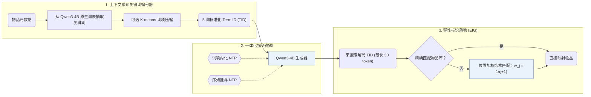

## At a Glance

Key Findings: 在域内 Amazon 基准（Beauty、Sports 和 Toys）及跨域配对（Sports-Clothing 和 Phones-Electronics）上，GRLM 均优于生成式与 LLM 基线，且 Top-10 生成 Term ID 的合法率达 0.989–0.998（Abstract，Tables 2, 3, and 5）。
Limitation: 生成的 Term ID 若无精确匹配的物品，需经结构匹配落地到候选库，因此最终排序部分取决于落地匹配规则而非生成器本身（Sec. 3.3）。

### 1. 为什么重要

自由文本物品标识直接暴露大语言模型（LLM）庞大的输出空间并易引发幻觉，而数值型语义 ID（Semantic ID，SID）又与原生词表存在语义鸿沟，需要高开销的词表扩充与对齐训练（Abstract）。GRLM 从 LLM 原生词表中抽取定长标准化关键词序列作为物品标识。

> "Text-based methods introduce LLMs' vast output space, leading to hallucination, while methods based on Semantic IDs (SIDs) encounter a semantic gap between SIDs and LLMs' native vocabulary, requiring costly vocabulary expansion and alignment training." (Abstract)

### 2. 方法

#### 上下文感知的关键词生成

上下文感知的关键词生成模块将物品元数据转化为由 5 个 Qwen3-4B 原生词组成的标准化 Term ID（TID），并可通过可选的 K-means 压缩将 54,255 个原始词项映射为 3,000–8,000 个核心词项（Abstract，Appendix A.4）。

#### 一体化指令微调

一体化指令微调在多任务下一 token 预测目标下，联合优化 Qwen3-4B 的词项语义内化与序列下一 TID 预测（Abstract）。

#### 弹性标识落地

推理阶段用束搜索解码最长 30 个 token 的候选 TID；当生成结果无法精确命中物品库时，弹性标识落地（EIG）按词项重合度对物品做结构匹配打分，第 $`j`$ 个生成词项的位置权重设为 $`w_j = \frac{1}{j+1}`$（Sec. 3.3）。

> "By exploiting the decompositional nature of TIDs, EIG combines direct mapping with structural mapping to ground TIDs into actual items efficiently." (Sec. 1)

### 3. 实验发现

- 域内与跨域精度：在 Amazon Beauty、Sports 和 Toys 域内基准（Table 2）、Sports-Clothing 与 Phones-Electronics 跨域配对（Table 3）以及十品类合并 Amazon 语料（Appendix Table 7）上，GRLM 均优于序列模型、SID 方法与自由文本 ID 基线（Abstract）。
- 合法率、消融与扩展性：Table 4 验证了上下文感知关键词生成、一体化指令微调与 EIG 的贡献；Table 5 报告 Top-10 TID 合法率达 0.989–0.998，Appendix Tables 8–9 对比了不同 TID 长度（5、7 和 10 个词）及词项压缩规模。

  > "Moreover, through detailed analytical experiments, we provide evidence that our TID-based method exhibits robust scaling properties while significantly mitigating hallucination." (Sec. 1)

### 4. 局限与分析

**Our analysis.**

- TIGER 将数值型 `RQ-VAE` 码作为词表外新 token 扩充词表；GRLM 直接复用 LLM 原生词表中的词构建 `Term-ID`。
- IDGenRec 同样采用原生词表词（`LLM-Vocab`），但在训练过程中交替更新 ID 生成器（`Altern.`）；GRLM 的 TID 仅离线生成一次（`Fixed`）。
