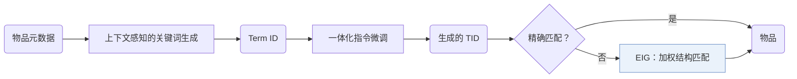

## At a Glance

Limitation: 生成的 Term ID 若对不上任何物品，就靠结构匹配落到物品上，所以最终排序有一部分来自落地步骤，而不是生成器（Sec. 3.3）。

### 1. 为什么重要

基于文本的物品标识把 LLM 巨大的输出空间暴露出来；语义 ID（Semantic ID，SID）则需要代价高的词表扩充和对齐训练（Abstract）。GRLM 走中间路线，用标准化的关键词做标识。

> "Text-based methods introduce LLMs' vast output space, leading to hallucination, while methods based on Semantic IDs (SIDs) encounter a semantic gap between SIDs and LLMs' native vocabulary, requiring costly vocabulary expansion and alignment training."（Abstract）（文本方法会幻觉；SID 方法和 LLM 原生词表之间有语义鸿沟。）

### 2. 方法

#### 上下文感知的关键词生成

上下文感知的关键词生成把物品元数据转成标准化的 Term ID（TID）（Abstract）。

#### 一体化指令微调

一体化指令微调把关键词内化和序列推荐放在一起优化（Abstract）。

#### 弹性标识落地

没有精确匹配时，弹性标识落地（EIG）按结构匹配给物品打分，第 $`j`$ 个生成的关键词权重为 $`w_j = \frac{1}{j+1}`$（Sec. 3.3）。

> "By exploiting the decompositional nature of TIDs, EIG combines direct mapping with structural mapping to ground TIDs into actual items efficiently."（Sec. 1）（利用 TID 可拆分的特点，结合直接映射和结构映射，把 TID 落到真实物品。）

### 3. 实验发现

- 主实验：GRLM 在多个场景下好于基线（Abstract）。
- 扩展性与幻觉：作者认为 TID 扩展性好，并减少了幻觉（Sec. 1）。

  > "Moreover, through detailed analytical experiments, we provide evidence that our TID-based method exhibits robust scaling properties while significantly mitigating hallucination."（Sec. 1）（分析实验表明 TID 方法扩展性稳健，并明显减少幻觉。）

### 4. 局限与分析

**Our analysis.**

- TIGER 把 `RQ-VAE` 码作为新 token 加入；GRLM 用词表里已有的 `Term-ID` 词。
- IDGenRec 也用词表词（`LLM-Vocab`），但在训练中更新 ID 生成器（`Altern.`）；GRLM 的 TID 只生成一次。
