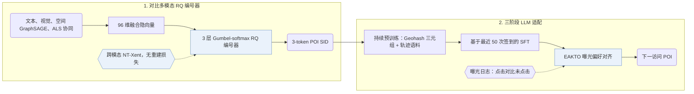

## At a Glance

Key Findings: 在高德地图（Amap）的长期在线 A/B 测试中，Gwhere 的 P-CTR 比线上基线提升 5.83%，U-CTR 提升 6.20%（Abstract）。
Limitation: 原文未报告量化后的冲突消解规则、解码策略及高德数据集的码本大小；在 50 QPS 负载下，线上部署的 Gwhere-0.5B 的 p99 延迟约为 30 ms，高于级联排序基线的 20 ms（Fig. 4）。

### 1. 为什么重要

将生成式检索扩展到工业级下一兴趣点（POI）推荐时，常受制于冗余或冲突的 token 分配、异构多模态信号难以融合，以及结构化的空间实体与移动规律（Abstract）。Gwhere 通过无重建损失的对比残差量化编号器学习高区分度的语义 ID（Semantic ID，SID），再经持续预训练、监督微调与曝光偏好对齐适配 LLM 生成器。

> "Gwhere first learns discriminative POI SIDs through a contrastive residual-quantization tokenizer that aligns textual, visual, spatial, and collaborative signals." (Abstract)

### 2. 方法

#### 对比式物品编号

Gwhere 将文本、图像、空间 GraphSAGE 和 ALS 协同四类视图融合为 96 维隐向量，并通过 Gumbel-softmax 分配 3 层残差码本中的码字（公开基准上每层 48 个码字）（Sec. 3.2.2，Sec. 4.1.2）。编号器省去解码器与重建损失，仅用 NT-Xent 对比损失将量化表征拉近自身多模态视图并推离同批负样本（Sec. 3.2，Sec. 3.2.2）。

#### 继续预训练

在基于最近 50 条签到序列做监督微调之前，Gwhere 先在由脱敏高德轨迹和 POI 元数据构建的两份语料上持续预训练，分别注入空间-语义对齐知识与群体移动模式（Sec. 3.3.1，Table 1）。

> "Each entry is a triplet of (SID, Geohash, Text Description), where Geohash is a 6-character string encoding the POI's precise geographical coordinates" (Sec. 3.3.1)

#### EAKTO

曝光感知的 Kahneman-Tversky 优化（EAKTO）将 KTO 适配到真实曝光日志中的非成对二元隐式反馈（Sec. 3.4）。

> "In contrast, KTO (Ethayarajh et al., 2024) operates on simpler binary signals (desirable / undesirable), aligning with the natural structure of exposure logs (clicks vs. non-clicks)." (Sec. 3.4)

### 3. 实验发现

- 公开与工业离线评估：在 Foursquare NYC、Foursquare TKY 和 Gowalla CA 上，Gwhere 的 Top-1 准确率（Acc@1）均优于传统模型、序列推荐与 LLM 基线（Table 4）；在包含 10,000K 用户与 83,100K POI 的高德工业数据集上，不同参数规模的 Gwhere 均超越线上级联排序系统（Abstract，Table 3）。
- 在线 A/B 与服务延迟：在高德首页的一周及一月期在线 A/B 测试中，Gwhere 将 P-CTR 提升 5.83%、U-CTR 提升 6.20%（Abstract，Table 6）；在 2 张 NVIDIA H20 GPU、50 QPS 压测下，Gwhere-0.5B 的 p99 延迟约为 30 ms，级联排序系统约为 20 ms（Fig. 4）。

### 4. 局限与分析

**Our analysis.**

- 编号器去掉重建损失而仅针对跨模态对比可分性训练，这意味着 SID 前缀未必构成由粗到细的语义层级。
- GNPR-SID 用带重建与多样性损失的 `RQ-VAE` 构建编码并仅以 `NTP` 微调；Gwhere 构建无重建损失的 `Contr. RQ` 码，并在后训练中加入曝光偏好对齐（`NTP → DPO`）。
