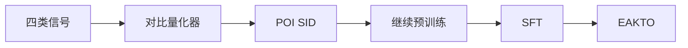

## At a Glance

Key Findings: 在高德（Amap）的长期在线 A/B 测试中，Gwhere 比线上基线的 P-CTR 高 5.83%，U-CTR 高 6.20%（Abstract）。

### 1. 为什么重要

作者指出，生成式检索难以扩展到工业场景，原因是 token 分配有冗余或冲突，异构物品信号也融合得不好（Abstract）。下一兴趣点（POI）推荐还多了结构化的空间实体和移动模式（Abstract）。

> "Gwhere first learns discriminative POI SIDs through a contrastive residual-quantization tokenizer that aligns textual, visual, spatial, and collaborative signals."（Abstract）（用对比残差量化编号器对齐文本、视觉、空间、协同四类信号，学出有区分度的 POI SID。）

### 2. 方法

#### 对比式物品编号

量化器用 Gumbel-softmax 分配码字（Sec. 3.2.2）。NT-Xent 损失把量化表示拉向物品自己的各模态表示，推离同批的其他物品（Sec. 3.2.2）。编号器没有重建损失（Sec. 3.2）。

#### 继续预训练

两份语料来自脱敏的高德轨迹和 POI 元数据，分别覆盖语义对齐和行为模式（Sec. 3.3.1，Table 1）。

> "Each entry is a triplet of (SID, Geohash, Text Description), where Geohash is a 6-character string encoding the POI's precise geographical coordinates"（Sec. 3.3.1）（每条数据是 (SID, Geohash, 文本描述) 三元组，Geohash 是编码 POI 坐标的 6 位字符串。）

#### EAKTO

曝光感知的 Kahneman-Tversky 优化（EAKTO）把 KTO 改到曝光日志的点击和未点击上（Sec. 3.4）。

> "In contrast, KTO (Ethayarajh et al., 2024) operates on simpler binary signals (desirable / undesirable), aligning with the natural structure of exposure logs (clicks vs. non-clicks)."（Sec. 3.4）（KTO 用二元信号，正好对应曝光日志的点击与未点击。）

### 3. 实验发现

- 离线：论文在公开数据集和高德工业数据集上评估 Gwhere（Abstract）。
- 部署：Gwhere 在高并发、低延迟的约束下服务高德首页（Abstract）。

### 4. 局限与分析

**Our analysis.**

- 没有重建损失，量化器只为可区分性训练。由此推断，语义 ID（Semantic ID，SID）的前缀不一定构成语义层级。
- GNPR-SID 构建 `RQ-VAE` 码，只用普通 `NTP` 训练；Gwhere 构建 `Contr. RQ` 码，并加了偏好对齐。
