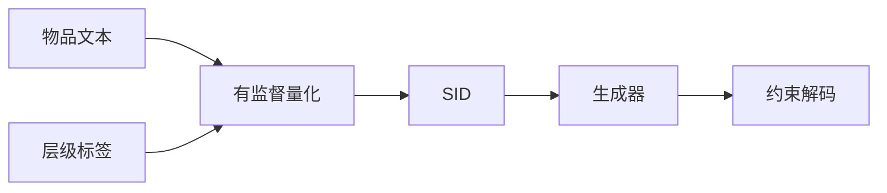

## At a Glance

Limitation: 编号器需要多级物品标签，没有标签的数据集要靠 LLM 生成，所以 ID 质量取决于标签质量（Sec. 3.4）。

### 1. 为什么重要

作者指出，无监督编号让语义 ID（Semantic ID，SID）有两个缺陷：语义上是扁平的；不同物品的表示纠缠在一起，会发生冲突（Abstract）。

> "Concurrently, to combat representation entanglement and prevent ID collisions at the source, we design a novel uniqueness loss that directly penalizes the latent representation overlap between distinct items."（Sec. 1）（唯一性损失直接惩罚不同物品潜在表示的重叠，从源头防止 ID 冲突。）

### 2. 方法

#### 生成层级标签

KuaiRand 这类没有层级标签的数据集，由 LLM 按"先检索、再分类"两步生成标签（Sec. 3.4，Sec. 1）。

#### 层级监督量化

训练好的码本能预测物品标签，于是每条推荐都有一条可追溯的语义路径（Abstract）。

#### 唯一性损失

唯一性损失惩罚不同物品之间的潜在重叠（Sec. 1）。作者认为，这个损失也提高了推荐多样性（Abstract）。

> "This mechanism not only resolves the critical ID collision problem but also promotes recommendation diversity by ensuring a more comprehensive utilization of the item representation space."（Abstract）（既解决 ID 冲突，也因表示空间用得更充分而提高多样性。）

#### 生成

生成器根据用户历史预测下一物品的 SID（Sec. 3.3）。

> "During inference, constrained decoding ensures that generated IDs correspond to valid items."（Sec. 3.3）（推理时用约束解码保证生成的 ID 对应真实物品。）

### 3. 实验发现

- 主实验：在三个公开基准上，HiD-VAE 好于对比方法（Abstract）。

### 4. 局限与分析

**Our analysis.**

- TIGER 用无监督的 `RQ-VAE` 码和普通 `Beam` 搜索；HiD-VAE 用标签监督的 `Hier. RQ` 码，生成器同为 `Enc-Dec`，并加约束解码。
