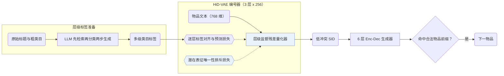

## At a Glance

Key Findings: HiD-VAE 将 Beauty、Sports 与 KuaiRand 上的 SID 冲突率从无监督 RQ-VAE 的 18.7%、19.5%、17.8% 降至 2.1%、2.8%、1.9%，并在三个基准上全面优于对比基线（Abstract，Table 1，Table 3）。
Limitation: 层级监督量化依赖多级类目标签，缺失类目树的物品库需依赖 LLM 合成标签（Sec. 3.4）。

### 1. 为什么重要

无监督残差量化生成的语义 ID（Semantic ID，SID）缺乏明确的层级语义，且不同物品的潜在表征纠缠在一起，极易产生编码冲突（Abstract）。HiD-VAE 用多级类目标签逐层监督码本，并在离散化前对潜在表征施加排斥惩罚。

> "Concurrently, to combat representation entanglement and prevent ID collisions at the source, we design a novel uniqueness loss that directly penalizes the latent representation overlap between distinct items."（Sec. 1）

### 2. 方法

#### 生成层级标签

对于 KuaiRand 这类缺少现成类目树的数据集，HiD-VAE 用 LLM 按“先检索、再分类”（`"retrieval-then-classification"`）两步流程从标题与原始类目合成多级标签（Sec. 1，Sec. 3.4）。

#### 层级监督量化

RQ-VAE 每一层码本分别对齐并预测对应层级的物品标签，使生成的离散码序列具备可追溯的粗到细类目路径（Abstract）。

#### 唯一性损失

唯一性损失在量化取整前直接惩罚不同物品在潜在空间中的重叠，在压低 ID 冲突率的同时促使物品更均匀地覆盖码本空间（Abstract，Sec. 1）。

> "This mechanism not only resolves the critical ID collision problem but also promotes recommendation diversity by ensuring a more comprehensive utilization of the item representation space."（Abstract）

#### 生成

6 层编码器-解码器根据用户历史预测下一物品的 SID，并在推理时通过前缀约束解码过滤非法码序列（Sec. 3.3）。

> "During inference, constrained decoding ensures that generated IDs correspond to valid items."（Sec. 3.3）

### 3. 实验发现

- 主结果与冲突率：在 Amazon Beauty、Sports and Outdoors 与 KuaiRand 三个公开基准上，HiD-VAE 均优于传统、序列与生成式基线，并将 SID 冲突率从 RQ-VAE 的 18.7%、19.5%、17.8% 分别降至 2.1%、2.8%、1.9%（Abstract，Table 1，Table 3）。

### 4. 局限与分析

**Our analysis.**

- TIGER 使用无监督 `RQ-VAE` 码、整数后缀消歧与无约束 `Beam` 搜索；HiD-VAE 在相同类型的 `Enc-Dec` 生成器前端改用多级标签监督的 `Hier. RQ` 码与唯一性损失，并配合约束解码。
