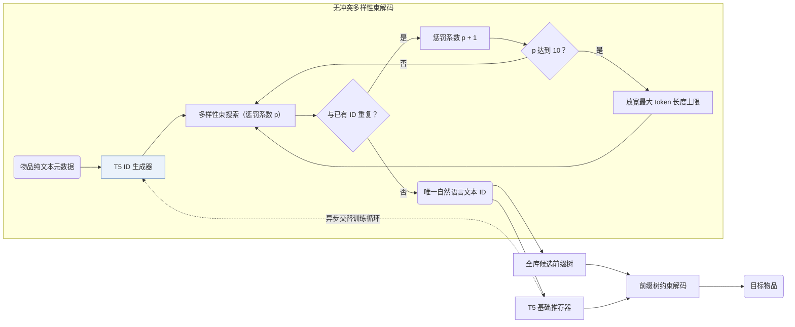

## At a Glance

Key Findings: 在 19 个数据集上联合预训练并直接在跨平台 6 个未见数据集上零样本评测时，IDGenRec 达到或超越域内有监督传统推荐模型，且在标准序列推荐评测中优于对比基线（Abstract，Tables 4 and 7）。
Limitation: 交替更新文本 ID 生成器会改变全库物品的 ID，训练期间需随之重建合法候选前缀树（Sec. 2.4）。

### 1. 为什么重要

词表外的数值码本会将生成式推荐器绑定在单一物品库上，而直接使用原始标题又冗长嘈杂（Abstract）。IDGenRec 训练一个 T5 ID 生成器，把物品元数据压缩为简短且唯一的自然语言语义 ID（Semantic ID，SID；属 `LLM-Vocab`），使交互历史变成与平台无关的纯文本序列，直接支持跨平台零样本迁移。

> "We propose an alternate training strategy that trains the LLM-based ID generator and the base recommender asynchronously, ensuring that their learned knowledge is well-aligned."（Sec. 1）

### 2. 方法

#### ID 生成器

ID 生成器与基础推荐器均以 T5 为骨干（Sec. 2.6）。ID 生成器读入标题、品类、价格、描述、创建时间、热度与地点等纯文本物品信息，在原生词表上生成简短的词片标识（Sec. 2.2）。

#### 生成唯一 ID

生成阶段通过多样性束搜索强制消除冲突：一旦检测到与已有物品重名，束搜索的多样性惩罚每轮加 1；累加到 10 仍冲突时则放宽长度上限，直至每个物品获得唯一 ID（Sec. 2.3，Sec. 3.2）。

> "If a duplicate is detected, the algorithm increases the diversity penalty in the beam search."（Sec. 2.3）

#### 基础推荐器

基础推荐器将用户历史拼接成文本 ID 序列，在存有全库候选 ID 的前缀树约束下解码目标物品，并与 ID 生成器异步交替更新（Sec. 1，Sec. 2.4）。

> "To ensure that the decoded ID corresponds to an actual existing item, we adopt a constrained sequence decoding strategy (De Cao et al., 2020). More specifically, a prefix tree is used to store all generated candidate IDs."（Sec. 2.4）

### 3. 实验发现

- 标准序列推荐：在域内监督设置下，IDGenRec 优于传统序列推荐模型与 P5 系列基线（Abstract，Table 4）。
- 跨平台零样本迁移：在 19 个数据集上预训练后，直接在来自其他平台的 6 个未见数据集上零样本测试，效果与域内有监督训练的部分传统推荐器相当甚至更好（Abstract，Table 7）。

### 4. 局限与分析

**Our analysis.**

- 靠逐步调高多样性惩罚和放宽长度消除冲突时，高密度相似物品簇中后处理的物品容易被迫选用偏离核心语义的词语。
- CID 从 `CF` 共现图构建固定的 `Spectral Clus.` 数值码；IDGenRec 从文本生成 `LLM-Vocab` 自然语言词串并采用交替更新（`Altern.`）。
