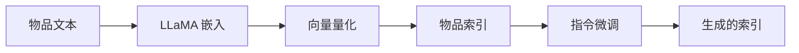

## At a Glance

Limitation: 物品索引只来自文本嵌入，协同语义只能通过调优任务进入模型（Sec. III-B）。

### 1. 为什么重要

推荐系统里的物品通常用大语言模型（LLM）词表之外的 ID 来索引，两者之间因此有语义鸿沟（Abstract）。

> "In essence, LLMs capture language semantics while recommender systems imply collaborative semantics, making it difficult to sufficiently leverage the model capacity of LLMs for recommendation."（Abstract）（LLM 擅长语言语义，推荐依赖协同语义，LLM 的能力难以充分用到推荐上。）

### 2. 方法

#### 物品索引

LC-Rec 用 LLaMA 编码物品文本，再量化嵌入（Sec. III-B）。均匀语义映射重新分配最后一层的码字，让原本会共用索引的物品分开（Sec. III-B2）。

#### 对齐调优

序列物品预测是主目标（Sec. III-C1）。两个显式任务在标题或描述与索引之间互相映射（Sec. III-C2）。隐式任务再加上非对称物品预测、基于意图的预测和偏好推断（Sec. III-C3）。

> "On the one hand, the LLM should be capable of accurately identifying the item indices based on the associated title or description. On the other hand, it is expected that LLM can naturally capture relevant item information from its indices."（Sec. III-C2）（LLM 既要能从标题或描述认出索引，也要能从索引读出物品信息。）

#### 训练

所有任务都写成条件语言生成，用一个指令微调的模型完成（Sec. III-D）。

> "To this end, we employ LLaMA [25] as our backbone model and then optimize it via instruction tuning."（Sec. III-D）（以 LLaMA 为骨干，做指令微调。）

### 3. 实验发现

- 主实验：LC-Rec 好于传统推荐器和已有的基于 LLM 的推荐器（Abstract）。

### 4. 局限与分析

**Our analysis.**

- TIGER 用同样的 `RQ-VAE` 码配 `Enc-Dec` 生成器；LC-Rec 用 `Multi-task NTP` 训练的 `Dec-Only` LLM。
