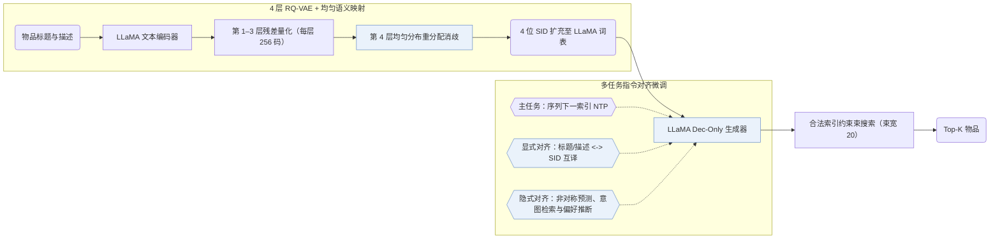

## At a Glance

Key Findings: 在 Amazon Instruments、Arts 与 Games 的全库排序评测中，LC-Rec 全面优于传统序列推荐器、TIGER 及此前的 LLM 推荐基线（Abstract，Table 3）。
Limitation: 物品索引仅由 LLaMA 文本嵌入量化生成，协同信号只能在后续指令微调阶段间接注入（Sec. III-B）。

### 1. 为什么重要

用词表外的离散编码索引物品时，大语言模型（LLM）预训练习得的自然语言语义与推荐系统依赖的协同交互信号之间存在明显断层（Abstract）。LC-Rec 在 RQ-VAE 末层通过均匀语义映射消除冲突，并在指令微调中联合训练显式的“文本-索引互译”与隐式的协同对齐任务。

> "In essence, LLMs capture language semantics while recommender systems imply collaborative semantics, making it difficult to sufficiently leverage the model capacity of LLMs for recommendation."（Abstract）

### 2. 方法

#### 物品索引

LC-Rec 用 LLaMA 编码物品标题与描述，经 4 层 × 256 码字的 RQ-VAE 量化（Sec. III-B）。针对落入同一编码的冲突物品，LC-Rec 不额外追加无语义整数后缀，而是在最后一层施加均匀分布约束，按残差距离将冲突物品分散到不同码字上（Sec. III-B2）。

#### 对齐调优

指令微调联合优化三类任务：以序列下一物品索引预测为主任务（Sec. III-C1）；两项显式双向对齐任务在标题/描述与离散语义 ID（Semantic ID，SID）之间互译（Sec. III-C2）；隐式对齐任务涵盖非对称物品预测、基于查询意图的物品预测以及用户偏好总结（Sec. III-C3）。

> "On the one hand, the LLM should be capable of accurately identifying the item indices based on the associated title or description. On the other hand, it is expected that LLM can naturally capture relevant item information from its indices."（Sec. III-C2）

#### 训练

所有对齐与推荐任务统一构造为条件语言生成指令，在同一个 LLaMA 仅解码器骨干上微调，并在推理时通过屏蔽非法前缀做约束束搜索（Sec. III-D）。

> "To this end, we employ LLaMA [25] as our backbone model and then optimize it via instruction tuning."（Sec. III-D）

### 3. 实验发现

- 主结果与消融：在 Amazon Instruments、Arts 与 Games 的全库排序评测中，LC-Rec 优于传统序列推荐模型、TIGER 与既有 LLM 推荐基线；消融实验验证了均匀语义映射与各组显隐式对齐任务各自的收益（Abstract，Tables 3 and 4）。

### 4. 局限与分析

**Our analysis.**

- TIGER 将 `RQ-VAE` 码送入从零训练的轻量 `Enc-Dec` Transformer 做单任务 `NTP`；LC-Rec 则把 `RQ-VAE` 码扩充进预训练 `Dec-Only` LLaMA 词表，依靠 `Multi-task NTP` 指令对齐打通语言空间与离散 ID。
