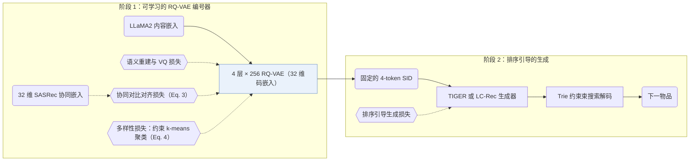

## At a Glance

Key Findings: 在 Instruments 上，LETTER-TIGER 的 Recall@10 为 0.1122，TIGER 为 0.1058；单独加入任一种正则项也能提升 TIGER（Table 2）。
Limitation: 协同正则依赖一个单独预训练的 CF 模型提供嵌入（Sec. 3.1）。

### 1. 为什么重要

早期的物品标识（普通 ID、原始文本或未加正则的码本编码）难以同时编码语义信息、融入协同信号并抑制码分配偏置。LETTER 从这三个维度同时约束 RQ-VAE 编号器，并将生成的 4 层语义 ID（Semantic ID，SID）接入 TIGER 和 LC-Rec 两种生成式骨干（Sec. 4.1.3）。

> "LETTER incorporates Residual Quantized VAE for semantic regularization, a contrastive alignment loss for collaborative regularization, and a diversity loss to mitigate code assignment bias."（Abstract）

### 2. 方法

#### 语义正则

RQ-VAE 按 4 个残差层级逐层量化物品内容嵌入（每层 256 个 32 维码字），使生成的标识保持由粗到细的语义层级结构（Sec. 3.1，Sec. 4.1.4）。

#### 协同正则

对比对齐损失将每个物品的量化残差嵌入拉向预训练协同过滤（CF）模型给出的嵌入，使交互相似的物品具有相近的码序列（Sec. 3.1，Eq. 3）。论文以 SASRec 和 LightGCN 为例说明 CF 教师模型，并在实验中采用 32 维 SASRec 嵌入（Sec. 3.1，Sec. 4.1.3）。

> "Intuitively, collaborative regularization encourages items with similar collaborative interactions to exhibit similar code sequences."（Sec. 3.1）

#### 多样性正则

多样性损失通过受约束 k-means 对码本嵌入聚类，拉近同簇嵌入并推开不同簇（Sec. 3.1，Eq. 4），从而抑制热门码字聚集过多物品的码分配偏置及下游生成偏置（Sec. 1）。

> "As illustrated in Figure 5(a), a biased code embedding distribution is more likely to cause biased code assignment in the latent space, where some codes are assigned to more items."（Sec. 3.1）

#### 训练与生成

LETTER 先用语义、协同与多样性组合损失训练编号器（Eq. 5），再冻结物品 SID 供生成器训练和推理使用（Sec. 3.2）。生成器训练阶段额外引入排序引导生成损失以拉大困难负例 SID 的相对打分差距（Abstract，Sec. 1），推理阶段通过前缀 Trie 将生成约束在合法标识范围内。

> "To ensure generating valid identifiers, we follow (Hua et al., 2023) to employ constrained generation (De Cao et al., 2020) via Trie"（Sec. 3.2.2）

### 3. 实验发现

- 主结果：将 LETTER 接入 TIGER（LETTER-TIGER）和基于 LoRA 微调 LLaMA2-7B 的 LC-Rec（LETTER-LC-Rec）后，在 Amazon Instruments、Amazon Beauty 和 Yelp 上的 Recall 与 NDCG@5/10 均优于各自的后端基座模型（Sec. 4.2，Table 1）。
- 正则消融：在 TIGER 上单独加入协同正则或多样性正则均可提升性能，两者与排序引导损失结合时取得最优结果（Sec. 4.3.1，Table 2）。
- 码本利用率权衡：加入协同正则会将 TIGER 的活跃码字数从 148 压低到 76，再结合多样性正则可恢复码本覆盖率（Sec. 4.3.2，Fig. 6）。

  > "Although adding collaborative regularization decreases the code utilization of TIGER (from 148 to 76), integrating diversity regularization inversely compensates for the drop in code utilization."（Sec. 4.3.2）

- 协同信号保持度：与未加正则的 RQ-VAE 编码相比，LETTER 的码序列相似度与协同过滤相似度一致性更高（Sec. 4.3.4，Tables 3 and 4）。
- 超参数敏感性：对比不同标识长度 $`L`$、码本大小 $`N`$、损失权重 $`\alpha`$ 与 $`\beta`$、聚类簇数 $`K`$ 及温度 $`\tau`$ 表明，将标识长度 $`L`$ 从 4 增至 8 会因自回归误差累积而降低推荐精度（Sec. 4.3.5）。

  > "Continuously increasing the identifier length from 4 to 8 will inversely degrade the performance. This is reasonable because autoregressive generation suffers from error accumulation (Ren et al., 2024b)."（Sec. 4.3.5）

  盲目扩大码本大小 $`N`$ 也会使模型过拟合内容嵌入中的噪声语义。

  > "However, 2) blindly expanding N might inversely hurt the performance, where larger codebook size might be more susceptible to noise in the item's semantic information, potentially leading to the over-fitting of some meaningless semantics."（Sec. 4.3.5）

### 4. 局限与分析

**Stated by the authors.** 结论部分指出三个后续研究方向：融合多类丰富用户行为的物品编号、跨领域物品编号，以及将自然语言指令与编号化交互历史相结合（Sec. 6）。

**Our analysis.**

- 编号器训练完成后即固定（`Fixed`），物品库更新时需重新训练 CF 模型与 RQ-VAE 并重新分配编码。ETEGRec 改为交替更新编号器与生成器（`Altern.`），DIGER 则让生成器损失直接反向传播至编号器（`Joint`）。
- 协同正则要求每个物品预先具备 CF 嵌入，这意味着缺少历史交互的冷启动物品在编号阶段无法获得协同信号。
- 协同对齐会将活跃码字数从 148 压缩至 76，而多样性正则反向扩大码字覆盖面（Sec. 4.3.2），因此损失权重 $`\alpha`$ 与 $`\beta`$ 需要在协同聚类紧凑度与码本均匀分布之间折中。
