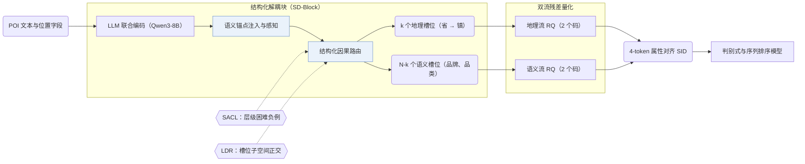

## At a Glance

Key Findings: 在快手和 Foursquare 上，LGRID 相比语义 ID（Semantic ID，SID）基线的 AUC 相对提升最高达 5.44%，并将完整 SID 冲突率从 LGSID 的 97.0% 降至 39.9%（Abstract）。
Limitation: 地理槽位固定绑定省、市、区、镇四级行政区划层级（Sec. 3.4.1）。

### 1. 为什么重要

现有 SID 框架通常先将物品各字段压缩成单一向量再做量化，导致地理、品牌与品类信息相互混杂，造成属性丢失、编码冲突且 SID 各位缺乏明确物理含义（Abstract）。LGRID 将 LLM 隐状态路由至专门的地理槽位与语义槽位，并对两路表示分别做残差量化，使 SID 的每一位对应明确的属性。

### 2. 方法

#### 结构化解耦块

结构化解耦块（SD-Block）利用 Qwen3-8B 联合编码 POI 的全部字段，并通过语义锚点注入、锚点引导感知与结构化因果路由将隐状态拆分为 $`N`$ 个槽位 token（Sec. 3.4）。其中 $`k`$ 个槽位按省、市、区、镇层级承载地理信息，其余 $`N-k`$ 个槽位承载品牌、品类等语义属性（Sec. 3.4.1）。

#### 协同对齐学习

协同对齐学习约束每个槽位既能解码还原对应属性，又具备跨物品区分度（Abstract，Sec. 3.5）。其中的对比目标（SACL）按行政层级采样共享粗粒度前缀但细粒度不同的层级困难负例（Sec. 3.5.2），潜在多样性正则（LDR）则约束不同槽位的特征子空间相互正交（Sec. 3.5.3）。

> "To prevent inter-slot redundancy, we impose Latent Diversity Regularization (LDR), which encourages subspace orthogonality so that each slot captures non-overlapping features."（Sec. 3.5.3）

#### 双流残差量化

双流残差量化（DSRQ）分别对地理槽位表示和语义槽位表示执行独立的残差量化（2 个地理码 + 2 个语义码），生成与物品属性逐位对齐的 4-token SID（Abstract，Sec. 3.6.2）。

### 3. 实验发现

- 排序收益与冲突率下降：在快手和 Foursquare 的十种判别式与序列排序模型（含 DIN、DIEN、SIM、HSTU）上，LGRID 相比 SID 基线取得最高 5.44% 的 AUC 相对提升，并将快手上的完整 SID 冲突率降至 39.9%，低于 RQ-VAE 的 98.0% 和 LGSID 的 97.0%（Abstract，Tables 1 and 5）。
- 属性解码与自检索：基于槽位表示解码粗粒度地理字段的准确率超过 99%，且联合编码在全库 POI 自检索上优于逐字段独立编码（Abstract，Tables 2–4）。
- 层级困难负例：在 SACL 消融中，用层级困难负例替代普通随机采样可将细粒度镇级区分准确率从 37.17% 提升至 83.51%（Sec. 4.4，Table 6）。

  > "In the SACL group, vanilla sampling yields limited fine-grained discrimination (Town: 37.17%), whereas hierarchical hard negatives raise it to 83.51%."（Sec. 4.4）

### 4. 局限与分析

**Our analysis.**

- 快手数据集上 39.9% 的完整 SID 冲突率意味着仍有大量 POI 共用同一个 4-token SID，这说明 LGRID 更适合作为判别式排序的特征增强（与原始物品 ID 嵌入拼接使用，Sec. 3.6.3），而不适合直接用于自回归生成唯一物品。
- TIGER 用 `RQ-VAE` 量化单一融合表示；LGRID 先解耦地理与语义槽位再做双流量化（`DSRQ`），输出特征供判别式排序模型（`Disc.`）打分。
