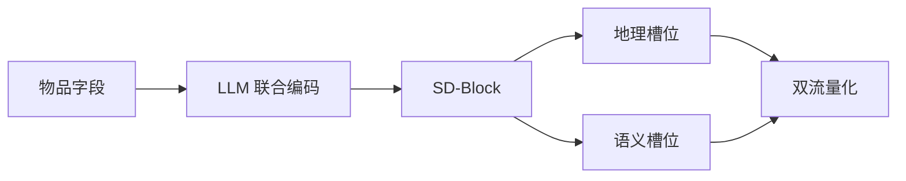

## At a Glance

Key Findings: 在快手和 Foursquare 上，LGRID 比语义 ID（Semantic ID，SID）基线的 AUC 相对最多高 5.44%，完整 SID 的冲突率降到 39.9%，LGSID 为 97.0%（Abstract）。
Limitation: 地理槽位照搬省、市、区、镇这一固定的行政层级（Sec. 3.4.1）。

### 1. 为什么重要

现有 SID 框架先构建一个表示，再量化（Abstract）。作者指出，这样会把地理、品牌、品类混在一起，造成信息损失和冲突，SID 各位也没有明确含义（Abstract）。LGRID 让 SID 的每一位对应一个明确的属性。

### 2. 方法

#### 结构化解耦块

结构化解耦块（SD-Block）通过语义锚点注入、锚点引导感知和结构化因果路由，把隐藏状态拆成 $`N`$ 个槽位 token（Sec. 3.4）。其中 $`k`$ 个是地理槽位，$`N-k`$ 个是品牌、品类等语义槽位（Sec. 3.4.1）。

#### 协同对齐学习

对齐学习让各槽位既能解码出属性，又有区分度（Abstract）。对比学习使用层级困难负例（Sec. 3.5.2）。

> "To prevent inter-slot redundancy, we impose Latent Diversity Regularization (LDR), which encourages subspace orthogonality so that each slot captures non-overlapping features."（Sec. 3.5.3）（潜在多样性正则让子空间正交，各槽位学到不重叠的特征。）

#### 双流残差量化

两路分别量化，SID 的各位因此对应物品属性（Abstract）。

### 3. 实验发现

- 属性解码：粗粒度地理字段的准确率超过 99%（Abstract）。
- 困难负例：把镇级区分准确率从 37.17% 提到 83.51%（Sec. 4.4）。

  > "In the SACL group, vanilla sampling yields limited fine-grained discrimination (Town: 37.17%), whereas hierarchical hard negatives raise it to 83.51%."（Sec. 4.4）（普通采样的镇级区分只有 37.17%，层级困难负例提到 83.51%。）

### 4. 局限与分析

**Our analysis.**

- 完整 SID 冲突率 39.9%，仍有许多物品共用 SID。由此推断，LGRID 更适合能容忍共用 SID 的判别式排序，而不是生成。
- TIGER 用 `RQ-VAE` 量化一个表示；LGRID 量化两路（`DSRQ`），输出给判别式排序模型。
