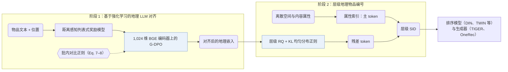

## At a Glance

Key Findings: 在快手本地生活推荐数据上，LGSID 在五个判别式排序模型（DIN、DIEN、SIM、TWIN、ETA）和两个生成式骨干（TIGER、OneRec）上均优于现有物品编号器（Tables 1–2）。
Limitation: LLM 对齐在执行 G-DPO 前需单独训练列表式奖励模型，且每次重新对齐都会改变残差 token（Abstract）。

### 1. 为什么重要

基于文本的推荐模型通常用提示编码物品描述，再将嵌入量化为离散的语义 ID（Semantic ID，SID）。在本地生活服务场景中，仅把位置信息拼进提示难以刻画细粒度空间特征与门店间的真实物理距离。LGSID 先通过强化学习将物品编码 LLM 对齐到真实空间距离关系，再执行层级地理编号。

> "However, in domain-specific tasks such as local-life services, simply injecting location information into prompts fails to capture fine-grained spatial characteristics and real-world distance awareness among items."（Abstract）

### 2. 方法

#### 奖励模型

列表式奖励模型通过距离感知的列表采样学习本地生活物品之间的真实空间距离关系（Introduction）。

> "The RL-based alignment module first trains reward models using distance-aware list-wise sampling to capture and compress real-world spatial relationships."（Introduction）

#### G-DPO 对齐

地理直接偏好优化（G-DPO）利用训练好的奖励模型将空间距离知识与协同信号注入 1,024 维 BGE 编码器，同时通过批内对比损失约束更新后的物品嵌入不偏离参考模型的语义表示（G-DPO，Eq. 7–8）。

> "To preserve LLMs' semantic representations during G-DPO updates, we introduce an in-batch contrastive loss as a similarity regularizer, as shown in Eq. 7."（G-DPO）

#### 层级地理物品编号

每个物品的 SID 由两部分组成：主 token 直接由离散空间与内容属性索引生成，残差 token 由带 KL 均匀簇使用率正则的层级残差量化器在 G-DPO 对齐后的地理向量上量化得到（Abstract，Hierarchical Geographic Item Tokenization）。

### 3. 实验发现

- 判别式与生成式骨干：在快手本地生活信息流数据集（50,000,000 条样本、2,325,266 个物品）上，将 LGSID 编码接入五个判别式排序模型（DIN、DIEN、SIM、TWIN、ETA，Table 1）与两个生成式骨干（TIGER、OneRec，Table 2）均优于对比的物品编号基线（Tables 1–2）。
- 对齐覆盖度与稳定性：Table 3 验证了 G-DPO 对齐后的语义与地理覆盖度提升，Tables 5 与 6 给出了多轮运行稳定性及对比相似度权重的敏感性分析（Tables 3, 5, and 6）。

### 4. 局限与分析

**Our analysis.**

- 主 token 依赖离散的空间与品类属性，这意味着元数据缺失的 POI 需要额外的兜底编码策略。
- 实验仅在快手私有工业数据集上进行，未报告公开 POI 基准结果、各层码本大小及冲突率；后续工作 LGRID 在快手数据集上测得 LGSID 的完整 SID 冲突率为 97.0%。
- LGRID 的 `DSRQ` 编码仅用于判别式排序（`Disc.`）；LGSID 的 `Geo-Idx+RQ` 编码同时作为判别式排序特征和 `Enc-Dec` 生成器的预测目标（`Disc. / Enc-Dec`）。
