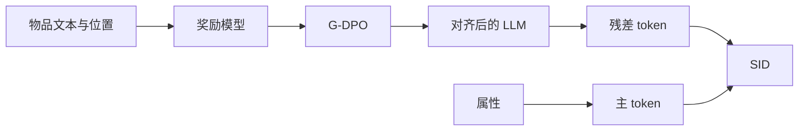

## At a Glance

Limitation: LLM 对齐要先单独训练一个列表式奖励模型，才能做 G-DPO；每重做一次对齐，残差 token 就会变（Abstract）。

### 1. 为什么重要

基于文本的推荐器用提示编码物品文本，再把物品编成离散的语义 ID（Semantic ID，SID）（Abstract）。作者指出，在本地生活服务里，只把位置写进提示，抓不住细粒度的空间特征和物品之间的真实距离（Abstract）。

> "However, in domain-specific tasks such as local-life services, simply injecting location information into prompts fails to capture fine-grained spatial characteristics and real-world distance awareness among items."（Abstract）（本地生活场景里，只往提示里加位置，刻画不了细粒度空间特征和真实距离。）

### 2. 方法

#### 奖励模型

列表式奖励模型学习物品之间的空间关系（Introduction）。

> "The RL-based alignment module first trains reward models using distance-aware list-wise sampling to capture and compress real-world spatial relationships."（Introduction）（先用距离感知的列表采样训练奖励模型，捕捉真实空间关系。）

#### G-DPO 对齐

G-DPO 借助奖励模型，把空间知识和协同信号注入 LLM（Abstract）。批内对比损失让每个物品的嵌入不偏离参考模型的输出（G-DPO，Eq. 7-8）。

> "To preserve LLMs' semantic representations during G-DPO updates, we introduce an in-batch contrastive loss as a similarity regularizer, as shown in Eq. 7."（G-DPO）（用批内对比损失作相似度正则，保住 LLM 的语义表示。）

#### 层级地理物品编号

主 token 来自离散的空间和内容属性，残差 token 来自对齐后 LLM 的地理向量（Abstract）。

### 3. 实验发现

- 主实验：在快手工业数据集上，LGSID 好于判别式和生成式推荐模型（Abstract）。
- 下游模型：Table 1 把 SID 用在 DIN、DIEN、SIM、TWIN 和 ETA 上，Table 2 用在 TIGER 和 OneRec 上（Tables 1-2）。
- 其他分析：论文给出了消融、可视化和案例（Abstract）。

### 4. 局限与分析

**Our analysis.**

- 主 token 需要离散属性。由此推断，属性缺失的物品需要兜底方案。
- LGRID 的 `DSRQ` 码只用于判别式排序；LGSID 的 `Geo-Idx+RQ` 码既用于排序，也用于生成。
