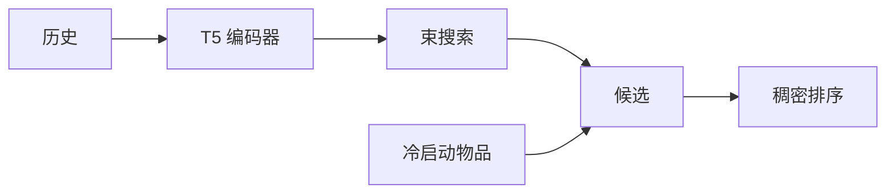

## At a Glance

Limitation: 所有冷启动物品都进入候选集，设计前提是冷启动物品不多（Sec. 3）。

### 1. 为什么重要

序列稠密检索为每个物品存一个表示，内存随物品库增长（Abstract）。生成式检索改为预测语义 ID（Semantic ID，SID），但两者之间缺少公平的比较（Abstract）。

> "Our findings indicate that the model's learned conditional probabilities tends to overfit to items seen during training, leading to a significantly reduced capability to generate cold-start items."（Sec. 2.4）（模型学到的条件概率过拟合训练中见过的物品，很难生成冷启动物品。）

### 2. 方法

#### 输入与训练

每个 SID token 的嵌入加上物品的文本表示和两个位置嵌入（Sec. 3）。训练结合两项：向下一物品文本表示靠拢的余弦相似度损失，和在其 SID 上的下一 token 预测（Sec. 3）。

#### 混合推理

解码器给出候选，编码器的输出把这些候选和冷启动物品一起排序（Sec. 3，Algorithm 1）。

> "During inference, the decoder retrieves K items by beam search, then supplemented with cold-start items and ranked with the encoder's output embeddings."（Sec. 3）（解码器用束搜索取 K 个物品，补上冷启动物品，再用编码器输出排序。）

这个设计建立在一个关于冷启动物品的假设上（Sec. 3）。

> "This design choice is based on the hypothesis that cold-start items are relatively sparse compared to in-set items, as recommendation systems periodically update themselves to incorporate newly introduced items."（Sec. 3）（假设冷启动物品相对少，因为系统会定期把新物品纳入。）

### 3. 实验发现

- 报告设置：生成式检索返回 20 个物品，再和冷启动物品一起排序（Sec. 4.2）。
- 主结果：在所评估的数据集上，LIGER 缩小了和稠密检索的差距，并改善了冷启动推荐（Abstract）。

### 4. 局限与分析

**Our analysis.**

- 最终顺序由稠密嵌入决定。生成的 SID 只负责选候选，不决定顺序。
- TIGER 只靠 `Beam` 搜索检索；LIGER 加了稠密损失（`NTP + Dense`）和 `Hybrid` 排序。
