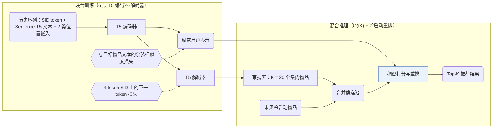

## At a Glance

Key Findings: LIGER 将束搜索召回的 K = 20 个 SID 候选与冷启动物品合并后做稠密重排，在 Amazon Beauty、Sports、Toys 和 Steam 上缩小了与全库稠密检索的差距并提升了冷启动推荐效果（Abstract，Sec. 4.2，Table 2）。
Limitation: 所有冷启动物品都会并入每次推理的候选集，该设计依赖冷启动物品数量较少的前提假设（Sec. 3）。

### 1. 为什么重要

序列稠密检索需要为每个物品保存连续向量，内存与推理开销随物品库规模线性增长；生成式检索则通过束搜索解码紧凑的语义 ID（Semantic ID，SID）（Abstract，Table 1）。论文在受控对比下发现，生成式检索在热启动物品上仍落后于稠密检索，且学到的条件概率过拟合训练集物品，几乎无法生成未见过的冷启动物品（Sec. 2.4）。LIGER 在同一编码器-解码器上联合训练生成与稠密目标，并在推理时将束搜索候选与冷启动物品合并重排。

> "Our findings indicate that the model's learned conditional probabilities tends to overfit to items seen during training, leading to a significantly reduced capability to generate cold-start items."（Sec. 2.4）

### 2. 方法

#### 输入与训练

用户历史中的每个物品由其 SID token 嵌入、冻结的 Sentence-T5-XXL 文本嵌入以及两类位置嵌入（物品位置与 token 位置）相加表示（Sec. 3，Sec. 4.1）。6 层 T5 编码器-解码器同时优化两项损失：在目标物品 4-token SID（3 层 × 256 码字 RQ-VAE 加去重后缀 token）上的下一 token 预测损失，以及将编码器输出对齐到目标物品文本嵌入的余弦相似度损失（Sec. 3，Sec. 4.1）。

#### 混合推理

推理阶段，解码器先通过束搜索召回 $`K`$ 个集内候选物品（主实验取 $`K = 20`$），再并入全部冷启动物品组成紧凑候选池，最后用编码器输出的稠密向量对候选池统一打分排序（Sec. 3，Algorithm 1）。

> "During inference, the decoder retrieves K items by beam search, then supplemented with cold-start items and ranked with the encoder's output embeddings."（Sec. 3）

只要系统定期更新编号器且增量冷启动物品占总物品库的比例较小，直接并入冷启动集合即可避免全库扫描（Sec. 3）。

> "This design choice is based on the hypothesis that cold-start items are relatively sparse compared to in-set items, as recommendation systems periodically update themselves to incorporate newly introduced items."（Sec. 3）

### 3. 实验发现

- 受控对比与冷启动恢复：将冷启动物品从 RQ-VAE 训练中留出后（Beauty 43 个、Toys 56 个、Sports 81 个、Steam 400 个；Table 3），TIGER 式生成式检索生成冷启动物品的概率接近零；LIGER 在四个数据集（3 个随机种子均值）上兼顾了集内精度与冷启动 Recall@10、NDCG@10（Sec. 2.4，Sec. 4.2，Table 2，Figs. 3–4）。
- 候选数 $`K`$ 扫描：束搜索仅召回 $`K = 20`$ 个候选并与冷启动物品合并重排，即可在远低于全库检索开销下逼近全库（$`K = N`$）稠密排序效果；将 $`K`$ 从 20 增至 100 可进一步缩小差距（Sec. 4.2，Table 4，Fig. 1）。

### 4. 局限与分析

**Our analysis.**

- 在 LIGER 的混合推理中，生成的 SID 仅承担粗召回过滤（$`K = 20`$），最终排序顺序以及全部冷启动物品的召回均由稠密内积决定。
- 若流式场景在两次重训编号器之间涌入大量新物品，每次请求都对全部冷启动物品做稠密打分，会削弱 $`O(tK)`$ 相对于全库稠密检索 $`O(N)`$ 的复杂度优势（Table 1）。
- TIGER 仅用 `NTP` 训练并靠 `Beam` 搜索检索；LIGER 用 `NTP + Dense` 联合训练并执行生成加稠密的 `Hybrid` 推理。
