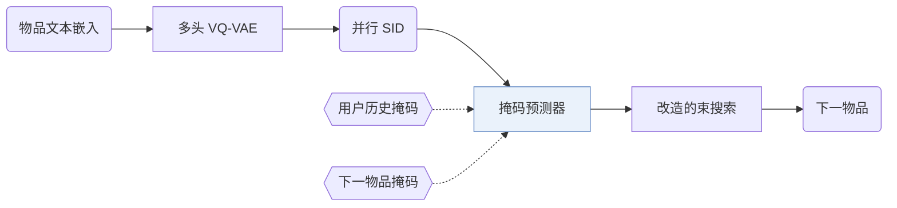
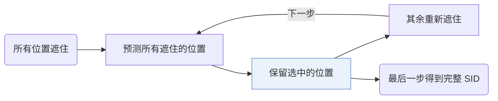

## At a Glance

Limitation: 扩散步数少，生成快，但推荐效果下降；作者把更好的权衡留作开放问题（Sec. 5.4.3，Fig. 5）。

### 1. 为什么重要

自回归生成式推荐器用因果注意力逐个 token 解码语义 ID（Semantic ID，SID）。作者指出这种做法的两个局限：每个 token 只能看到它前面的 token；早期 token 的错误会沿固定的从左到右顺序传下去（Abstract）。LLaDA-Rec 改为在 SID 的所有位置上做离散扩散。

> "To address these issues, we propose LLaDA-Rec, a discrete diffusion framework that reformulates recommendation as parallel semantic ID generation."（Abstract）（用离散扩散把推荐改写成并行生成语义 ID。）

### 2. 方法

#### 并行编号

多头 VQ-VAE 把物品文本嵌入切成若干子向量，每个子向量单独量化，一个头对应 SID 的一位（Sec. 4.1）。作者这样做，是因为残差量化和双向结构不匹配（Abstract）。

#### 掩码训练

训练用两种掩码机制（Abstract）。用户历史掩码学习物品之间的序列依赖。下一物品掩码遮住目标物品 SID 的部分 token，用户历史保持可见，让预测器学习同一物品内各 token 的关系（Sec. 4.2.3）。

#### 自适应顺序解码

推理从全部遮住的 SID 开始，分几步填满（Sec. 4.3.4）。每一步模型选出要保留的位置，其余位置重新遮住。

> "All unselected positions are remasked so that the MASK predictor can re-evaluate them in the context of the partially generated sequence."（Sec. 4.3.4）（未选中的位置重新遮住，让预测器在已生成部分的基础上重新判断。）

步数可调，每一步可以预测多个 token（Sec. 4.4.2）。标准束搜索不适合扩散式生成，所以论文改造了束搜索，在这个过程中保留多个候选（Abstract）。

### 3. 实验发现

- 主实验：在三个真实数据集上，LLaDA-Rec 好于基于 ID 的推荐器和生成式推荐器（Abstract）。
- 生成顺序：自适应顺序最好，从左到右有时最差（Sec. 5.4.2，Fig. 4）。

  > "The adaptive approach consistently delivers superior performance, with left2right occasionally producing the poorest results, highlighting the shortcomings of the commonly used left2right scheme."（Sec. 5.4.2）（自适应顺序始终最好，常用的从左到右有时最差。）

### 4. 局限与分析

**Our analysis.**

- 编号器训练一次就固定（`Fixed`），只编码物品文本（`Text`）。由此推断，协同信号只能通过生成器进入。
- RPG 也用 `Non-AR` 生成器生成并行码；RPG 用 `Par. OPQ` 码和 `Graph` 解码，LLaDA-Rec 用 `Par. VQ` 码和 `Diff.` 解码。
