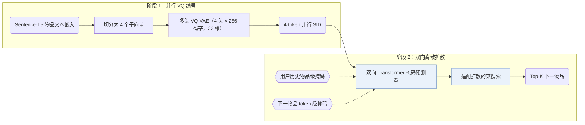
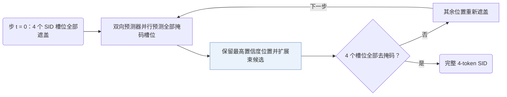

## At a Glance

Key Findings: 在 Amazon Industrial Scientific、Musical Instruments 和 Video Games 上，LLaDA-Rec 优于基于 ID、扩散与自回归的 SID 基线，且自适应顺序去掩码优于固定的从左到右解码（Table 3，Sec. 5.4.2，Fig. 4）。
Limitation: 减少扩散步数虽能提高生成效率但会降低推荐精度，论文将更优的效率-效果权衡留作开放问题（Sec. 5.4.3，Fig. 5）。

### 1. 为什么重要

自回归生成式推荐器通过因果注意力逐个 token 解码语义 ID（Semantic ID，SID），不仅限制每个位置只能关注前序 token，还会使早期 token 的预测误差沿固定的从左到右顺序逐层累积。LLaDA-Rec 用基于双向注意力的离散掩码扩散替代因果自回归解码，在所有 SID 槽位上并行生成。

> "To address these issues, we propose LLaDA-Rec, a discrete diffusion framework that reformulates recommendation as parallel semantic ID generation."（Abstract）

### 2. 方法

#### 并行编号

由粗到细的残差量化具有强顺序层级，与双向注意力架构不匹配；因此 LLaDA-Rec 采用多头 VQ-VAE 将每个物品的 Sentence-T5 文本嵌入切分为 4 个子向量，并用各自独立的 256 码字（32 维）码本分别量化，每个头对应 SID 的一个并行槽位（Sec. 4.1，Sec. 5.1.4）。

#### 掩码训练

双向 Transformer 掩码预测器（Scientific 与 Instrument 上为 4 层，Game 上为 6 层）结合两类互补的掩码机制训练：用户历史物品级掩码遮盖历史序列中的完整物品以捕捉跨物品序列转移；下一物品 token 级掩码在保持用户历史可见的前提下遮盖目标物品 4 个 SID token 的子集，使预测器学习同一物品内部的 token 共现关系（Sec. 4.2.3）。

#### 自适应顺序解码

推理在 $`t = 0`$ 步从 4 个槽位全部遮盖的 SID 开始，经可控步数迭代填满（Sec. 4.3.4，Sec. 4.4.2）。每一步由预测器并行评估所有掩码槽位的分布，保留置信度最高的位置并将其余位置重新遮盖，留待下一步在已生成上下文中重新预测；同时用适配扩散过程的束搜索在多步去掩码中维护多条候选轨迹（Sec. 4.3.3–4.3.4）。

> "All unselected positions are remasked so that the MASK predictor can re-evaluate them in the context of the partially generated sequence."（Sec. 4.3.4）

### 3. 实验发现

- 主实验对比：在 Amazon Industrial Scientific、Musical Instruments 和 Video Games 三个数据集上，LLaDA-Rec 在 Recall@1/5/10 与 NDCG@5/10 上均优于基于物品 ID、连续扩散及自回归 SID 的基线（含 TIGER、LETTER、LC-Rec、RPG、VQ-Rec），且通过配对 t 检验验证了显著性（Table 3）。
- 编号与注意力消融：将多头 VQ-VAE 替换为层级 RQ-VAE、将适配束搜索替换为贪心解码，或将双向注意力替换为因果注意力，均会导致推荐指标下降（Table 4，Fig. 3）。
- 去掩码顺序：基于置信度的自适应去掩码顺序始终优于随机顺序与固定顺序，而常用的从左到右固定顺序在部分设置下表现最差（Sec. 5.4.2，Fig. 4）。

  > "The adaptive approach consistently delivers superior performance, with left2right occasionally producing the poorest results, highlighting the shortcomings of the commonly used left2right scheme."（Sec. 5.4.2）

### 4. 局限与分析

**Our analysis.**

- 多头 VQ-VAE 编号器仅在物品文本嵌入上训练一次并固定（`Fixed`、`Text`），这意味着协同过滤信号只能通过双向扩散生成器学入，而未进入 SID 编码分配阶段。
- RPG 同样用 `Non-AR` 骨干并行预测无序编码；RPG 采用 `Par. OPQ` 编码与单步图约束解码（`Graph`），而 LLaDA-Rec 采用 `Par. VQ` 编码与多步迭代离散扩散去掩码（`Diff.`）。
