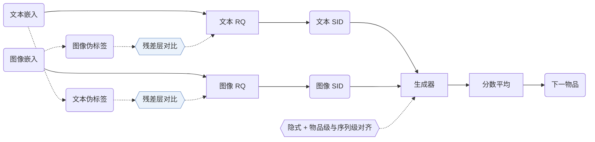

## At a Glance

Key Findings: MACRec 在三个数据集上的 HR@10、NDCG@5 和 NDCG@10 都领先所有基线；在 Games 的 HR@5 上，MISSRec 为 0.0674，MACRec 为 0.0671（Table 2）。

### 1. 为什么重要

生成式推荐需要的语义 ID（Semantic ID，SID）要有层级、冲突少，还要便于训练生成器（Abstract）。早期的多模态生成式推荐对每个模态单独量化，文本和图像的 ID 互不参照。

> "However, existing multimodal GR models typically encode each modality separately to obtain semantic IDs for different modalities."（Related Work）（现有多模态 GR 模型通常对每个模态单独编码得到语义 ID。）

MACRec 在两处加入跨模态交互：量化器内部和生成器的训练任务（Methodology）。

### 2. 方法

#### 双模态伪标签

MACRec 分别按文本嵌入和图像嵌入给物品聚类。簇标签用来定义量化器中对比学习的正例对（Dual-modality Pseudo-label Generation）。

#### 跨模态量化

每个模态经过一个 MLP 和一个残差量化器。各残差层上的对比损失用的是另一个模态的标签（Cross-modal Quantization with Contrastive Learning）。

> "More concretely, we use visual pseudo-labels to enhance the residual representations of the text modality, and conversely, use textual pseudo-labels to optimize those of the visual modality."（Cross-modal Quantization with Contrastive Learning）（用视觉伪标签增强文本的残差表示，反过来用文本伪标签优化视觉的残差表示。）

重建损失和量化损失保证码能还原原始嵌入（Cross-modal Reconstruction Alignment）。

#### 多方面对齐

生成器的训练包括：各模态内的下一物品预测、两种 SID 表示的隐式对齐，以及跨模态的物品级和序列级显式任务（Generative Recommendation with Multi-aspect Alignment）。

> "For sequence-level alignment, we construct a prediction task where a historical sequence of textual semantic IDs is used to predict the visual semantic ID of the next recommended item."（Explicit Alignment with Different Generation Tasks）（序列级对齐：用历史的文本语义 ID 预测下一物品的视觉语义 ID。）

### 3. 实验发现

- 消融：去掉任何一个模块，三个数据集上的 HR@10 都下降（Table 3）。
- 冲突：MACRec 的物品 ID 冲突率低于 MQL4GRec（Table 4）。

### 4. 局限与分析

**Our analysis.**

- MQL4GRec 也分别构建文本 SID 和图像 SID（`Dual RQ`）；MACRec 改为 `Cross RQ`，并在生成器目标里加了对比项（`NTP + Ctr.`）。
- 表示只用文本和图像（`Text+Img`）。CARD 加入协同信号（`Text+Img+CF`），用 `NU-RQ` 量化合并后的单一输入。
