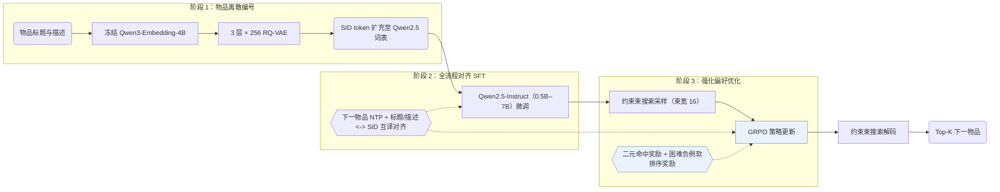

## At a Glance

Key Findings: 将 Qwen2.5 骨干从 0.5B 扩展至 7B 参数时训练损失与评估损失单调下降，结合全流程 SID 对齐、约束束采样与 GRPO 后在 Amazon Industrial 与 Office 上全面超越传统、生成式与 LLM 基线（Abstract，Sec. 5.2，Table 1，Fig. 1）。
Limitation: 扩展定律实验仅度量模型增大时的训练损失与评估损失，未直接报告排序指标随规模的变化曲线（Sec. 5.2，Fig. 1）。

### 1. 为什么重要

用语义 ID（Semantic ID，SID）序列替代海量嵌入表的工业级生成式推荐器大多闭源，公开基准上模型参数扩展定律是否成立、怎样的最小后训练配方即可获得强竞争力仍缺乏系统验证。

> "Yet most industrial deployments remain proprietary, leaving two fundamental questions open: (1) Do the expected scaling laws hold on public benchmarks? (2) What is the minimal post-training recipe that enables competitive performance?"（Abstract）

MiniOneRec 开源复现了覆盖 RQ-VAE 物品编号、监督微调（SFT）全流程 SID 对齐与 GRPO 强化学习（RL）的完整流水线，并公开多尺寸模型代码、训练脚本与权重检查点（Sec. 1）。

### 2. 方法

#### 物品编号

冻结的 Qwen3-Embedding-4B 文本编码器提取物品标题与描述嵌入，3 层 × 256 码字的 RQ-VAE 将每个物品量化为 3 位层级 SID（Sec. 3.2，Sec. 4）。

> "The codebooks, the encoder and the decoder are trained jointly, while the text encoder remains frozen."（Sec. 3.2）

#### 全流程 SID 对齐

三层共 3 × 256 个 SID token 直接追加进 Qwen2.5-Instruct 词表。下一物品 SID 预测与双向语言-SID 对齐任务（标题/描述与 SID 互译）贯穿 SFT 与后续 RL 全程联合优化，不在预热后丢弃（Sec. 3.3，Sec. 6）。

#### 强化偏好优化

RL 阶段采用 GRPO，以束宽为 16 的约束束搜索替代无约束多项式采样，确保每条提示采样出 16 个互异且合法的候选 SID（Sec. 3.4.1，Sec. 5.5.2）。混合奖励由精确命中的二元正确性奖励与拉大困难负例差距的软排序惩罚项组成（Sec. 3.4.2）。

> "The mixed reward discussed combines binary correctness with a soft ranking term, helping the LLM tell hard negatives apart."（Sec. 3.4.2）

### 3. 实验发现

- 规模扩展与主基准：Qwen2.5 骨干从 0.5B 增至 7B 时训练与评估损失单调下降（Sec. 5.2，Fig. 1），MiniOneRec 在 Amazon Industrial and Scientific 与 Office Products 上优于传统序列模型、SID 生成模型（TIGER、LC-Rec）及 LLM 推荐基线（Table 1）。
- 对齐策略与采样消融：在 SFT 与 RL 全程保留语言-SID 辅助对齐的变体在各项指标上均显著高于仅做早期对齐的变体（Sec. 5.5.1，Fig. 4a）；GRPO 训练中束宽 16 的约束束采样也稳定优于无约束采样（Sec. 5.5.2，Fig. 4）。
- 跨域迁移与预训练先验：仅在 Industrial 域训练后直接零样本评测未见过的 Office 域（Sec. 5.4，Table 2），以及从预训练 Qwen2.5 权重初始化对比从零随机初始化（Sec. 5.6，Table 3），均取得一致的排序收益。

### 4. 局限与分析

**Our analysis.**

- LC-Rec 仅通过 `Multi-task NTP` SFT 将 `Dec-Only` LLM 对齐到 `RQ-VAE` SID；MiniOneRec 将双向对齐任务一直保留至带约束束采样的 GRPO 强化学习阶段（`NTP → RL`）。
- 工业版 OneRec 使用 `R-KM` 从多模态与协同信号（`MM+CF`）构建 SID，而 MiniOneRec 仅用纯文本（`Text`）训练 `RQ-VAE`，未报告额外的冲突后缀消歧规则。
