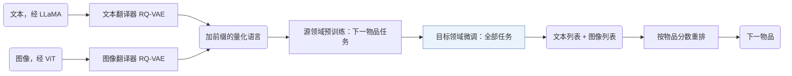

## At a Glance

Limitation: 用两种模态时，预训练在 Games 上没有带来提升，在目标领域上的零样本能力也弱（Sec. 4.3，Sec. 4.5）。

### 1. 为什么重要

基于预训练语言模型的生成式推荐器带着通用语言知识，和推荐的需要对不上，也很少用到物品文本和图像之间互补的知识（Abstract）。MQL4GRec 把多领域、多模态的物品内容转成同一套离散词汇，让在源领域训练的生成器能迁移到目标领域。

> "Our key idea is to transform items from different domains and modalities into a unified language, which can serve as a bridge for transferring recommendation knowledge."（Abstract）（把不同领域、不同模态的物品转成统一的语言，作为迁移推荐知识的桥梁。）

### 2. 方法

#### 量化翻译器

冻结的模态编码器（文本用 LLaMA，图像用 ViT）编码物品内容（Sec. 3.1）。每个模态一个 RQ-VAE 做量化，各有自己的码本。

> "We train a quantitative translator for each modality, then add prefixes to the codewords from each of the two codebooks to form a dictionary."（Sec. 3.1）（每个模态训练一个量化翻译器，给两个码本的码字加前缀，组成词典。）

#### 生成任务

下一物品生成在同一模态内预测下一物品的量化语言。非对称物品生成从文本历史预测图像语言，或反过来（Sec. 3.2）。量化语言对齐任务在物品的文本语言和图像语言之间互相映射。

#### 预训练与微调

源领域预训练只用两个下一物品生成子任务。目标领域微调用全部生成任务（Sec. 3.3）。

推理时，生成器为每个模态各给出一个推荐列表，重排步骤按物品分数合并两个列表（Sec. 3.3，Eq. 7）。

### 3. 实验发现

- 主实验：在 Instruments、Arts 和 Games 上，MQL4GRec 多数情况下最好，NDCG 上尤其明显（Sec. 4.2，Table 1）。
- 预训练：用两种模态时，预训练在 Instruments 和 Arts 上有提升，在 Games 上没有。

  > "Under dual modalities, pre-training significantly improves performance on the Instruments and Arts datasets; however, it does not yield a notable improvement for the Games dataset, potentially due to overfitting."（Sec. 4.3）（预训练在 Instruments 和 Arts 上明显有效，在 Games 上不明显，可能是过拟合。）

- 零样本：不经微调的预训练模型，在 Instruments 和 Arts 上有初步但较弱的零样本能力，在 Games 上没有（Sec. 4.5，Table 5）。

### 4. 局限与分析

**Our analysis.**

- 两个量化器分开训练（`Dual RQ`），文本码和图像码只靠生成任务联系起来。MACRec 改用 `Cross RQ`，在量化内部加入跨模态对比学习。
- TIGER 只量化文本（`Text`）；MQL4GRec 加了图像（`Text+Img`），生成器同为 `Enc-Dec`，用 `Beam` 解码。
