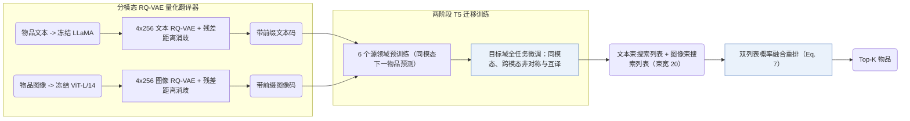

## At a Glance

Key Findings: 在 Amazon Instruments、Arts 与 Games 的全库排序评测中，MQL4GRec 整体表现最优（NDCG 优势尤为突出），且双模态下的多源域预训练显著提升了 Instruments 与 Arts 的精度（Sec. 4.2，Sec. 4.3，Table 1）。
Limitation: 双模态预训练在 Games 数据集上未带来增益，且未经微调的跨领域零样本迁移能力仍较弱（Sec. 4.3，Sec. 4.5）。

### 1. 为什么重要

预训练语言模型自带的通用语言先验与协同交互规律并不一致，且既有生成式模型很少在同一离散词表内融合文本与图像互补信息（Abstract）。MQL4GRec 将多领域、多模态物品内容翻译为带模态前缀的统一量化词表（`Dual RQ`），打通源域预训练迁移与双模态生成融合。

> "Our key idea is to transform items from different domains and modalities into a unified language, which can serve as a bridge for transferring recommendation knowledge."（Abstract）

### 2. 方法

#### 量化翻译器

MQL4GRec 用冻结的 LLaMA 与 ViT 分别提取文本和图像表征，各用一套独立的 4 层 × 256 码字 RQ-VAE 量化为离散语义 ID（Semantic ID，SID），按残差到码字的距离重分配冲突物品，再为两套码本加上不同前缀合并成统一词典（Sec. 3.1）。

> "We train a quantitative translator for each modality, then add prefixes to the codewords from each of the two codebooks to form a dictionary."（Sec. 3.1）

#### 生成任务

三类生成任务将两路模态码连接起来：同模态下一物品生成在文本或图像单模态内预测目标；非对称物品生成从文本历史预测下一物品的图像码或反向预测；量化语言对齐任务在同一物品的文本码与图像码之间双向互译（Sec. 3.2）。

#### 预训练与微调

在六个源领域预训练时仅启用两项同模态下一物品预测任务；迁移到目标领域微调时联合启用全部任务（Sec. 3.3）。推理阶段分别在文本与图像空间做束搜索，再按融合得分重排合并两个候选列表（Sec. 3.3，Eq. 7）。

### 3. 实验发现

- 主结果：在 Instruments、Arts 和 Games 三个目标域上，MQL4GRec 在绝大多数指标（尤其是 NDCG）上优于序列推荐、多模态与生成式基线（Sec. 4.2，Table 1）。
- 多源域预训练：双模态设置下，源域预训练显著提升了 Instruments 与 Arts，但在 Games 上未见增益（Sec. 4.3）。

  > "Under dual modalities, pre-training significantly improves performance on the Instruments and Arts datasets; however, it does not yield a notable improvement for the Games dataset, potentially due to overfitting."（Sec. 4.3）

- 零样本迁移：不做目标域微调直接评测时，预训练模型在 Instruments 与 Arts 上呈现初步但偏弱的零样本能力，在 Games 上则无零样本效果（Sec. 4.5，Table 5）。

### 4. 局限与分析

**Our analysis.**

- MQL4GRec 的文本与图像编号器彼此独立训练（`Dual RQ`），模态关联完全留给下游生成任务学习；MACRec 则在量化阶段内部引入跨模态对比交互（`Cross RQ`）。
- TIGER 仅量化单路文本（`Text`）并做单路 `Beam` 解码；MQL4GRec 量化 `Text+Img` 双流并在解码端执行双分支融合重排（`Dual Beam`）。
