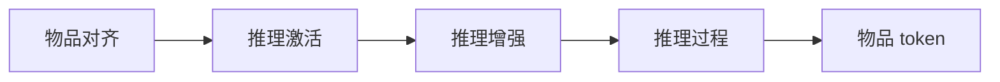

## At a Glance

Key Findings: 在快手的在线 A/B 测试中，Think-Ahead 部署相比线上模型让 App 停留时长提升 0.159%（Sec. 5.4.2，Table 3）。
Limitation: 多步推理和实时延迟要求冲突，完整模型只能离线运行，线上由另一个实时 OneRec 模型生成最后一个物品 token（Sec. 4.4）。

### 1. 为什么重要

OneRec 这类生成式推荐器直接预测物品 token，不给出明确、可控的推理（Abstract）。OneRec-Think 让 LLM 在同一次输出里先写推理，再写下一物品的 token。

> "In contrast, we reformulate this task to unify reasoning and recommendation in a single autoregressive pass."（Sec. 3）（把推理和推荐统一在一次自回归生成里。）

### 2. 方法

#### 物品对齐

在下一 token 预测下做多任务预训练，让 LLM 能同时读懂自然语言和物品 token（Sec. 4.1）。四个任务是：交错的用户画像落地、序列偏好建模、物品稠密描述、通用语言建模。先有一个 token 预热子阶段，冻结基座 LLM，只训练物品 token 的嵌入；之后所有参数一起训练。

#### 推理激活

工业行为序列噪声大。监督微调先从剪枝后的用户上下文中提取推理轨迹，再用这些轨迹引导模型在原始行为数据上生成推理（Sec. 4.2）。推理过程和目标物品用联合似然训练。

#### 推理增强

用 GRPO 做强化学习，打磨推理路径（Sec. 4.3）。每条采样出的推理之后，用约束束搜索生成候选，奖励取候选与目标物品 token 按位置匹配的最好结果（Eq. 6）。

> "To overcome this, we introduce the Rollout-Beam reward that evaluates reasoning capability by the model’s best achievable performance within a constrained beam."（Sec. 4.3）（Rollout-Beam 奖励用约束束内能达到的最好结果来评估推理能力。）

#### Think-Ahead 部署

完整的 OneRec-Think 模型离线生成推理路径和前两个物品 token（Sec. 4.4）。

> "It utilizes the pre-generated item-tokens as a constrained prefix to rapidly produce the final itemic token."（Sec. 4.4）（以预先生成的物品 token 作约束前缀，快速生成最后一个 token。）

### 3. 实验发现

- 公开基准：在 Amazon Beauty、Toys 和 Sports 上，OneRec-Think 好于 Table 1 中的基线（Sec. 5.2）。
- 消融：在 Beauty 上，给基础模型先加物品对齐、再加推理机制，推荐指标都有提升（Sec. 5.3，Table 2）。

### 4. 局限与分析

**Our analysis.**

- OneRec 用 `NTP → DPO` 训练 `Enc-Dec` 生成器；OneRec-Think 用 `NTP → RL` 训练 `Dec-Only` LLM，并在物品之前先生成推理（`CoT`）。
- 在线收益来自一个拆开的系统，最后一个 token 由另一个模型生成。由此推断，测到的效果混合了离线推理和线上模型自身的更新。
