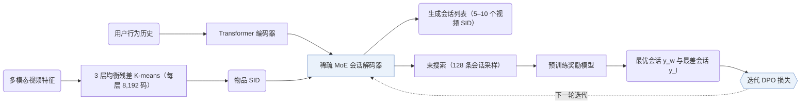

## At a Glance

Key Findings: 在离线奖励模型指标上，OneRec 优于点积召回基线及 TIGER 等逐点生成器（Table 1）；在快手在线 A/B 测试中，OneRec-1B+IPA 的总观看时长提升 +1.68%，平均单次观看时长提升 +6.56%（Table 2）。
Limitation: 在线测试中，OneRec 提升了观看时长，但在点赞等互动指标上较弱（Sec. 6）。

### 1. 为什么重要

主流工业推荐系统采用多阶段“召回-排序”级联架构，前一阶段的候选集合直接限制后一阶段的效果上限；已有的生成式模型即便接入，也仅在召回阶段充当候选选择器。

> "existing methods typically treat each ranker independently, where the effectiveness of each isolated stage serves as the upper bound for the subsequent ranking stage, thereby limiting the performance of the overall ranking system."（Sec. 1）

OneRec 用单一阶段的生成式模型替代多级级联，并部署于快手主场景（Abstract，Sec. 1）。

### 2. 方法

#### 均衡的语义 ID

每个视频在行为对齐的多模态嵌入上通过多层均衡残差 K-means 获得 3 层语义 ID（Semantic ID，SID），每层码本含 8,192 个码，且每个簇容纳相同数量的物品（Sec. 3.1，Algorithm 1）。

#### 按会话生成列表

OneRec 不局限于预测单个下一物品，而是直接生成包含 5–10 个物品的完整会话列表，同时建模会话内物品的内容组合与排列顺序（Sec. 1）。Transformer 编码器编码用户交互历史，稀疏 MoE 解码器自回归生成目标会话的 SID 序列（Sec. 3.2）。

> "The decoder takes the semantic IDs of the target session as input and generates the target in an auto-regressive manner."（Sec. 3.2）

#### 迭代偏好对齐

推荐系统对每次请求只展示一个结果列表，日志中无法同时观测同一请求下的真实正、负会话列表。OneRec 用束搜索为每个用户采样 128 个候选会话，由预训练奖励模型打分，将得分最高与最低的会话配对用于 DPO 训练（Sec. 3.3.2），并在下一轮迭代中由更新后的生成器重新采样。

### 3. 实验发现

- 按会话生成：在会话观看时长与互动概率等离线奖励模型指标上，OneRec 优于点积召回基线及 TIGER 等逐点生成方法（Sec. 5.2，Table 1）。
- 偏好对齐：加入迭代偏好对齐（IPA）进一步提升了离线会话奖励指标（Sec. 5.2，Table 1，Fig. 4），并在快手在线 A/B 测试中使 OneRec-1B+IPA 的总观看时长提升 +1.68%、平均单次观看时长提升 +6.56%（Table 2）。

### 4. 局限与分析

**Stated by the authors.**

> "Additionally, our analysis of online results reveals that, besides user watch time, our model has limitations in interactive indicators, such as likes."（Sec. 6）

**Our analysis.**

- DPO 样本对由预训练奖励模型排序，而非来自用户对候选列表的真实反馈。这表明对齐质量的上限受制于奖励模型在多目标上的拟合精度。
- MiniOneRec 在公开数据上复现该流程，改用仅基于文本（`Text`）的 `RQ-VAE` SID、`Dec-Only` 生成器，并用 RL 替代 DPO（`NTP → RL`）。
