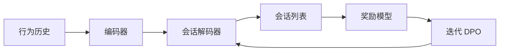

## At a Glance

Limitation: 在线测试中，OneRec 提升了观看时长，但在点赞等互动指标上较弱（Sec. 6）。

### 1. 为什么重要

多数推荐器是"召回-排序"的级联，生成式模型即使有，也只在召回阶段选候选（Abstract）。作者认为，每一级都给下一级设了上限。

> "existing methods typically treat each ranker independently, where the effectiveness of each isolated stage serves as the upper bound for the subsequent ranking stage, thereby limiting the performance of the overall ranking system."（Sec. 1）（各级排序器独立处理，前一级的效果就是后一级的上限。）

OneRec 用一个单阶段生成式模型替代级联，并部署在快手主场景（Abstract，Sec. 1）。

### 2. 方法

#### 均衡的语义 ID

每个物品由均衡 K-means 得到语义 ID（Semantic ID，SID），每个簇里的物品数相同（Sec. 3.1，Algorithm 1）。

#### 按会话生成列表

OneRec 不只预测下一个物品，而是生成整个会话的物品列表，并考虑列表内物品的内容和顺序（Sec. 1）。编码器建模用户历史，解码器生成会话列表（Sec. 3.2）。

> "The decoder takes the semantic IDs of the target session as input and generates the target in an auto-regressive manner."（Sec. 3.2）（解码器以目标会话的语义 ID 为输入，自回归地生成。）

#### 迭代偏好对齐

推荐系统对每个请求只展示一次，同一请求下拿不到真正的正、负列表（Abstract）。OneRec 用束搜索采样多个结果，用预训练的奖励模型打分，把最高分和最低分的结果配成一对做 DPO（Sec. 3.3.2）。下一轮再由模型生成新样本。

### 3. 实验发现

- 按会话生成：在奖励模型指标上，OneRec 好于点积召回方法和 TIGER 这类逐点生成方法（Sec. 5.2，Table 1）。
- 偏好对齐：加入 IPA 后，生成的会话进一步变好（Sec. 5.2，Table 1）。

### 4. 局限与分析

**Stated by the authors.**

> "Additionally, our analysis of online results reveals that, besides user watch time, our model has limitations in interactive indicators, such as likes."（Sec. 6）（在线结果显示，除观看时长外，模型在点赞等互动指标上有局限。）

**Our analysis.**

- DPO 样本对按奖励模型排序，而不是按用户对两个列表的真实反馈。由此推断，对齐质量受奖励模型限制。
- MiniOneRec 在公开数据上复现这条流程，改用只基于文本（`Text`）的 `RQ-VAE` SID、`Dec-Only` 生成器，并用 RL 替代 DPO（`NTP → RL`）。
