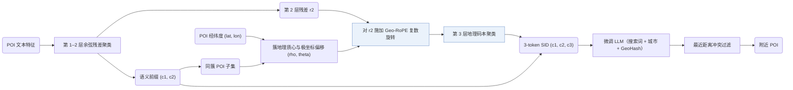

## At a Glance

Key Findings: 在工业数据集上，ProGEO 的 Hit@50 为 0.4243（RQ-Kmeans 为 0.4056），平均地理聚类距离降至 25.41 km（RQ-OPQ 为 46.71 km）（Table 1）。
Limitation: 地理编码仅作用于第三层量化，且按最近用户距离消解 SID 冲突依赖公开 Foursquare 基准中缺失的实时用户坐标（Sec. 3.3，Table 3）。

### 1. 为什么重要

本地生活服务推荐既要求语义相关，又要求推荐地点在地理上可达；但标准语义码本仅按内容特征对物品聚类。

> "existing semantic codebooks neglect geographic constraints, often resulting in recommendations that are semantically relevant yet geographically unreachable."（Abstract）

ProGEO 在前两层保留标准语义码字，并在第三层追加地理码字，用以编码每个 POI 相对其所属语义簇的空间偏移，使地理位置直接成为语义 ID（Semantic ID，SID）的组成部分，而非弱辅助特征（Sec. 1）。

### 2. 方法

#### 语义层

前两层码本以余弦相似度为度量对混合特征向量做残差聚类，并将第二层投影残差 $`\mathbf{r}_2`$ 传给下一层（Sec. 3.1）。最终的 SID 由两层标准语义码本与一层地理码本组成（Fig. 2）。

#### 地理质心局部坐标

共享相同前两层语义前缀 $`(c_1, c_2)`$ 的全部 POI 构成一个语义簇子集。子集内 POI 的实际经纬度确定该簇的地理质心，每个 POI 的全局坐标随之转换为围绕该质心的局部极坐标 $`(\rho, \theta)`$（Sec. 1，Sec. 3.2）。

#### Geo-RoPE

在第三层聚类前，Geo-RoPE 将每个 POI 相对簇质心的极坐标偏移编码为作用在第二层语义残差 $`\mathbf{r}_2`$ 上的复数旋转（Sec. 1，Sec. 3.3）。旋转后向量之间的余弦相似度因此同时反映语义相似性与空间邻近度。

> "We extend RoPE to the spatial domain, formalizing geographic proximity as rotary operations in high-dimensional feature space."（Sec. 3.3）

#### 生成

在工业场景中，微调后的 LLM 提示包含搜索词、城市名称以及用户实时位置的 GeoHash（Table 4），并在推理时按离用户最近的距离筛选同 SID 候选以消解冲突（Table 3）。

### 3. 实验发现

- Geo-RoPE 作用层位：仅在第三层聚类施加 Geo-RoPE 在各测试层位中取得了最高的码本利用率（CUR = 7.67%）与独立编码率（ICR = 57.08%）（Sec. 4.3.2，Fig. 5）。
- 空间可达性案例：引入 Geo-RoPE 后推荐的 POI 集中在用户周边，而去掉该模块的变体会返回位于另一城市的语义相似 POI（Sec. 4.5.2）。

  > "when Geo-RoPE is introduced, the recommended POIs are concentrated much closer to the user, typically within a 6-kilometer radius."（Sec. 4.5.2）

### 4. 局限与分析

**Our analysis.**

- 地理信号只进入 SID 的第三个 token。这意味着生成器在利用 SID 内部的空间线索之前，必须先选定前两层语义簇。
- OneLoc 使用普通 `R-KM` 码；ProGEO 在同类残差 K-means 编号器上增加了专用地理码本层（`R-KM+Geo-CB`）。
- GNPR-SID 同样在 POI SID 中编码地理信息（`Attr+Geo+CF`），但直接用普通 `RQ-VAE` 量化融合特征，未设空间旋转码本层。
