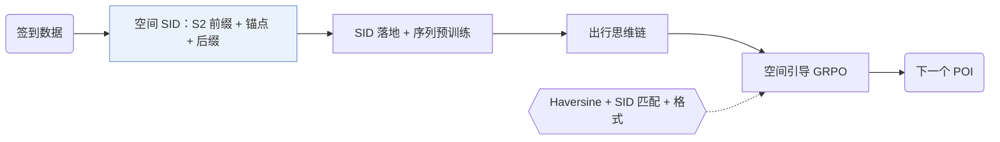

## At a Glance

Key Findings: 在 NYC 上，ROS 的 HR@1 为 0.4478，CoAST 为 0.4027（+11.2%）；在 TKY 和 Gowalla-CA 上，比最强的 LLM 基线分别高 +11.0% 和 +15.7%（Table 1）。
Limitation: 单调先验认为短时间内的远距离移动不太可能，所以 ROS 可能低估乘地铁或走高速的快速长途出行，交通枢纽附近尤其如此（Limitations）。

### 1. 为什么重要

基于 LLM 的生成式推荐器很少用地理信号，而在出行和本地服务场景里地理很重要（Abstract）。ROS 把下一次到访看作一串受时间、意图和地理约束的决策（Sec. 2.3）。它用层级空间语义 ID（Semantic ID，SID）表示每个 POI，SID 同时编码所在区域和 POI 语义（Abstract）。

> "We present ROS, a generative next POI recommendation framework that treats geography as an explicit decision variable."（Sec. 5）（ROS 把地理当作显式的决策变量。）

### 2. 方法

#### 层级空间 SID

每个 POI 的 SID 由地理前缀、语义锚点和区分后缀三部分组成（Sec. 2.2.1）。地理前缀取 POI 的 S2 Cell ID，写成十六进制数字，去掉所有 POI 共有的前缀，再把剩下的数字分组成 token。语义锚点用 Qwen-0.6B 嵌入 POI 的品类描述，再用 RQ-VAE 量化。

#### SID 落地

双向对齐训练模型从文本预测 SID，也从 SID 生成文本（Sec. 2.2.2）。

> "This bidirectional alignment grounds SID tokens in functional semantics and fine-grained neighborhood cues."（Sec. 2.2.2）（双向对齐让 SID token 带上功能语义和细粒度的街区信息。）

之后的序列预训练在 SID 序列上做下一 POI 预测，模型学到近期性、品类重复和街区连续性。

#### 出行思维链

模型按三个确定的阶段推理：刻画用户；构建与意图一致的候选空间；剪枝候选（Sec. 2.3）。剪枝依据时间一致性、语义匹配，以及由街道地址和转移距离判断的空间可达性。

#### 空间引导的强化学习

GRPO 优化一个统一奖励（Sec. 2.4.3）。奖励由三部分组成：预测 POI 与真实 POI 之间的 Haversine 距离（Sec. 2.4.1），带完全匹配奖励的层级 SID 匹配（Sec. 2.4.2），以及格式项。

### 3. 实验发现

- 思维链阶段：三个阶段全用才最好（Sec. 3.3，Table 3）。
- 跨城迁移：在一个城市训练，用到两个没见过的城市，ROS 的迁移效果好于 LLM4POI 和 GA-LLM（Sec. 3.4，Table 6）。

### 4. 局限与分析

**Our analysis.**

- GNPR-SID 用普通 `RQ-VAE` 量化 POI 特征；ROS 在语义码前面加了显式的 S2 cell 前缀（`Geo-Prefix+RQ-VAE`）。
- SpaceTime-GR 只用地理索引（`Geo`，`Geo-Idx`）；ROS 在 SID 中加入品类语义，并在解码前先推理（`CoT+C-Beam`）。
