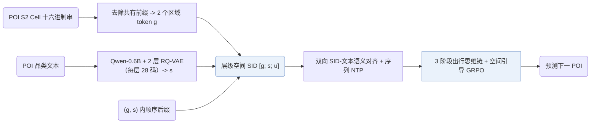
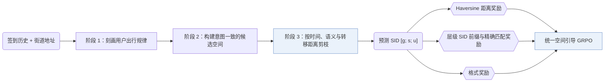

## At a Glance

Key Findings: 在 NYC 上，ROS 的 HR@1 为 0.4478，优于 CoAST 的 0.4027（+11.2%）；在 TKY 和 Gowalla-CA 上，较最强 LLM 基线分别提升 +11.0% 和 +15.7%（Table 1）。
Limitation: 单调空间距离先验将短时间内的长距离移动视为低概率事件，因此在地铁或高速公路沿线及交通枢纽附近会低估快速跨区出行（Limitations）。

### 1. 为什么重要

基于 LLM 的生成式推荐器对地理结构的利用有限，而地理可达性在人类出行与本地生活服务中直接决定候选是否可行。ROS 将下一次到访建模为受时间、意图与地理联合约束的多步决策序列（Sec. 2.3），并用同时编码区域局部性与品类语义的层级空间语义 ID（Semantic ID，SID）`[g; s; u]` 表示每个 POI（Abstract）。

> "We present ROS, a generative next POI recommendation framework that treats geography as an explicit decision variable."（Sec. 5）

### 2. 方法

#### 层级空间 SID

每个 POI 的 SID 依次拼接地理前缀 `g`、语义锚点 `s` 和消歧后缀 `u`（Sec. 2.2.1）。地理前缀将 POI 的 S2 Cell ID 转为十六进制数字，剥离全城物品库共有的高位前缀后分组为两个区域 token；语义锚点用 Qwen-0.6B 编码品类描述，再经每层 28 码的 2 层 RQ-VAE 量化，最后在每个 `(g, s)` 组合内附加顺序后缀 `u` 保证唯一性。

#### SID 语义对齐

双向对齐任务同时训练 LLM 由 POI 文本预测空间 SID、以及由空间 SID 生成文本描述（Sec. 2.2.2）。

> "This bidirectional alignment grounds SID tokens in functional semantics and fine-grained neighborhood cues."（Sec. 2.2.2）

随后的序列预训练在 SID 轨迹上执行下一 POI 预测，使骨干网络掌握近期偏好、品类复访与街区连续性。

#### 出行思维链

在输出目标 SID 之前，生成器按三个确定阶段展开推理：刻画用户出行习惯、构建与当前意图一致的候选空间，并根据时间一致性、语义匹配度以及由街道地址和转移距离推断的空间可达性剪枝候选（Sec. 2.3）。

#### 空间引导的强化学习

GRPO 在统一复合奖励下优化“推理+生成”策略（Sec. 2.4.3）：奖励由预测 POI 与真实 POI 坐标间的单调 Haversine 距离衰减项（Sec. 2.4.1）、带精确命中加成的层级 SID 前缀匹配项（Sec. 2.4.2）以及输出格式校验项共同组成。

### 3. 实验发现

- 思维链阶段消融：同时保留全部三个出行思维链阶段取得最高 HR@1，去掉用户画像、候选构建或空间剪枝任一阶段都会降低各数据集上的准确率（Sec. 3.3，Table 3）。
- 跨城迁移：在单一城市训练并在两个未见城市上直接评测时，ROS 在所有迁移方向上均优于 LLM4POI 和 GA-LLM（Sec. 3.4，Table 6）。

### 4. 局限与分析

**Our analysis.**

- GNPR-SID 用普通 `RQ-VAE` 量化 POI 特征；ROS 在语义码前显式前置了 S2 单元区域前缀（`Geo-Prefix+RQ-VAE`）。
- SpaceTime-GR 仅使用纯地理索引（`Geo`，`Geo-Idx`）；ROS 将 S2 地理前缀与品类 `RQ-VAE` 语义码结合，并在受限束解码前执行结构化时空推理（`CoT+C-Beam`）。
