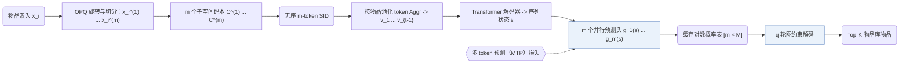
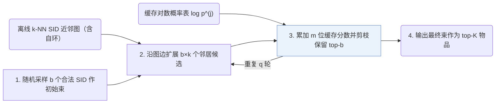

## At a Glance

Key Findings: 使用最长 64 个 token 的 ID 时，RPG 在 NDCG@10 上较生成式基线平均提升 12.6%，同时降低了推理开销（Abstract）。
Limitation: 作者假设在给定输入序列的条件下，单个语义 ID（Semantic ID，SID）内的各个 token 彼此条件独立（Sec. 2.2.1）。

### 1. 为什么重要

TIGER 等自回归生成式推荐器通过束搜索逐位解码 SID，单次推荐请求需多次执行生成器前向传播。受此计算开销限制，已有模型通常将 SID 压缩得很短，常见长度为 4 个 token（Abstract）。

> "Running beam search for 32 steps would be computationally prohibitive."（Sec. 1）

RPG 用最长 64 个 token 的无序优化乘积量化（OPQ）ID、单次前向的并行多 token 预测，以及在物品 SID 相似图上的迭代传播解码，替代短残差码上的逐步束搜索。

### 2. 方法

#### 概览



#### 第 1 步：用 OPQ 构建长 SID

RPG 用优化乘积量化（OPQ）替代残差量化，使所有 SID 位置可以并行预测而非串行依赖（Sec. 2.1.1）。

> "To align with parallel decoding, we tokenize each item into an unordered long semantic ID (up to 64 tokens per item) using optimized product quantization (Jégou et al., 2011; Ge et al., 2014)."（Sec. 1）

OPQ 将旋转后的物品语义嵌入切分为 $`m`$ 个子向量，每个子向量在各自大小为 $`M`$ 的独立码本中完成最近邻量化（Sec. 2.1.1）：

```math
\mathbf{x}_i = \left[\mathbf{x}_i^{(1)}; \dots; \mathbf{x}_i^{(m)}\right], \qquad c_{i,j} = \arg\min_{c \in \mathcal{C}^{(j)}} \left\| \mathbf{x}_i^{(j)} - \mathbf{a}_c^{(j)} \right\|_2^2
```

其中：
- $`\mathbf{x}_i`$ 是物品 $`i`$ 经 OPQ 旋转后的语义嵌入；
- $`\mathbf{x}_i^{(j)}`$ 是其第 $`j`$ 个子向量；
- $`\mathcal{C}^{(j)}`$ 是第 $`j`$ 个子空间码本，含 $`M`$ 个码字 $`\mathbf{a}_c^{(j)}`$；
- $`c_{i,j}`$ 是物品 $`i`$ 的 SID 第 $`j`$ 位 token。

这里的“无序”（"Unordered"）指解码时任一 token 都不以前序位置的 token 为条件，但第 $`j`$ 位仍固定对应第 $`j`$ 个码本（Sec. 2.1.1）。即便不同物品落入同一组 token，它们在解码图中仍保留各自节点；在 64-token 长度下此类冲突极少发生（Appendix C）。

#### 第 2 步：物品级输入

若将每个历史物品展开为 64 个 token，上下文序列会急剧拉长（Sec. 2.1.2）。RPG 为每个码本维护可学习的 token 嵌入表 $`\mathbf{E}_j \in \mathbb{R}^{M \times d}`$，通过均值或最大池化将单个物品的 $`m`$ 个 token 嵌入聚合为单个物品向量 $`\mathbf{v}_i = \mathrm{Aggr}(\mathbf{e}_{1,c_{i,1}}, \dots, \mathbf{e}_{m,c_{i,m}})`$（Sec. 2.1.2）。Transformer 解码器读入历史序列 $`\mathbf{v}_1, \dots, \mathbf{v}_{t-1}`$ 并输出用户状态表示 $`\mathbf{s} \in \mathbb{R}^{d}`$（Sec. 2.2.1）。

#### 第 3 步：用 MTP 损失并行预测

RPG 为下一物品 SID 的每一位配置独立的投影头，并用多 token 预测（MTP）损失联合训练全部 $`m`$ 个预测头。

> "Since each token produced by OPQ encodes a separate subvector of the target item's semantic representation, we assume that tokens in the tuple are conditionally independent given the input sequence s."（Sec. 2.2.1）

```math
\mathcal{L} = -\sum_{j=1}^{m} \log \mathbb{P}^{(j)}(c_{t,j} \mid s) = -\sum_{j=1}^{m} \log \frac{\exp\left(\mathbf{e}_{c_{t,j}}^{\top} g_j(\mathbf{s}) / \tau\right)}{\sum_{c \in \mathcal{C}^{(j)}} \exp\left(\mathbf{e}_{c}^{\top} g_j(\mathbf{s}) / \tau\right)}
```

其中：
- $`c_{t,j}`$ 是目标物品 SID 的第 $`j`$ 个 token；
- $`g_j`$ 是第 $`j`$ 个码本对应的 MLP 投影头；
- $`\mathbf{e}_c`$ 是 token $`c`$ 的嵌入向量；
- $`\tau`$ 是温度系数（Eq. 1）。

#### 第 4 步：缓存 token 分数

推理时，RPG 只需一次前向传播即可算出全部 $`m`$ 个码本上的 token 概率分布并缓存（Eq. 2）。任意候选 SID 的总分随即简化为查表累加 $`m`$ 个缓存对数概率（Eq. 3）：

```math
\mathbf{p}^{(j)} = \mathrm{softmax}\left(\mathbf{E}_j\, g_j(\mathbf{s}) / \tau\right) \in \mathbb{R}^{M}, \qquad \mathrm{score}(c_1, \dots, c_m) = \sum_{j=1}^{m} \log p^{(j)}_{c_j}
```

其中 $`p^{(j)}_{c_j}`$ 是 $`\mathbf{p}^{(j)}`$ 中对应 token $`c_j`$ 的概率项（Sec. 2.2.2）。

#### 第 5 步：图约束解码

训练结束后，RPG 离线构建以物品库各物品为节点的有向 $`k`$ 近邻图（Sec. 2.3.1）。两物品间的相似度定义为各子空间 token 嵌入内积之和：

```math
\mathrm{sim}(i, i') = \sum_{j=1}^{m} \mathbf{e}_{j,c_{i,j}}^{\top}\, \mathbf{e}_{j,c_{i',j}}
```

每个节点保留相似度最高的 $`k`$ 个邻居（Sec. 2.3.1）并包含一条自环边（Sec. 2.3.2）。在线解码按四步迭代执行（Sec. 2.3.2）：

1. 从物品库随机采样 $`b`$ 个合法 SID 作为初始束。
2. 将当前束全部节点的 $`b \times k`$ 个图邻居加入临时候选集。
3. 查表累加缓存的对数概率为访问到的候选打分，保留得分最高的 $`b`$ 个节点。
4. 重复第 2、3 步共 $`q`$ 轮，返回最终束作为 top-$`K`$ 推荐结果。

> "Since neighboring nodes in the graph tend to have similar logits, we expand the beam by propagating through the graph, including all b×k neighbors of the current beam into a temporary set."（Sec. 2.3.2）

```python
import torch

def rpg_decode(s, heads, token_emb, item_codes, neighbors, b=10, q=2, tau=0.05):
    """
    s:          [d] sequence representation of one user
    heads:      list of m projection heads g_j, each mapping [d] -> [d]
    token_emb:  [m, M, d] token embedding tables E_j
    item_codes: [N, m] SID of every catalog item; entry j indexes codebook j
    neighbors:  [N, k] graph neighbors of every item; the item itself is included here
    """
    m = item_codes.size(1)
    # Eq. 2: one softmax per codebook, cached for this user
    proj = torch.stack([g(s) for g in heads])                                         # [m, d]
    log_p = torch.log_softmax(torch.einsum("jcd,jd->jc", token_emb, proj) / tau, -1)  # [m, M]
    # Eq. 3 for the whole catalog
    scores = log_p[torch.arange(m), item_codes].sum(dim=-1)                          # [N]
    # step 1: random initial beam of b valid SIDs
    beam = torch.randperm(item_codes.size(0))[:b]                                     # [b]
    for _ in range(q):
        # step 2: beam plus graph neighbors, without duplicates
        cand = torch.unique(neighbors[beam].reshape(-1))                              # [<= b*k]
        # step 3: keep the b best candidates
        beam = cand[torch.topk(scores[cand], k=min(b, cand.numel())).indices]
    return beam                                                                       # item indices
```

简化说明：代码在图搜索前一次性算出了全量物品库分数；原论文仅对沿图边访问到的候选节点打分（Sec. 2.3.3）。此外，代码将预测头、token 嵌入表与近邻图作为已知输入传入，省略了 OPQ 量化、Transformer 解码器、MTP 训练与离线建图过程。

> "Compared to generative models like TIGER (Rajput et al., 2023), RPG reduces the number of sequence encoder forward passes per input instance from approximately O(bm) to just O(1), greatly improving inference efficiency (Section 3.3)."（Sec. 2.4.2）



### 3. 实验发现

- 主排序对比：在 Sports and Outdoors、Beauty、Toys and Games 和 CDs and Vinyl 四个数据集上，采用长 OPQ SID 的 RPG 在 NDCG@10 上较 TIGER、VQ-Rec 等序列与生成式基线平均提升 12.6%（Abstract，Table 2）。
- 推理效率：在 Sports 上，RPG 的运行时显存占用与推理耗时均显著低于采用自回归束搜索的 TIGER（Sec. 3.3，Fig. 3）。

  > "Moreover, RPG reduces runtime memory consumption by nearly 25× and achieves an inference speedup of almost 15× compared to TIGER."（Sec. 3.3）

- ID 长度消融：排序指标并非随 SID 长度单调递增；Sports、Beauty、Toys 和 CDs 上的最优长度分别为 16、32、16 和 64（Sec. 3.5.1，Fig. 4）。

  > "From Figure 4, we observe that, in general, longer OPQ-based semantic IDs lead to better performance. However, for smaller datasets, they may converge earlier."（Sec. 3.5.1）

- 语义编码器对齐：主实验使用 OpenAI text-embedding-3-large 编码物品文本，Table 4 额外换用 sentence-t5-base 重做对比以对齐既往 TIGER 基准协议（Sec. 3.1，Sec. 3.5.2）。
- 长尾物品表现：在 Sports 按训练交互频次划分的各分组中，RPG 均优于 TIGER（Sec. 3.5.3，Fig. 5）。

### 4. 局限与分析

**Stated by the authors.** 效率对比实验仅采用单一固定超参数配置，且所报告的运行内存仅统计计算 logit 时的 GPU 显存，不包含模型参数本身的存储开销（Sec. 3.3）。

**Our analysis.**

- 候选 SID 的得分由各位边际对数概率直接相加得到（Eq. 3），因此生成器无法建模同一 SID 内部不同位置 token 之间的联合依赖。同一矩阵格内的 ACERec 引入对比与辅助目标（`MTP + Ctr. + Aux.`），SPRINT 将训练目标替换为 `Dual-level Flow Ctr.`；二者均保留 `Par. OPQ` 与 `Non-AR`。
- 解码近邻图是独立于生成器的外部索引，每个物品对应一个图节点；一旦物品重新编号或重训 token 嵌入，整张图都必须重建（Sec. 2.3.1）。
