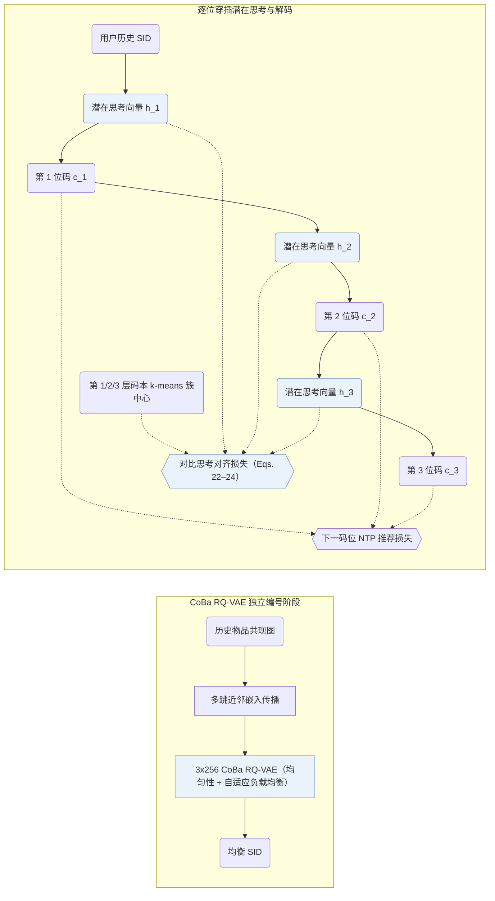

## At a Glance

Key Findings: S2GR 在 Beauty 与工业短视频数据集上分别取得 99.30% 与 76.25% 的独立编码率，离线超越序列、推理与 TIGER 基线，并在短视频平台线上 A/B 测试中优于对照模型 TIGER（Abstract，Sec. 5.3，Sec. 5.4，Tables 2–4）。
Limitation: 在工业数据集同等模型规模下，穿插潜在思考使训练耗时从 TIGER 的约 45 h 增至约 59 h，推理总耗时从约 0.88 h 微增至约 0.90 h（Appendix B.1，Table B.1）。

### 1. 为什么重要

常规生成式推荐器直接从交互序列输出语义 ID（Semantic ID，SID），而前置自然语言推理把全部算力堆在首位码之前，纯隐向量推理又缺乏可核验的语义监督（Abstract，Sec. 1）。S2GR 在每一位 SID 码之前穿插一个连续潜在思考向量，并用下一位真实码对应的 k-means 簇中心直接监督该思考步。

### 2. 方法

#### 与行为对齐的码本

S2GR 从训练期之前的历史序列构建物品共现图，在量化前沿图传播平滑物品文本嵌入（Sec. 4.2.1）。

> "This encodes essential collaborative patterns without requiring additional model training."（Sec. 4.2.1）

码本均衡 RQ-VAE（`CoBa RQ-VAE`）在此基础上加入分布均匀性约束与自适应负载均衡，先于生成器独立完成优化（Sec. 4.2，Sec. 4.2.2）。

#### 逐步潜在思考

编码器-解码器生成器在预测每一位离散 SID 码之前先输出一个连续潜在思考向量，不转换成自然语言词串（Sec. 4.3.2）。对比思考损失将该思考向量拉向对应层码本中真实下一码所在的 k-means 簇中心，与离散码位的推荐交叉熵损失联合训练（Eqs. 22–24）。

#### 解码

束搜索时，每条候选束在单步内确定性地前向产出连续思考向量并紧接着展开下一位 SID 码，思考向量本身不占用额外束宽（Appendix B.1）。

> "For inference, the increase in latency is relatively small."（Appendix B.1）

### 3. 实验发现

- 模块消融：去掉穿插潜在思考向量或去掉簇中心对比思考损失，在 Amazon Beauty 与工业短视频数据集上均导致排序指标明显回落（Sec. 5.3，Table 2）。
- 在线 A/B 测试：在大规模短视频平台开展的 7 天线上 A/B 测试中，以同规模 TIGER 为对照基线，S2GR 取得稳定正向在线收益（Abstract，Sec. 5.4，Table 4）。

### 4. 局限与分析

**Our analysis.**

- TIGER 仅用纯文本训练 `RQ-VAE`（`Text`）并做单任务 `NTP`；S2GR 在编号前融入图传播协同信号（`Text+CF`，`CoBa RQ-VAE`），并在生成端联合优化思考对比项（`NTP + Ctr.`）。
- OneRec-Think 在 `Dec-Only` LLM 上自回归生成显式文本思维链（`CoT`）；S2GR 沿用紧凑的 `Enc-Dec` 架构与常规 `Beam` 搜索，以每层单步连续隐向量完成逐级推理。
