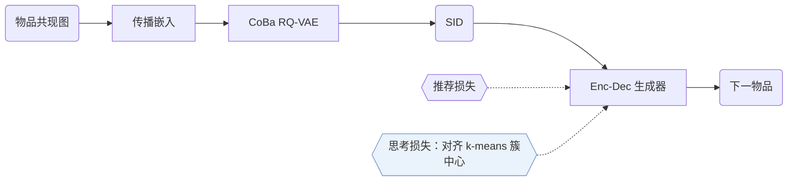
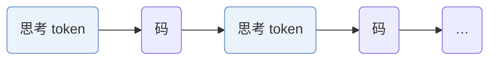

## At a Glance

Limitation: 在工业数据集上用同等规模的模型，训练约需 59 h，TIGER 约 45 h；推理总时长从约 0.88 h 增至约 0.90 h（Appendix B.1，Table B.1）。

### 1. 为什么重要

多数生成式推荐器直接从交互序列生成语义 ID（Semantic ID，SID），中间没有推理（Abstract）。作者指出推理增强变体的两个问题：推理全部放在生成之前，计算量在 SID 各层之间分配不均；潜在推理向量没有可解释的语义，也无法验证监督。S2GR 让思考 token 和 SID 码交替生成，每个码前一个思考 token，并用下一个码的语义监督它（Sec. 1）。

### 2. 方法

#### 与行为对齐的码本

S2GR 从历史序列构建物品共现图，在图上传播物品嵌入（Sec. 4.2.1）。

> "This encodes essential collaborative patterns without requiring additional model training."（Sec. 4.2.1）（不需额外训练模型就能编码基本的协同模式。）

码本均衡的 RQ-VAE 给量化器加了均匀性约束和自适应负载均衡（Sec. 4.2.2）。

#### 逐步潜在思考

生成器在每个 SID 码之前输出一个思考 token，它是连续的潜在嵌入，不是自然语言文本（Sec. 4.3.2）。对比损失让它对齐对应码本中下一个真实码的 k-means 簇中心。生成器的目标是推荐损失加上这个思考损失（Eqs. 22–24）。编号器单独优化（Sec. 4.2）。

#### 解码

每条束在一个连续步骤里生成思考 token 和其后的 SID 码，思考 token 不会让束变多（Appendix B.1）。

> "For inference, the increase in latency is relatively small."（Appendix B.1）（推理延迟增加较小。）

### 3. 实验发现

- 消融：去掉逐步推理 token 或思考损失，Beauty 和工业数据集上的效果都下降（Sec. 5.3，Table 2）。
- 在线 A/B 测试：作者报告，在一个大规模短视频平台上以 TIGER 为对照的测试证实了 S2GR 有效（Abstract，Sec. 5.4，Table 4）。

### 4. 局限与分析

**Our analysis.**

- TIGER 用只基于文本的 `RQ-VAE` 码（`Text`）和普通 `NTP`；S2GR 在编号器里加入协同信号（`Text+CF`，`CoBa RQ-VAE`），在生成器上加对比项（`NTP + Ctr.`）。
- OneRec-Think 用 `Dec-Only` LLM 以文本推理（`CoT`）；S2GR 保留 `Enc-Dec` 生成器和 `Beam` 解码，用潜在 token 推理。
