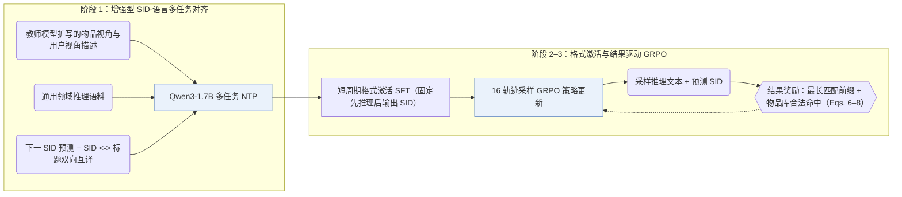

## At a Glance

Key Findings: 引入教师合成的多视角描述与通用推理语料做多任务 SID-语言对齐后，SIDReasoner 在 Amazon Games、Office 与 Industrial 全库评测中于 GRPO 前后均取得显著提升（Tables 2 and 3）。
Limitation: 强化学习阶段仅根据最终语义 ID（Semantic ID，SID）的最长正确前缀与物品库合法性计算结果奖励，不对中间推理文本施加直接过程监督（Sec. 3.3.2）。

### 1. 为什么重要

即便把离散 SID 与自然语言放进同一词表，大语言模型（LLM）面对无原生语义的编码仍难以展开有效推演，而推荐场景又缺乏高质量人工推理标注（Abstract）。SIDReasoner 先通过教师扩写语料与通用推理数据强化 SID-语言双向对齐，再配合轻量的结果导向 GRPO，将基座的通用推理能力直接迁移至推荐任务。

> "Stronger SID–language alignment can help general reasoning abilities better generalize to recommendation tasks."（Sec. 5）

### 2. 方法

#### SID-语言对齐

多任务对齐阶段联合训练序列下一 SID 预测与“SID-物品标题”双向互译（Sec. 3.2.2），并由教师模型从物品特征与用户画像两个视角扩写描述，同时混入通用推理数据防止基座推理能力退化（Sec. 3.2.3）。

#### 推理激活

简短的有监督“冷启动推理激活”（"cold-start reasoning activation"）阶段训练模型稳定输出“先推理、后推荐”的响应格式；此处的“冷启动”仅指推理格式初始化，与冷启动用户或物品无关（Sec. 3.3.1）。

> "This stage mainly serves to improve the reliability of response formatting, ensuring that reasoning is consistently generated before recommendation."（Sec. 3.3.1）

#### 基于结果的 GRPO

GRPO 对每条历史提示采样 16 条“推理 + SID”完整轨迹，仅按生成 SID 的最长正确前缀长度及是否命中合法物品赋分更新策略（Sec. 3.3.2，Eqs. 6–8）。

### 3. 实验发现

- 对齐策略消融：在多任务对齐中加入教师扩写描述与通用推理语料，无论在对齐后直接评测还是叠加 GRPO 后评测均稳定提升全库排序指标（Table 3）。
- 跨域推理迁移：在多领域联合完成 SID-语言对齐后，仅在单一领域上运行 GRPO 学到的推理策略即可迁移提升其余领域的准确率（Sec. 4.2.2，Fig. 3）。

  > "Such reasoning knowledge, once learned, can be transferred across domains."（Sec. 4.2.2）

- 推理链自适应压缩：随 GRPO 迭代推进，生成的推理文本长度自然缩短，未牺牲推荐精度（Sec. 4.4.2，Fig. 6）。

### 4. 局限与分析

**Our analysis.**

- LC-Rec 在 `Dec-Only` LLM 上仅执行 `Multi-task NTP` 指令对齐；SIDReasoner 在教师增强对齐之后衔接格式激活与结果导向强化学习（`NTP → RL`，`CoT`）。
- TIGER 用小型 `Enc-Dec` 生成器通过 `NTP` 直接解码 `RQ-VAE` SID；SIDReasoner 则在 Qwen3-1.7B 上先生成自然语言推理链再输出 `RQ-VAE` SID。
