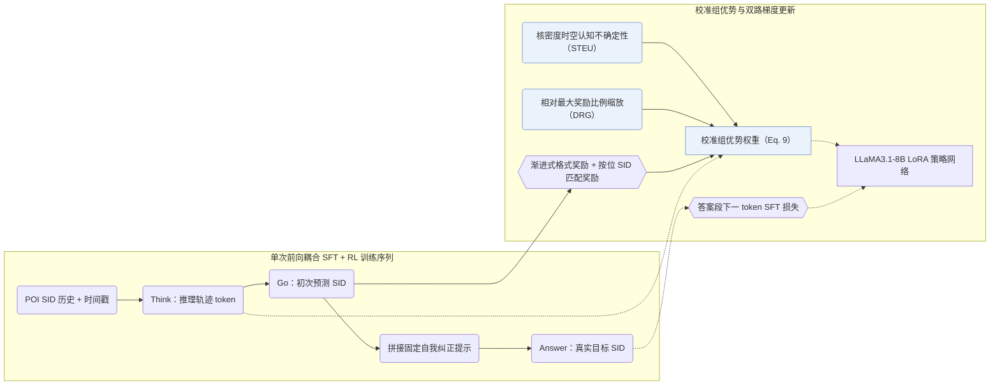

## At a Glance

Key Findings: 在 Foursquare NYC、TKY 与 Gowalla CA 上，Think2Go 超越序列、图网络、LLM 与推理类 POI 基线，在 10 选 1 SID 品类识别任务上优于 GNPR，并在跨城市域外迁移中保持更小性能衰减（Sec. 5.5–5.8，Tables 2–5）。
Limitation: 模型输入仅含离散 POI 语义 ID（Semantic ID，SID）与时间戳，不含原始名称或经纬度文本，空间信息完全依赖 RQ-VAE 码与核密度不确定性权重传递（Sec. 4.2.1，Appendix E）。

### 1. 为什么重要

下一兴趣点（POI）签到序列稀疏且多变：不带推理的模型难以捕捉深层出行意图，而与基座分开训练的离散 SID 又难以被预训练 LLM 直接理解（Abstract，Sec. 5.8）。Think2Go 将监督记忆与强化学习探索耦合进单条 `Think -> Go -> Self-correct -> Answer` 轨迹，并用时空认知不确定性与相对奖励比例校准组优势权重（Sec. 4，Sec. 4.1）。

### 2. 方法

#### 统一 SFT 与 RL

模型仅读入列表式 RQ-VAE POI SID 与时间信息（Appendix E）。训练时先由模型生成推理轨迹（`Think`）与初次预测（`Go`），随后拼接固定自我纠正提示与真实答案（`Answer`）：推理段 token 接受 RL 策略梯度更新，追加答案段 token 接受 SFT 交叉熵监督（Sec. 4.1，Table 7）。

> "This forms a Think–>Go–>Self–correct–>Answer structure, where tokens from the reasoning trace are used for RL, and tokens from the appended answer are used for SFT."（Sec. 4.1）

#### 渐进奖励

强化学习奖励先激励合法的输出格式，随后按拆分的层级 SID 码位逐位奖励语义命中（Sec. 4.2.2）。

#### 校准的优势

常规组内归一化优势对高频惯常签到与低频跨区探索赋予相同步长（Sec. 4.2.3）。Think2Go 叠乘两项校准权重：其一用核密度估计（KDE）度量当前查询与用户历史时空分布的偏离度作为认知不确定性（STEU），放大高不确定性且答对样本的更新步长、收缩答错样本步长（Sec. 4.2.1，Sec. 6）；其二按当前奖励占最大奖励的比例缩放组优势（DRG），保留绝对质量信号并形成隐式课程（Sec. 4.2.4，Eq. 9）。

> "challenging samples with high epistemic uncertainty and correct predictions receive larger updates to encourage exploration, while incorrect predictions are updated conservatively to ensure robustness."（Sec. 4.2.1）

### 3. 实验发现

- 模块消融与探索熵：去掉推理 token、STEU 不确定性权重、DRG 奖励缩放或 token 熵正则均会导致准确率回落（Sec. 5.5，Table 3）；DRG 在训练全程维持了较高的推理 token 熵值，抑制策略过早坍缩（Sec. 4.2.4，Sec. 5.6，Fig. 3）。

  > "Through comparative experiments, we further observe that it effectively alleviates entropy collapse by maintaining a high entropy level for the reasoning tokens, which implies greater exploration capacity."（Sec. 4.2.4）

- SID 语义探针与跨城迁移：在给定单样本提示（Appendix C.2，Table 8）、仅凭裸 SID 从 10 个候选品类中判别正确类目的测试中，Think2Go 显著高于 GNPR（Sec. 5.7，Table 4），在跨城市域外评测中衰减更小（Sec. 5.8，Table 5），并在 NYC 上对比 Refine-POI 报告了单轮训练时长、测试耗时与显存开销（Appendix E，Table 10）。

### 4. 局限与分析

**Our analysis.**

- GNPR-SID 仅用 `NTP` 训练 `RQ-VAE` POI SID 且未报告具体解码策略（`–`）；Think2Go 联合 SFT 与不确定性校准 RL（`NTP → RL`），并以 `CoT+Beam` 先推理后解码。
- ROS 将地理网格前缀直接写进标识符本身（`Geo-Prefix+RQ-VAE`）并配 `CoT+C-Beam`；Think2Go 保持纯 `RQ-VAE` SID，改由强化学习优势权重注入时空分布先验。
