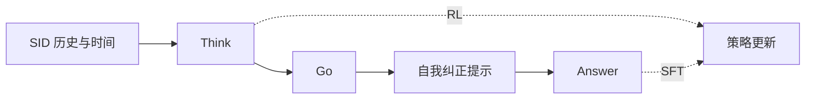

### 1. 为什么重要

下一 POI 推荐要从稀疏而复杂的出行模式中学习（Abstract）。作者认为，不做推理的模型抓不到其中深层的意图；语义 ID（Semantic ID，SID）如果和模型分开训练，LLM 也读不懂它（Abstract，Sec. 5.8）。Think2Go 让 LLM 先推理再推荐，并在一个结构里同时训练记忆和推理，而不是先 SFT 再 RL（Sec. 4，Sec. 4.1）。

### 2. 方法

#### 统一 SFT 与 RL

模型输入只有 SID 和时间信息（Appendix E）。训练时，模型先推理并给出第一次预测，然后接上一段固定的自我纠正提示，再接正确答案（Sec. 4.1，Table 7）。

> "This forms a Think–>Go–>Self–correct–>Answer structure, where tokens from the reasoning trace are used for RL, and tokens from the appended answer are used for SFT."（Sec. 4.1）（形成"思考-出发-自我纠正-答案"结构，推理部分的 token 用于 RL，答案部分的 token 用于 SFT。）

#### 渐进奖励

奖励先偏向格式正确的回答，再偏向语义正确的答案（Sec. 4.2.2）。正确性在拆开的 SID 单元上计分。

#### 校准的优势

标准的组优势对容易和困难的样本给同样的更新权重（Sec. 4.2.3）。Think2Go 加了两个权重。核密度估计衡量查询和用户时空历史的吻合程度，这种认知不确定性改变更新幅度（Sec. 4.2.1，Sec. 6）。

> "challenging samples with high epistemic uncertainty and correct predictions receive larger updates to encourage exploration, while incorrect predictions are updated conservatively to ensure robustness."（Sec. 4.2.1）（认知不确定性高且预测正确的难样本更新更大，预测错误的更新保守。）

第二个权重按奖励相对最大奖励的比例缩放组优势，保留绝对表现的信号（Sec. 4.2.4，Eq. 9）。作者把两者的组合称为一种隐式课程。

### 3. 实验发现

- 消融：Table 3 分别去掉推理 token、认知不确定性权重（STEU）、奖励感知权重（DRG）和 token 熵奖励（Sec. 5.5）。
- 熵：奖励感知的缩放让推理 token 的熵在训练中保持较高（Sec. 4.2.4，Sec. 5.6，Fig. 3）。

  > "Through comparative experiments, we further observe that it effectively alleviates entropy collapse by maintaining a high entropy level for the reasoning tokens, which implies greater exploration capacity."（Sec. 4.2.4）（推理 token 的熵保持较高，缓解了熵坍缩，探索能力更强。）

- 理解 SID：给出一个 SID 和十个候选品类，让模型选出正确品类，并与 GNPR 比较（Sec. 5.7，Table 4）。这个任务的提示带一个示例（Appendix C.2，Table 8）。
- 域外：在域外数据集上，Think2Go 的下降比其他方法少（Sec. 5.8，Table 5）。
- 效率：对比在 NYC 上训练的 Refine-POI，论文报告了每轮训练时间、测试时间和内存（Appendix E，Table 10）。

### 4. 局限与分析

**Our analysis.**

- GNPR-SID 只用 `NTP` 在 `RQ-VAE` POI SID 上训练，没有报告推理策略（`–`）；Think2Go 加了强化学习阶段（`NTP → RL`），并在解码前推理（`CoT+Beam`）。
- ROS 也在解码前推理（`CoT+C-Beam`），但把地理放进 SID 本身（`Geo-Prefix+RQ-VAE`）；Think2Go 保留普通 `RQ-VAE` SID，通过优势权重建模空间。
