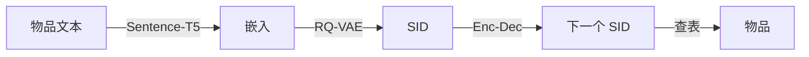

## At a Glance

Key Findings: 在 Amazon Beauty 上，TIGER 的 Recall@5 为 0.0454，SASRec 为 0.0387；RQ-VAE 语义 ID（Semantic ID，SID）好于 LSH ID 和随机 ID（Tables 1 and 2）。
Limitation: 作者指出，由于束搜索，TIGER 在推理时可能比基于 ANN 的检索更费算力（Appendix E）。

### 1. 为什么重要

大规模推荐器通常把用户和物品嵌入同一个空间，再用近似最近邻（ANN）搜索选候选（Abstract）。作者称 TIGER 是第一个基于语义 ID 的生成式推荐模型（Sec. 2）。本清单中很多后来的论文沿用这条 SID 流程，只改其中一个阶段。

> "We propose a new paradigm of building generative retrieval models for sequential recommendation."（Sec. 1）（为序列推荐提出构建生成式检索模型的新范式。）

### 2. 方法

#### 概览



#### 第 1 步：物品文本到潜在向量

TIGER 用每个物品的标题、价格、品牌和品类拼成一句话，由预训练的 Sentence-T5 编码成 768 维嵌入 $`\mathbf{x}`$（Sec. 4）。DNN 编码器 $`E`$ 的中间层大小为 512、256 和 128，用 ReLU 激活，把 $`\mathbf{x}`$ 映射成 32 维潜在向量 $`\mathbf{z} = E(\mathbf{x})`$（Sec. 4）。

#### 第 2 步：残差量化成码

RQ-VAE 量化上一层留下的残差，每一层都在细化上一层的码。

> "Residual-Quantized Variational AutoEncoder (RQ-VAE) [40] is a multi-level vector quantizer that applies quantization on residuals to generate a tuple of codewords (aka Semantic IDs)."（Sec. 3.1）（RQ-VAE 是多层向量量化器，对残差量化，得到一组码字，即语义 ID。）

TIGER 用 $`M = 3`$ 层，每层的码本有 $`K = 256`$ 个 32 维码字（Sec. 4）。在第 $`m`$ 层：

```math
\mathbf{r}_1 = \mathbf{z}, \qquad c_m = \arg\min_{k \in \{0, \dots, K-1\}} \left\| \mathbf{r}_m - \mathbf{e}_k^{(m)} \right\|_2^2, \qquad \mathbf{r}_{m+1} = \mathbf{r}_m - \mathbf{e}_{c_m}^{(m)}
```

其中：
- $`\mathbf{r}_m \in \mathbb{R}^{32}`$ 是进入第 $`m`$ 层的残差；
- $`\mathbf{e}_k^{(m)}`$ 是第 $`m`$ 层码本中的第 $`k`$ 个码字；
- $`c_m`$ 是第 $`m`$ 层选中的码。

```python
import torch

def rqvae_quantize(z, codebooks, beta=0.25):
    """
    z:         [B, 32] latent vectors from the encoder E(x)
    codebooks: list of M tensors, each [K, 32] (M = 3, K = 256)
    """
    r = z
    z_hat = torch.zeros_like(z)
    codes, vq_loss = [], 0.0
    for E_m in codebooks:
        # nearest codeword at this level
        c_m = torch.cdist(r, E_m).pow(2).argmin(dim=-1)                     # [B]
        e_m = E_m[c_m]                                                       # [B, 32]
        # codebook and commitment terms of the quantization loss
        vq_loss = vq_loss + (e_m - r.detach()).pow(2).mean() + beta * (r - e_m.detach()).pow(2).mean()
        # straight-through estimate, then the residual for the next level
        z_hat = z_hat + r + (e_m - r).detach()
        r = r - e_m.detach()
        codes.append(c_m)
    return torch.stack(codes, dim=-1), z_hat, vq_loss                        # [B, M], [B, 32], scalar
```

简化说明：代码只写了量化循环和量化损失，省去了 DNN 编码器和解码器、重建损失，以及码本的 k-means 初始化。

#### 第 3 步：训练编号器

解码器 $`D`$ 从选中码字之和 $`\hat{\mathbf{z}} = \sum_{m=1}^{M} \mathbf{e}_{c_m}^{(m)}`$ 重建 $`\hat{\mathbf{x}} = D(\hat{\mathbf{z}})`$。RQ-VAE 用重建损失和量化损失一起训练编码器、解码器和码本：

```math
\mathcal{L}(\mathbf{x}) = \|\mathbf{x} - \hat{\mathbf{x}}\|_2^2 + \sum_{m=1}^{M} \left( \left\|\mathrm{sg}[\mathbf{r}_m] - \mathbf{e}_{c_m}^{(m)}\right\|_2^2 + \beta \left\|\mathbf{r}_m - \mathrm{sg}[\mathbf{e}_{c_m}^{(m)}]\right\|_2^2 \right)
```

其中：
- $`\mathrm{sg}[\cdot]`$ 是停止梯度算子；
- $`\beta = 0.25`$ 是承诺项的权重（Sec. 4）。

为防止码本坍缩，TIGER 在第一个训练批上跑 k-means，用簇中心初始化码本（Sec. 3.1）。

#### 第 4 步：冲突 token

几个物品可能得到相同的三个码。TIGER 再加第四个 token，让每个物品的 SID 唯一：共用 (12, 24, 52) 的两个物品变成 (12, 24, 52, 0) 和 (12, 24, 52, 1)（Sec. 3.1）。

> "To remove the collisions, we append an extra token at the end of the ordered semantic codes to make them unique."（Sec. 3.1）（在码序列末尾加一个 token 消除冲突。）

```python
from collections import defaultdict

def append_collision_token(code_tuples):
    """code_tuples: list of (c1, c2, c3), one per item."""
    seen = defaultdict(int)
    sids = []
    for t in code_tuples:
        sids.append((*t, seen[t]))   # 0 for the first item with this tuple, 1 for the second, ...
        seen[t] += 1
    return sids
```

代码按输入顺序分配第四个 token。SID 到物品的映射表在编号器训练完后建一次，之后冻结（Appendix E）。

#### 第 5 步：序列到序列生成

TIGER 把用户历史展开成 SID token 序列，前面加一个用户 token。原始用户 ID 被哈希到 2,000 个用户 token 之一（Sec. 4）。生成器是用 T5X 框架搭的 Transformer 编码器-解码器，编码器和解码器各 4 层，6 个自注意力头，每头 64 维（Sec. 4）。

> "Given Semantic IDs for items in a user session, a Transformer-based sequence-to-sequence model is trained to predict the Semantic ID of the next item that the user will interact with."（Abstract）（给定会话中物品的语义 ID，训练 Transformer 序列到序列模型预测下一物品的语义 ID。）

生成器在目标 SID 的四个 token 上做下一 token 预测：

```math
\mathcal{L}_{\mathrm{NTP}} = -\sum_{m=1}^{4} \log P_\theta\left(c_{t,m} \mid \mathbf{c}_{1:t-1},\, c_{t,1:m-1}\right)
```

其中：
- $`\mathbf{c}_{1:t-1}`$ 是历史物品的 SID token 序列；
- $`c_{t,m}`$ 是目标物品 SID 的第 $`m`$ 个 token。

推理时，TIGER 用自回归束搜索解码 SID，再通过冻结的映射表把每个生成的 SID 对应到物品（Appendix E）。

### 3. 实验发现

下面三条都是 TIGER 和 SASRec 的比较。在 Sports and Outdoors 的全部四列上，最强基线是 S3-Rec（Table 1）。在 Beauty 和 Toys and Games 的 Recall@10、NDCG@10 上，最强基线也是 S3-Rec。

- Beauty：TIGER 的 Recall@5 = 0.0454，NDCG@5 = 0.0321，Recall@10 = 0.0648，NDCG@10 = 0.0384；SASRec 分别为 0.0387、0.0249、0.0605 和 0.0318（Table 1）。
- Sports and Outdoors：TIGER 的 Recall@5 = 0.0264，NDCG@5 = 0.0181，Recall@10 = 0.0400，NDCG@10 = 0.0225；SASRec 分别为 0.0233、0.0154、0.0350 和 0.0192（Table 1）。
- Toys and Games：TIGER 的 Recall@5 = 0.0521，NDCG@5 = 0.0371，Recall@10 = 0.0712，NDCG@10 = 0.0432；SASRec 分别为 0.0463、0.0306、0.0675 和 0.0374（Table 1）。
- ID 消融：Table 2 比较随机 ID、LSH 语义 ID 和 RQ-VAE 语义 ID。在全部十二列指标上，RQ-VAE ID 最高，随机 ID 最低（Table 2）。

  > "Our results show that RQ-VAE consistently outperforms LSH."（Sec. 4.2）（RQ-VAE 始终好于 LSH。）

- 非法 ID：取 top-10 预测时，三个数据集上有 0.1%–1.6% 的生成 ID 对应不到物品（Sec. 4.5，Fig. 6）。
- 冷启动：作者指出，SID 改善了对没有历史交互的物品的检索（Abstract，Fig. 5）。
- 多样性：解码时基于温度的采样可以控制预测的多样性（Sec. 4.3）。
- ID 长度与码本大小：作者还试过其他设置，例如从大小为 64 的码本取 6 个码字（Appendix E）。

  > "We noticed that the recommendation metrics for TIGER were robust to these changes."（Appendix E）（TIGER 的推荐指标对这些改动不敏感。）

### 4. 局限与分析

**Stated by the authors.**

> "we note that our model can be more computationally expensive than ANN-based models during inference due to the use of beam search for autoregressive decoding."（Appendix E）（由于自回归解码用束搜索，推理时可能比基于 ANN 的模型更费算力。）

**Our analysis.**

- TIGER 的表示只用物品文本（`Text`）。LETTER 用文本和协同信号（`Text+CF`），配可学习的 RQ 编号器（`Learn. RQ`）。
- 编号器在训练生成器之前就固定了（`Fixed`）。ETEGRec 轮流更新编号器和生成器（`Altern.`）。
- 不加约束的束搜索可能生成对应不到物品的 ID（Sec. 4.5）。LETTER 用约束束搜索解码（`C-Beam`）。
- 束搜索每生成一个 SID token 就要跑一步生成器。RPG 并行预测一个 SID 的所有 token（`Non-AR`），并在合法 ID 构成的图上解码（`Graph`）。
