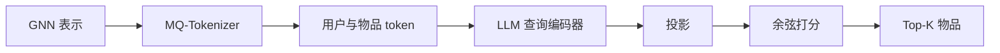

## At a Glance

Limitation: 新用户和新物品要重训协同过滤模型才能得到表示；只有编号器和 LLM 保持冻结（Sec. II-E.2）。

### 1. 为什么重要

基于 LLM 的推荐器需要 LLM 能读的用户 token 和物品 token（Abstract）。每个用户或物品一个 token，词表就随用户数和物品数一起膨胀（Sec. I）。作者还指出两点不足：现有 token 刻画不了高阶协同知识；对训练数据之外的用户或物品泛化差（Abstract）。TokenRec 从协同表示出发给用户和物品编号，并用检索替代自回归解码。

### 2. 方法

#### MQ-Tokenizer

基于 GNN 的协同过滤模型学习用户和物品表示，存进向量数据库（Sec. II-C.2）。

> "Specifically, our MQ-Tokenizer assigns each user and item a small number of discrete tokens generated by quantizing the GNN-based representations."（Sec. II-C.1）（量化 GNN 表示，给每个用户和物品分配少量离散 token。）

编号器随机遮盖表示，用 K 个独立的编码器编码，每个输出按各自的码本量化（Sec. II-C.2，Sec. II-C.3）。解码器把 K 个码字取平均，再用 MLP 重建协同表示（Sec. II-C.4，Eq. 9）。用户编号器和物品编号器分开训练。

> "we propose to randomly mask these representations to create a challenging task that enables the tokenizer to build a comprehensive understanding and generalize well."（Sec. II-C.2）（随机遮盖表示，加大任务难度，让编号器理解得更全面、泛化更好。）

#### 生成式检索

LLM 读入的提示含用户的 token，还可以含交互过的物品的 token；训练时这些物品 token 被打乱，不按时间顺序（Sec. II-D.2）。LLM 充当查询编码器。三层 MLP 投影它的隐藏状态，再与 GNN 物品表示算余弦相似度，给所有物品打分，取 top-K（Sec. II-D.3，Eqs. 17–19）。

### 3. 实验发现

- 主实验：在四个数据集上，TokenRec 好于传统推荐器和基于 LLM 的推荐器（Abstract，Tables 2 and 3）。
- 推理时间：作者把速度归因于用检索代替解码。

  > "This can be attributed to our generative retrieval paradigm, bypassing the most time-consuming auto-regressive decoding and beam search processes of LLMs [ 29 ] ."（Sec. III-D）（生成式检索绕过了 LLM 最耗时的自回归解码和束搜索。）

### 4. 局限与分析

**Our analysis.**

- TIGER 用 `Beam` 解码基于文本的 `RQ-VAE` ID；TokenRec 只用协同信号构建 token（`CF`），用 `Scoring` 排序，从不生成 ID。
- CID 也对协同信号编号（`CF`），但用 `Spectral Clus.`，以 `C-Beam` 解码；TokenRec 用 `Masked VQ` 和 `Encoder`。
