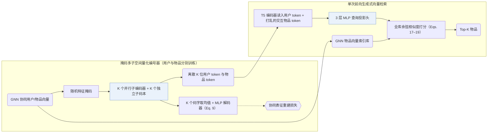

## At a Glance

Key Findings: 在 LastFM、MovieLens-1M、Amazon Beauty 与 Clothing 四个数据集上，TokenRec 全面超越协同、序列与 LLM 基线，并将单用户 top-20 推理耗时降至 5.76–8.43 ms（自回归束搜索基线为 76–102 ms）（Abstract，Tables 2, 3, and 5）。
Limitation: 面对新用户或新物品时，尽管编号器与 LLM 保持冻结，仍需重训上游 GNN 协同过滤模型以生成初始协同表征（Sec. II-E.2）。

### 1. 为什么重要

若为每个用户和物品各分配一个独立 token，LLM 词表会随用户与物品规模线性膨胀（Sec. I）；而纯文本编码又缺失高阶协同图结构，在训练集外的用户或物品上泛化受限（Abstract）。TokenRec 对随机掩码后的 GNN 协同表征做并行向量量化，将用户与物品表示为紧凑的离散语义 ID（Semantic ID，SID）组合，并以单次向量内积检索替代耗时的自回归束搜索。

### 2. 方法

#### MQ-Tokenizer

GNN 协同过滤模型预先学出用户与物品稠密向量并存入向量库（Sec. II-C.2）。独立训练的用户与物品 MQ-Tokenizer 先对输入向量施加随机掩码，再经 $`K`$ 个并行子编码器投影至各自的子码本量化（Sec. II-C.2，Sec. II-C.3）；解码端对选出的 $`K`$ 个码字取平均后经 MLP 重建原始协同向量（Sec. II-C.4，Eq. 9）。

> "Specifically, our MQ-Tokenizer assigns each user and item a small number of discrete tokens generated by quantizing the GNN-based representations."（Sec. II-C.1）

> "we propose to randomly mask these representations to create a challenging task that enables the tokenizer to build a comprehensive understanding and generalize well."（Sec. II-C.2）

#### 生成式检索

T5 骨干充当查询编码器，读入由用户 token 与历史交互物品 token 拼成的提示（训练时打乱历史物品顺序而不按时间排列）（Sec. II-D.2）。其输出隐状态经 3 层 MLP 投影后，直接与向量库中的全量 GNN 物品表征计算余弦相似度，单次前向选出 top-$`K`$ 候选（Sec. II-D.3，Eqs. 17–19）。

### 3. 实验发现

- 主结果对比：在四个基准的全库排序与未见用户评测中，TokenRec 均优于传统协同过滤、序列推荐及既有 LLM 推荐基线（Abstract，Tables 2–4）。
- 推理耗时：省去逐 token 自回归生成与束搜索后，单用户 top-20 推理延迟从 76–102 ms 大幅降至 5.76–8.43 ms（Sec. III-D，Table 5）。

  > "This can be attributed to our generative retrieval paradigm, bypassing the most time-consuming auto-regressive decoding and beam search processes of LLMs [ 29 ] ."（Sec. III-D）

### 4. 局限与分析

**Our analysis.**

- TIGER 用 `RQ-VAE` 量化纯文本（`Text`）并以 `Beam` 逐位解码；TokenRec 用 `Masked VQ` 量化双侧 `CF` 表征，通过稠密余弦 `Scoring` 一步召回，不逐位生成目标 ID。
- CID 同样离散化 `CF` 信号但采用 `Spectral Clus.` 与 `C-Beam` 自回归解码；TokenRec 则将 LLM 作为 `Encoder` 查询编码器使用。
