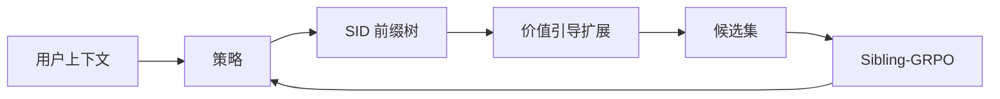

### 1. 为什么重要

对生成式推荐器做强化学习微调时，候选用束搜索这类按似然驱动的解码来采样（Abstract）。作者指出这样做的两个问题。低概率分支里的高奖励物品会被过早剪掉；共享高概率前缀的候选奖励相关，削弱了强化学习的比较信号。加大束宽也解决不了，多出的算力大多花在重复的高概率候选上（Sec. 1）。V-STAR 改的是强化学习候选的构造方式和优势的计算方式。

> "Our V-STAR primarily focuses on training-time improvement."（Sec. 4.4）（V-STAR 主要改进训练阶段。）

### 2. 方法

#### 价值头

价值头读取策略模型在每个语义 ID（Semantic ID，SID）前缀上的隐藏状态，预测它的价值（Sec. 4.1）。训练它所用的稠密语义回报，来自冻结文本编码器算出的物品嵌入。

#### 价值引导的高效解码

VED 把 SID 解码看作在固定算力预算下、在前缀树上构建候选集（Sec. 4.2）。先用按概率引导的束初始化前缀树。每个节点的优先级结合它的预测价值和策略熵；优先级高于同层平均值的节点新增一个子节点（Eq. 11）。新子节点从尚未展开的合法子节点中按归一化的策略概率采样。

> "We develop Value-Guided Efficient Decoding (VED) for budgeted candidate construction by allocating decoding compute to high-value and high-ambiguity nodes."（Sec. 1）（VED 把解码算力分给价值高、不确定性高的节点，在预算内构建候选。）

#### Sibling-GRPO

Sibling-GRPO 把每个父前缀下的子节点分成一组（Sec. 4.3）。每个子节点的分数是其后代候选的平均奖励，优势在兄弟节点之间归一化（Eq. 17）。

> "We introduce Sibling-GRPO, a tree-structured objective that uses sibling groups to mitigate advantage compression under correlated candidates."（Sec. 1）（用兄弟组缓解候选相关时的优势压缩。）

### 3. 实验发现

- 解码预算：在相同的训练期解码预算下，VED 在所测指标上好于束搜索（Sec. 5.5，Fig. 4）。预算按候选构建中模型计算的 token 数计，不是端到端延迟。
- 训练目标：GRPO 加 Sibling-GRPO 在所试目标中 NDCG 和 HR 最高（Sec. 5.4，Table 4）。

### 4. 局限与分析

**Our analysis.**

- MiniOneRec 用同样的 `RQ-VAE` SID、`Dec-Only` 生成器和 `NTP → RL` 训练；V-STAR 只改强化学习候选的采样方式和优势的计算方式。
