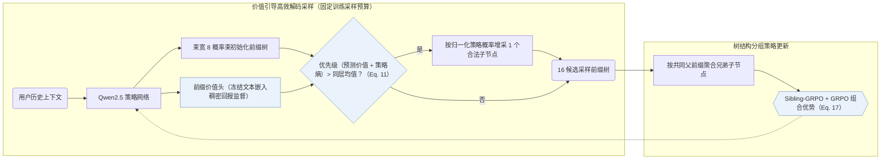
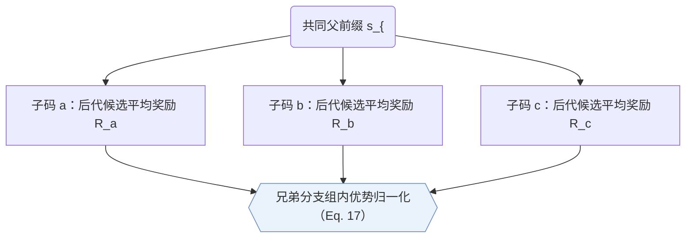

## At a Glance

Key Findings: 在相同训练期 token 计算预算下，V-STAR 在 Amazon Industrial 与 Office 上超越包括 MiniOneRec 在内的束搜索强化学习基线，并在微信视频号广告线上 A/B 测试中带来 +1.23% 的 GMV 提升（Sec. 5.3–5.5，Tables 1 and 4，Fig. 4）。
Limitation: 价值引导的前缀树扩展仅用于训练期强化学习候选采样，线上实时推理仍回退为常规似然束搜索（Sec. 4.4）。

### 1. 为什么重要

强化学习微调若用似然驱动的束搜索采样候选，既会在前几层过早剪掉低先验概率分支中的高回报物品，又会让大量候选挤在同一高概率前缀下导致奖励高度相关、优势信号被压缩（Abstract）；单纯拉大束宽只会把额外算力浪费在重复的头部路径上（Sec. 1）。V-STAR 在固定算力预算下向高价值、高熵前缀节点倾斜扩展，并在同一父前缀的兄弟分支间归一化优势。

> "Our V-STAR primarily focuses on training-time improvement."（Sec. 4.4）

### 2. 方法

#### 价值头

前缀价值头读取策略网络在每个语义 ID（Semantic ID，SID）前缀位置上的隐藏状态并预测期望回报，其稠密监督信号由冻结文本编码器计算的物品语义相似度给出（Sec. 4.1）。

#### 价值引导的高效解码

价值引导高效解码（VED）在固定 token 评估预算下构建候选前缀树（Sec. 4.2）：先用概率引导束搭起初始树骨架，再综合预测价值与策略熵计算各节点优先级；凡优先级高于同层均值的节点，从尚未展开的合法子节点中按归一化策略概率额外采样一个子节点（Eq. 11）。

> "We develop Value-Guided Efficient Decoding (VED) for budgeted candidate construction by allocating decoding compute to high-value and high-ambiguity nodes."（Sec. 1）

#### Sibling-GRPO

Sibling-GRPO 将同一父前缀下的直接子节点归为一个兄弟组，以各子节点后代候选的平均奖励作为分支得分，并在兄弟节点内部做优势归一化（Sec. 4.3，Eq. 17）。

> "We introduce Sibling-GRPO, a tree-structured objective that uses sibling groups to mitigate advantage compression under correlated candidates."（Sec. 1）

### 3. 实验发现

- 采样预算效率：在候选构建阶段消耗相同模型评估 token 数的条件下，VED 在 HR 与 NDCG 上稳定优于常规束搜索采样（Sec. 5.5，Fig. 4）。
- 目标消融与线上测试：将序列级 GRPO 与树结构 Sibling-GRPO 结合在 Industrial 与 Office 上取得全部对比目标中的最高精度（Sec. 5.4，Table 4），并在微信视频号广告 5 天线上 A/B 测试中实现 GMV +1.23% 增长（Sec. 5.3）。

### 4. 局限与分析

**Our analysis.**

- MiniOneRec 采用同类的 3 层 `RQ-VAE` SID、Qwen2.5 `Dec-Only` 骨干与 `NTP → RL` 约束束采样；V-STAR 保持推理结构不变，专门改造了 RL 阶段的树扩展算力分配与兄弟组相对优势估计。
