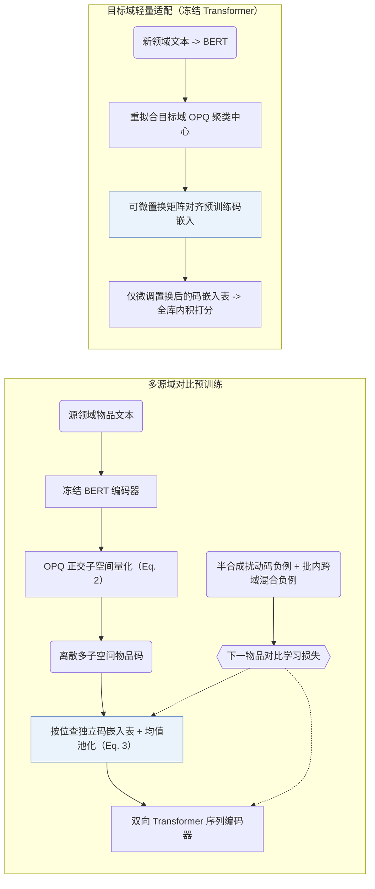

## At a Glance

Key Findings: 在五个 Amazon 源领域预训练后，VQ-Rec 在六个跨领域与跨平台下游基准上均位列第一或第二，并在所有热度分组（尤其是冷启动长尾组）上全面优于 SASRec（Sec. 3.4.3，Table 2，Fig. 4）。
Limitation: 若跳过目标领域的码嵌入表微调而直接零样本评估预训练编码器，下游推荐精度会大幅下滑（Sec. 3.3，Table 3）。

### 1. 为什么重要

直接将预训练语言模型（PLM）的连续文本向量送入可迁移序列推荐器，会使表征过度耦合表面文本风格并放大跨领域分布差异（Abstract，Sec. 4）。VQ-Rec 在文本编码与序列编码器之间插入优化乘积量化（`OPQ`）离散物品码，通过查表池化配合双向编码器完成全库判别打分（`Scoring`），其并行子空间离散编码机制被后续众多语义 ID（Semantic ID，SID）生成模型沿用（Sec. 2.1）。

### 2. 方法

#### 文本到码

冻结的 BERT 提取物品文本向量后，优化乘积量化（OPQ）将向量切分为多个正交子空间，在每个子空间内独立分配聚类中心索引（Sec. 2.2.1，Eq. 2），初始中心在全部源域文本上联合学得。

#### 码到表示

每个码位维护一张与 OPQ 聚类中心解耦的可学习码嵌入表，查出各子空间码嵌入后取均值即得物品表征（Sec. 2.2.2，Eq. 3）。

#### 对比预训练

Transformer 序列编码器编码历史物品表征序列，以真实下一物品为正例，结合随机替换部分码位的半合成负例与同批跨领域负例做对比预训练（Sec. 2.3，Sec. 2.3.1）；预训练期间 BERT 与 OPQ 索引固定，联合更新码嵌入表与 Transformer（Sec. 2.4）。

#### 跨域微调

迁移至新领域时，VQ-Rec 重新拟合目标域 OPQ 中心，用可微置换网络将其与已有码嵌入表对齐，随后冻结跨领域共享的 Transformer 编码器、仅微调置换后的码嵌入表（Sec. 2.4，Sec. 2.4.1）。同一领域内新上架物品只需编码文本并查表即可获得表征，无需重新训练（Sec. 2.4.2）。

> "During fine-tuning, we fix the Transformer sequence encoder (transferred across different domains), and only optimize the parameters involved in item representations, enabling parameter-efficient fine-tuning."（Sec. 2.4）

> "When a new item emerges, one can encode its item text into discrete indices, and then obtain the corresponding item representations by embedding lookup."（Sec. 2.4.2）

### 3. 实验发现

- 跨域与跨平台迁移：在六个 Amazon 与 Online Retail 下游数据集上，VQ-Rec 相比基于 ID、基于文本及既有可迁移序列推荐基线全部取得最优或次优表现（Table 2）。
- 预训练与微调消融：省去下游码表微调会导致性能骤降；去掉多源域预训练在全部六个测试集上同样造成一致退化（Sec. 3.3，Table 3）。
- 热度分组分析：在按交互频次划分的所有物品热度组中，VQ-Rec 均优于 SASRec，在低频冷启动组优势最大（Sec. 3.4.3，Fig. 4）。

  > "VQ-Rec has better performance than SASRec in all groups, especially in cold-start groups."（Sec. 3.4.3）

### 4. 局限与分析

**Our analysis.**

- ActionPiece 与 RPG 同样建立在无序 `OPQ` 子空间码之上：ActionPiece 合并共现码片做 `Enc-Dec` 生成，RPG 在合法物品图上并行解码长 `OPQ` 码；VQ-Rec 则用 `Encoder` 对池化码嵌入做全库判别打分（`Scoring`）。
- UTGRec 同样面向多领域迁移（`Multi-Dom`），但以树结构码本（`Tree`）与自回归 `Beam` 解码替代了 OPQ 查表打分。
