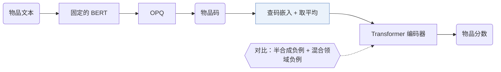

### 1. 为什么重要

可迁移推荐器用预训练语言模型（PLM）编码物品文本，把编码直接当作物品表示（Abstract）。作者认为，这种紧绑定过于强调文本特征，放大了领域差异的影响（Abstract，Sec. 4）。VQ-Rec 在文本和表示之间插入离散码：物品文本先映射成一个离散索引向量，即物品码，再用这个码到嵌入表里查出物品表示（Sec. 2.1）。VQ-Rec 是判别式序列推荐器，不是生成式的；后来的语义 ID（Semantic ID，SID）论文沿用了它的编码方案。

### 2. 方法

#### 文本到码

固定的 BERT 编码器嵌入物品文本，优化乘积量化（OPQ）把嵌入切成若干子空间，在每个子空间里独立分配一个索引（Sec. 2.2.1，Eq. 2）。PQ 中心从所有训练领域的文本编码中学得。

#### 码到表示

码的每一位有自己的码嵌入表，物品表示是查出的各嵌入的平均（Sec. 2.2.2，Eq. 3）。码嵌入和 PQ 中心是两套独立的参数。

#### 对比预训练

Transformer 编码物品表示组成的序列（Sec. 2.3.1）。真实的下一物品是正例。半合成负例随机替换物品码的一部分，混合领域负例是同批的其他物品（Sec. 2.3）。预训练更新码嵌入和 Transformer；BERT 固定，PQ 事先算好（Sec. 2.4）。

#### 跨域微调

到新领域时，VQ-Rec 重新训练 PQ 中心，用可微的置换网络把它们和已有的码嵌入对齐，再微调置换后的嵌入表（Sec. 2.4.1）。

> "During fine-tuning, we fix the Transformer sequence encoder (transferred across different domains), and only optimize the parameters involved in item representations, enabling parameter-efficient fine-tuning."（Sec. 2.4）（微调时固定跨领域迁移的 Transformer，只优化物品表示相关的参数。）

已知领域里出现新物品时不需要重训。

> "When a new item emerges, one can encode its item text into discrete indices, and then obtain the corresponding item representations by embedding lookup."（Sec. 2.4.2）（新物品的文本编码成离散索引，查嵌入表即得表示。）

### 3. 实验发现

- 主实验：在跨领域和跨平台设置下，VQ-Rec 在六个下游数据集上都是最好或第二好（Table 2）。
- 消融：不微调预训练模型，效果大幅下降；去掉预训练，所有测试数据集上的结果也都下降（Sec. 3.3，Table 3）。
- 热度分组：在每个物品热度分组中，VQ-Rec 都好于 SASRec（Sec. 3.4.3，Fig. 4）。

  > "VQ-Rec has better performance than SASRec in all groups, especially in cold-start groups."（Sec. 3.4.3）（各组都好于 SASRec，冷启动组尤其明显。）

### 4. 局限与分析

**Our analysis.**

- ActionPiece 从同类的 `OPQ` 码出发，但把码合并成依赖上下文的 token，用 `Enc-Dec` 生成器生成；VQ-Rec 用 `Encoder` 给物品打分（`Scoring`）。
- UTGRec 也面向多领域迁移（`Multi-Dom`），但用 `Tree` 编号器替代乘积量化，用 `Beam` 解码。
