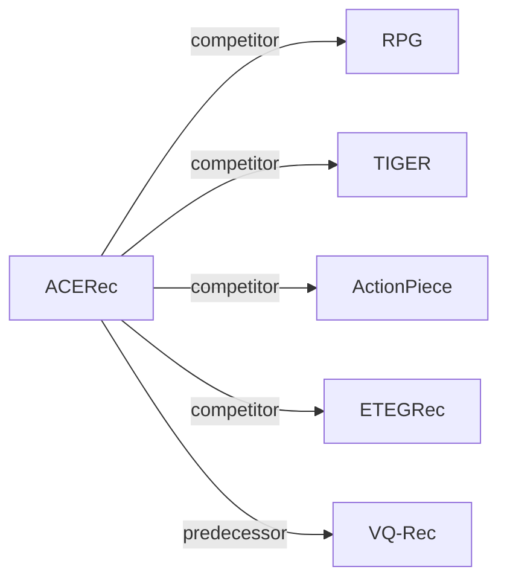

# ACERec

*Unleash the Potential of Long Semantic IDs for Generative Recommendation* — Xia et al. · arXiv’26

`V. Efficiency` · `Backbone` · [Paper](https://arxiv.org/abs/2602.13573) · [Matrix](../../README.md#v--backbone) · [中文](../zh/papers/acerec.md)

Reading level: Overview (Level 1) · On this page: [TL;DR](#tldr) · [At a Glance](#at-a-glance) · [3. Experiments](#3-experimental-findings) · [5. Related Work](#5-connections-to-related-work)

- `Non-AR`: Non-autoregressive.
- `Fixed`: SIDs are built first and not changed while the generator trains.
- `MTP + Ctr. + Aux.`: Multi-token prediction jointly optimized with contrastive and auxiliary objectives.

### TL;DR

> [!NOTE]
> ACERec compresses long Semantic IDs into compact latent tokens with an Attentive Token Merger and adds an Intent Token with a dual-granularity objective, to keep long-ID expressiveness at short-ID cost.

### At a Glance

| Aspect | Summary |
| :-- | :-- |
| Research Problem | V. Efficiency: Can it be trained and served within latency and cost budgets? |
| Key Contribution | ACERec compresses long Semantic IDs into compact latent tokens with an Attentive Token Merger and adds an Intent Token with a dual-granularity objective, to keep long-ID expressiveness at short-ID cost. |
| Modified Stage | Backbone |

### 3. Experimental Findings

Experimental setup

- **Datasets**: Nine Amazon domains: Sports, Beauty, Toys, CDs, Office, Pets, Baby (2014 edition) and Science, Instruments (2023 edition); users with fewer than 5 interactions excluded; training histories truncated to the 50 most recent items. Sizes: Appendix Table 5 (not restated here).
  - Source: Nine Amazon domains and preprocessing: [S4.SS1.p1](https://arxiv.org/html/2602.13573v2#S4.SS1.p1), [A1.SS3.p1](https://arxiv.org/html/2602.13573v2#A1.SS3.p1), [A1.SS3.p2](https://arxiv.org/html/2602.13573v2#A1.SS3.p2).
- **Split**: Chronological leave-last-out: last interaction for test, second-to-last for validation, the rest for training.
  - Source: Leave-last-out allocation: [S4.SS1.p1](https://arxiv.org/html/2602.13573v2#S4.SS1.p1).
- **Candidates**: full catalog (exact scoring over the entire item pool).
  - Source: Full candidate ranking: [S4.SS1.p3](https://arxiv.org/html/2602.13573v2#S4.SS1.p3) and [S3.SS3.p1](https://arxiv.org/html/2602.13573v2#S3.SS3.p1).
- **Visibility**: warm; no unseen-item protocol is defined. The cold-start analysis buckets test items by training frequency [0, 5] to [16, 20], mixing zero-frequency and low-frequency items; tokenizer exposure is not separated.
  - Source: Frequency buckets of test items in training: [S4.SS5.p1](https://arxiv.org/html/2602.13573v2#S4.SS5.p1).
- **SID**: OPQ semantic IDs with m=32 orthogonal subspaces (8 to 64 tested), each with its own codebook of size M (value not restated); an Attentive Token Merger compresses the 32 tokens into 4 latent tokens for the sequence model. Collision handling: not reported.
  - Source: OPQ long semantic IDs m=32 with subspace codebooks: [S3.SS1.SSSx1.p1](https://arxiv.org/html/2602.13573v2#S3.SS1.SSSx1.p1) and [S4.SS3.p3](https://arxiv.org/html/2602.13573v2#S4.SS3.p3); no collision rule found.
- **Inference budget**: No beam search: per-subspace log-probabilities are computed once and every candidate is scored by gathering and summing its code log-probabilities (exact full-catalog scoring). Hardware, inference batch size, and measured latency: not reported in the main text.
  - Source: Parallel subspace matching and score gathering: [S3.SS3.p1](https://arxiv.org/html/2602.13573v2#S3.SS3.p1), [S3.SS3.p3](https://arxiv.org/html/2602.13573v2#S3.SS3.p3), [S3.SS3.p5](https://arxiv.org/html/2602.13573v2#S3.SS3.p5).
- **Results from**: Tables 1-2 (six representative datasets versus ID-based and semantic-ID baselines; the other three in Appendix C.1; HGN, SASRec, S3-Rec, TIGER on Sports, Beauty, Toys copied from the TIGER paper, others reproduced); Figure 3 (semantic ID length); Figure 5 (cold-start buckets on Pets and Baby).
  - Source: Main: [S3.T1](https://arxiv.org/html/2602.13573v2#S3.T1) and [S3.T2](https://arxiv.org/html/2602.13573v2#S3.T2), scope stated in [S4.SS2.p1](https://arxiv.org/html/2602.13573v2#S4.SS2.p1); ID length: [S4.F3](https://arxiv.org/html/2602.13573v2#S4.F3); cold start: [S4.F5](https://arxiv.org/html/2602.13573v2#S4.F5); copied baselines: [A1.SS4.p1](https://arxiv.org/html/2602.13573v2#A1.SS4.p1).

### 5. Connections to Related Work

- **Competitor** · [RPG](rpg.md): RPG predicts long OPQ IDs in parallel and decodes over an item graph; ACERec compresses the long IDs into a few latent tokens for sequence modeling and scores all items exactly.
  - Source: ACERec v2, baselines: https://arxiv.org/html/2602.13573v2#S4.SS1.p2; Tables 1-2: https://arxiv.org/html/2602.13573v2#S3.T1 and https://arxiv.org/html/2602.13573v2#S3.T2; ID-length comparison: https://arxiv.org/html/2602.13573v2#S4.SS3.p3.
- **Competitor** · [TIGER](tiger.md): TIGER generates short RQ-VAE IDs by beam search; ACERec uses long OPQ IDs with parallel scoring.
  - Source: ACERec v2, baselines: https://arxiv.org/html/2602.13573v2#S4.SS1.p2; Table 1 (numbers copied from TIGER): https://arxiv.org/html/2602.13573v2#S3.T1 and https://arxiv.org/html/2602.13573v2#A1.SS4.p1.
- **Competitor** · [ActionPiece](actionpiece.md): ActionPiece merges feature tokens contextually; ACERec merges long OPQ codes into latent tokens with attention.
  - Source: ACERec v2, baselines: https://arxiv.org/html/2602.13573v2#S4.SS1.p2; Tables 1-2: https://arxiv.org/html/2602.13573v2#S3.T1 and https://arxiv.org/html/2602.13573v2#S3.T2.
- **Competitor** · [ETEGRec](etegrec.md): ETEGRec learns the tokenizer end to end; ACERec keeps fixed OPQ codes and compresses them.
  - Source: ACERec v2, baselines: https://arxiv.org/html/2602.13573v2#S4.SS1.p2; Tables 1-2: https://arxiv.org/html/2602.13573v2#S3.T1 and https://arxiv.org/html/2602.13573v2#S3.T2.
- **Predecessor** · [VQ-Rec](vq-rec.md): ACERec follows VQ-Rec and RPG in using OPQ-based semantic IDs and their evaluation protocol.
  - Source: ACERec v2, Section 4.1 protocol follows Hou et al. (2023): https://arxiv.org/html/2602.13573v2#S4.SS1.p1; related work: https://arxiv.org/html/2602.13573v2#S2.p1.

[View all papers in this cell](../../README.md#v--backbone)
