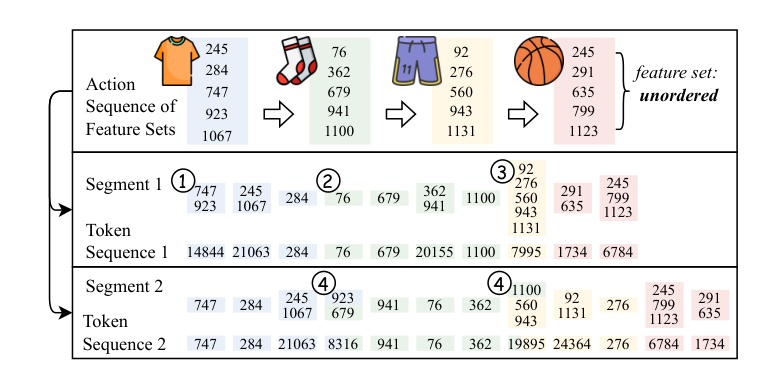

# ActionPiece: ActionPiece: Contextually Tokenizing Action Sequences for Generative Recommendation

[Back to Catalog](../../README.md) · [Paper (`https://arxiv.org/abs/2502.13581`)](https://arxiv.org/abs/2502.13581) · [Source Record (`data/papers/actionpiece.yaml`)](../../data/papers/actionpiece.yaml)

> **Summary**: Abstract: "without considering contextual relationships".

## Taxonomy & Table 1 Specification

| Field | Value | Vocabulary Definition |
| :--- | :--- | :--- |
| **Authors & Year** | Hou et al. (2025) | Published / posted in `ICML’25` |
| **Problem Band** | `I. Informativeness` | Do the SIDs, or the model reading them, carry the collaborative and multimodal signals recommendation needs? |
| **Primary Stage** | `Tokenization` | The primary design change sits in the Tokenization stage. |
| **Representation** | `Text` |  |
| **Tokenization** | `OPQ` | Optimized product quantization. |
| **Backbone** | `Enc-Dec` | Encoder-decoder. |
| **Tokenizer Training** | `Fixed` | SIDs are built first and not changed while the generator trains. |
| **Training Objective** | `NTP` | Next-token prediction loss only; continuing from a pretrained LLM (SFT) also counts as NTP. |
| **Inference Decoding** | `Ensemble` |  |
| **POI / Local-Life** | `false` | Point-of-interest / geographic recommendation indicator |
| **Code Repository** | [`https://github.com/google-deepmind/action_piece`](https://github.com/google-deepmind/action_piece) | Official or public implementation link |

## Architecture

## Verbatim Evidence & Rationale

- **`problem`** (arXiv abstract): Abstract: "without considering contextual relationships".

## 旧卡片说明

迁自 `d61aa6c:papers/actionpiece.md`。保留方法说明、实验叙述与局限；本轮只对照现有记录处理明确冲突，未重新逐句核查原论文。分类和规格以页面上方由记录生成的表格为准。

### ActionPiece：上下文动作序列分词

> ActionPiece 根据同一动作内及相邻动作间的特征共现关系压缩行为序列，减少生成式推荐中的序列长度。

### 研究动机与问题定义

将每个动作展开为多个特征 token 会造成序列过长，并损失动作上下文。ActionPiece 关注的是行为序列的上下文分词效率，重点在已有物品特征的上下文组合。

### TL;DR（核心摘要）

`动作序列 → 共现统计 → ActionPiece 词表 → 序列压缩 → 生成式推荐输入`

方法按加权共现关系迭代合并 token，并用集合排列正则减轻特征顺序影响。生成模型接收压缩后的动作序列。

### 输入与使用场景

| 方面 | 说明 |
|---|---|
| 使用信息 | 动作中的物品特征及动作顺序 |
| 信息融入位置 | 行为序列分词与模型输入 |
| 语义标识结构 | 不适用 |
| 适用场景 | 长行为序列推荐 |

### 方法设计

#### 3.1 问题定义（Problem Formulation）
ActionPiece 将一次用户动作表示为无序物品特征集合，把一段行为历史表示为特征集合序列。目标是为动作序列学习更短且包含上下文的 token 序列。

#### 3.2 上下文动作序列分词器
词表从每个特征 token 初始化，通过统计同一集合内部和相邻集合之间的共现关系，反复合并高权重 token 对。由于集合内部无序，论文引入集合排列分段策略，为同一动作产生多个等价分词结果。

#### 3.3 生成式推荐模型
压缩后的 ActionPiece 序列被送入生成式推荐模型训练。推理时模型生成动作 token，再解析回推荐动作/物品。论文还使用多种分段结果进行推理时集成，以降低某一种分段方式的偶然影响。

#### 3.4 讨论与实验
实验分别考察序列长度、词表规模、token 利用率、分段策略和案例。该方法的核心对象是动作 token。

### 实验结论

- ActionPiece 能缩短动作序列，并改善 token 利用率。
- 上下文加权和集合排列正则对分词质量有贡献。

### 局限性与研究定位

#### 局限性
- 对最终推荐物品的直接可解释映射不是论文重点。

#### 研究定位
ActionPiece 更适合放在“生成式推荐的行为序列建模与分词”章节。

### 相关资源

- [论文原文](https://arxiv.org/abs/2502.13581)
- [开源代码](https://github.com/google-deepmind/action_piece)

### 标签

`动作序列分词` · `子词合并` · `序列推荐`

### 架构图来源

*图源：原论文，图1（[论文原文](https://arxiv.org/abs/2502.13581)）。图片使用许可待核实。*

---

### 检索方式补充

迁自 `d61aa6c:tables/boundary-and-excluded-methods.md` 的机制说明。

重点是动作序列上下文分词；沿用的物品特征构码和生成配置见当前记录。

旧表的“核心／边界／排除”分组已由当前问题与阶段分类取代。

## Peer Methods in `I. Informativeness` × `Tokenization` (33 peers)

| Method | Venue | Representation | Tokenization | Backbone | Tokenizer | Objective | Inference |
| :--- | :--- | :--- | :--- | :--- | :--- | :--- | :--- |
| [CoST](cost.md) | RecSys’24 | `Text` | `C-RQ` | `Enc-Dec` | `Fixed` | `NTP` | `Beam` |
| [LETTER](letter.md) | CIKM’24 | `Text+CF` | `Learn. RQ` | `Enc-Dec` | `Fixed` | `NTP + Rank` | `C-Beam` |
| [LMIndexer](lmindexer.md) | ICML’24 | `Text` | `Self-Sup. ID` | `Enc-Dec` | `Fixed` | `NTP` | `C-Beam` |
| [ADC-SID](adc-sid.md) | arXiv’25 | `Text+Img+CF` | `MoE-VQ` | `Enc-Dec` | `Fixed†` | `NTP` | `–` |
| [DAS](das.md) | CIKM’25 | `Text+CF` | `Dual RQ` | `Enc-Dec` | `Fixed` | `NTP` | `Beam` |
| [EAGER-LLM](eager-llm.md) | WWW’25 | `Text+CF` | `Dual H-KM` | `Dec-Only` | `Fixed` | `Multi-task NTP` | `Beam` |
| [FlexCode](flexcode.md) | arXiv’25 | `Text+CF` | `Dual RQ-VAE` | `–` | `Joint` | `NTP` | `–` |
| [GenSAR](gensar.md) | RecSys’25 | `Text+CF` | `Shared/Spec. RQ` | `Enc-Dec` | `Fixed` | `Multi-task NTP` | `C-Beam` |
| [GNPR-SID](gnpr-sid.md) | KDD’25 | `Attr+Geo+CF` | `RQ-VAE` | `Dec-Only` | `Fixed` | `NTP` | `–` |
| [GRAM](gram.md) | ACL’25 | `Text+CF` | `H-KM` | `Enc-Dec` | `Fixed` | `NTP` | `C-Beam` |
| [KGTB](kgtb.md) | arXiv’25 | `Attr+Geo+CF` | `KG-RQ` | `Dec-Only` | `Fixed` | `Multi-task NTP` | `–` |
| [MME-SID](mme-sid.md) | CIKM’25 | `Text+Img+CF` | `MM-RQ` | `Dec-Only` | `Fixed` | `NTP` | `Scoring` |
| [MQL4GRec](mql4grec.md) | ICLR’25 | `Text+Img` | `Dual RQ` | `Enc-Dec` | `Fixed` | `Multi-task NTP` | `Beam` |
| [PSRQ](psrq.md) | CIKM’25 | `Text+Img` | `Prog. RQ` | `Encoder` | `Fixed` | `Discrim.` | `Scoring` |
| [QT-Mob](qt-mob.md) | KDD’25 | `Text+Geo` | `RQ-VAE` | `Dec-Only` | `Fixed` | `Multi-task NTP` | `C-Beam` |
| [TokenRec](tokenrec.md) | TKDE’25 | `CF` | `Masked VQ` | `Encoder` | `Fixed` | `Discrim.` | `Scoring` |
| [CapsID](capsid.md) | arXiv’26 | `Text+CF` | `Soft-RQ` | `Dec-Only` | `Fixed` | `NTP` | `C-Beam` |
| [ChronoID](chronoid.md) | arXiv’26 | `Text+Time` | `RQ-VAE / Par. VQ` | `Dec-Only†` | `Fixed` | `NTP` | `Beam†` |
| [GrIS (RecDMoN / RQ-GAE)](gris-recdmon-rq-gae.md) | CIKM’26 | `Text+CF` | `RecDMoN / RQ-VAE` | `Enc-Dec` | `Fixed` | `–` | `–` |
| [MACRec](macrec.md) | AAAI’26 | `Text+Img` | `Cross RQ` | `Enc-Dec` | `Fixed` | `NTP + Ctr.` | `C-Beam` |
| [MMGRec](mmgrec.md) | TOMM’26 | `Text+Img+CF` | `Graph RQ-VAE` | `Enc-Dec` | `Fixed` | `NTP` | `C-Beam` |
| [MMQ](mmq.md) | WSDM’26 | `Text+Img` | `MoE-VQ` | `HeterRec` | `Joint` | `MTP` | `–` |
| [MSCGRec](mscgrec.md) | arXiv’26 | `Text+Img+CF` | `RQ-VAE+DINO` | `Enc-Dec` | `Fixed†` | `NTP` | `Trie/C-Beam` |
| [PCR-CA](pcr-ca.md) | KDD’26 | `Text+CF` | `PC-AE` | `Disc.` | `Joint` | `Discrim.` | `Scoring` |
| [Pctx](pctx.md) | CIKM’26 | `Text+CF` | `RQ` | `Enc-Dec` | `Fixed` | `NTP` | `Beam+Agg.` |
| [ProGEO](progeo.md) | arXiv’26 | `Text+Geo` | `R-KM+Geo-CB` | `Dec-Only` | `Fixed` | `NTP` | `Beam+Geo-Filter` |
| [RoFiGR](rofigr.md) | arXiv’26 | `Text+Img+CF` | `CF-Aligned MM RQ` | `Enc-Dec` | `Fixed` | `NTP + Aux.` | `C-Beam` |
| [ROS](ros.md) | ACL’26 | `Text+Geo` | `Geo-Prefix+RQ-VAE` | `Dec-Only` | `Fixed` | `NTP → RL` | `CoT+C-Beam` |
| [SPRIG](sprig.md) | CIKM’26 Short | `Text / Audio` | `R-KM` | `Dec-Only` | `Fixed` | `NTP` | `Div. Beam` |
| [Tlow](tlow.md) | CIKM’26 Applied | `Text` | `Flow+PQ` | `Non-AR` | `Fixed` | `MTP + Rel.MSE` | `Scoring` |
| [UniRec](unirec.md) | arXiv’26 | `Text+CF` | `RQ` | `Dec-Only` | `Fixed` | `NTP → DPO` | `C-Beam` |
| [UniSID](unisid.md) | arXiv’26 | `Text+Img+Attr` | `Direct SID Heads` | `–` | `–` | `–` | `–` |
| [VarLenRec (TIGER)](varlenrec-tiger.md) | arXiv’26 | `Text` | `HARQ` | `Enc-Dec` | `Fixed` | `NTP + Aux.` | `C-Beam` |
