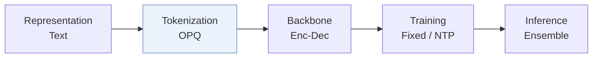
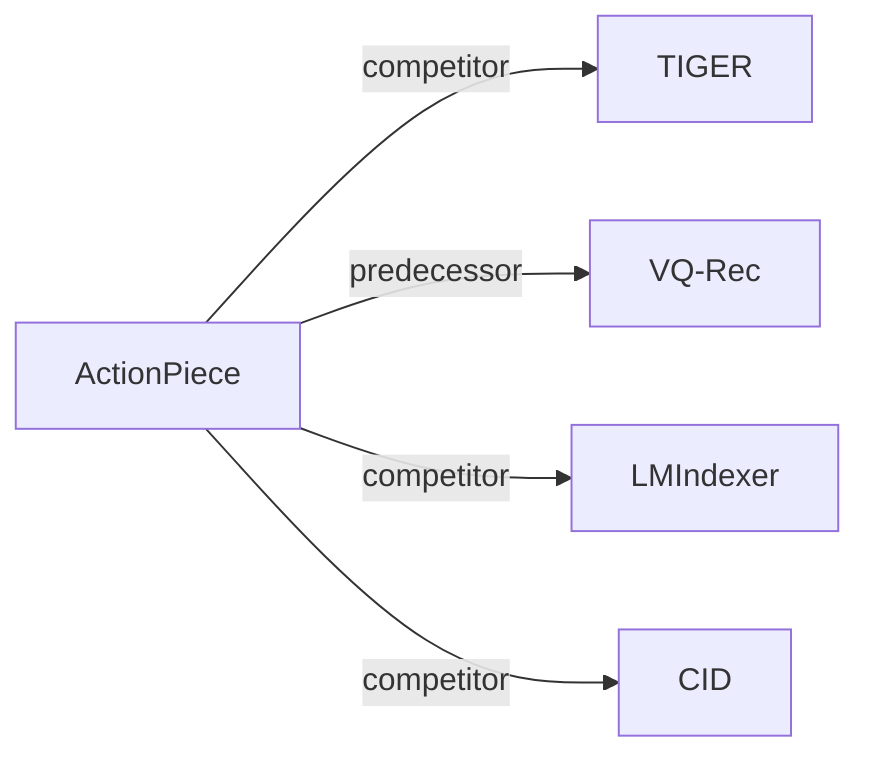

# ActionPiece

| **Title** | *Contextually Tokenizing Action Sequences for Generative Recommendation* |
| :-- | :-- |
| **Authors** | Hou et al. |
| **Venue** | ICML’25 |
| **Problem × Stage** | `I. Informativeness` · `Tokenization` |
| **Links** | [Paper](https://arxiv.org/abs/2502.13581) · [Code](https://github.com/google-deepmind/action_piece) · [Matrix](../../README.md#i--tokenization) · [中文](../zh/papers/actionpiece.md) |
| **Reading level** | Reading Notes (Level 2) |

On this page: [TL;DR](#tldr) · [At a Glance](#at-a-glance) · [1. Why It Matters](#1-why-this-paper-matters) · [2. Method](#2-how-it-works) · [3. Experiments](#3-experimental-findings) · [4. Limitations](#4-limitations--critical-analysis) · [5. Related Work](#5-connections-to-related-work)

- `OPQ`: Optimized product quantization.
- `Enc-Dec`: Encoder-decoder.
- `Fixed`: SIDs are built first and not changed while the generator trains.
- `NTP`: Next-token prediction loss only; continuing from a pretrained LLM (SFT) also counts as NTP.

### TL;DR

> [!NOTE]
> ActionPiece represents each action as a set of item features and merges co-occurring feature patterns into new tokens, so identical actions get context-dependent tokens instead of fixed independent ones.

---

### At a Glance

| Aspect | Summary |
| :-- | :-- |
| Research Problem | I. Informativeness: Do the SIDs, or the model reading them, carry the collaborative and multimodal signals recommendation needs? |
| Key Contribution | ActionPiece represents each action as a set of item features and merges co-occurring feature patterns into new tokens, so identical actions get context-dependent tokens instead of fixed independent ones. |
| Modified Stage | Tokenization |

---

### 1. Why This Paper Matters

Existing generative recommendation (GR) models tokenize each action on its own, so an action gets the same tokens in every sequence (Abstract). The authors argue that the same action can mean different things in different contexts (Abstract). ActionPiece lets the surrounding actions decide how an action is tokenized.

> "However, existing GR models tokenize each action independently, assigning the same fixed tokens to identical actions across all sequences without considering contextual relationships." (Abstract)

---

### 2. How It Works

#### Actions as Feature Sets

Each action is an unordered set of item features, so a user history is a sequence of feature sets (Abstract).

#### Vocabulary Construction

Merges are counted both within individual sets and across adjacent sets (Abstract). The two kinds of token pairs receive different weights (Sec. 1).

> "Considering the structural differences between token pairs, e.g., whether they occur within a single set or between two adjacent sets, we assign different weights to different pairs." (Sec. 1)

#### Set Permutation Regularization

Because feature sets are unordered, set permutation regularization produces multiple segmentations of the same action sequence with the same semantics (Abstract). These segmentations augment the training data and are ensembled at inference (Sec. 3.2.2).

---

### 3. Experimental Findings

Experimental setup

- **Datasets**: Amazon Reviews: Sports and Outdoors, Beauty, and CDs and Vinyl. Users with fewer than 5 reviews are filtered; an item-frequency filter is not reported. Processed sizes (users / items / actions): Sports 35,598 / 18,357 / 260,739; Beauty 22,363 / 12,101 / 176,139; CDs 75,258 / 64,443 / 1,022,334.
  - Source: Dataset categories: [S4.SS1.p1](https://arxiv.org/html/2502.13581v3#S4.SS1.p1); user filter and truncation: [A6.p2](https://arxiv.org/html/2502.13581v3#A6.p2); processed sizes: [S3.T3](https://arxiv.org/html/2502.13581v3#S3.T3).
- **Split**: Per-user chronological leave-last-out: last item for test, second-to-last for validation, earlier items for training. Histories are truncated to 20 items for generative methods and 50 items for ID-based and feature-enhanced baselines.
  - Source: Leave-last-out allocation: [S4.SS1.p1](https://arxiv.org/html/2502.13581v3#S4.SS1.p1); history truncation: [A6.p2](https://arxiv.org/html/2502.13581v3#A6.p2).
- **Candidates**: not reported (full catalog versus sampled evaluation candidates); top-K lists are produced by beam search.
  - Source: Evaluation settings name metrics only: [S4.SS1.p3](https://arxiv.org/html/2502.13581v3#S4.SS1.p3); top-K lists come from beam search: [A8.p4](https://arxiv.org/html/2502.13581v3#A8.p4).
- **Visibility**: warm; no unseen-item protocol is defined.
  - Source: Standard leave-last-out protocol with no cold-start experiment: [S4.SS1.p1](https://arxiv.org/html/2502.13581v3#S4.SS1.p1).
- **SID**: Each item is an unordered set of 4 OPQ codes x 256 codewords (sentence-t5-base text embeddings) plus 1 extra identification code to prevent conflicts. ActionPiece then merges co-occurring feature sets into a context-dependent vocabulary of 40,000 tokens (tuned over 5k-40k), so the same item can map to different tokens in different sequences.
  - Source: OPQ features, 256 codewords per digit, extra identification code: [A6.I1.i3.p1](https://arxiv.org/html/2502.13581v3#A6.I1.i3.p1); vocabulary size 40,000 and tuning range: [A7.T7](https://arxiv.org/html/2502.13581v3#A7.T7) and [A8.p2](https://arxiv.org/html/2502.13581v3#A8.p2).
- **Inference budget**: Beam search with beam size 50; inference-time ensemble over q=5 set-permutation segmentations, with item scores averaged across the 5 ranking lists. Recall and NDCG at K=5 and 10. Inference hardware, inference batch size, and measured latency: not reported (each model is trained on one 40GB NVIDIA A100; the paper states only that latency stays comparable when segments run in parallel).
  - Source: Beam size 50 and q=5 segmentations: [A8.p2](https://arxiv.org/html/2502.13581v3#A8.p2) and [A7.T7](https://arxiv.org/html/2502.13581v3#A7.T7); score averaging: [S3.SS3.SSS2.p1](https://arxiv.org/html/2502.13581v3#S3.SS3.SSS2.p1); GPU statement is for training: [A8.p3](https://arxiv.org/html/2502.13581v3#A8.p3); qualitative latency statement: [S3.SS4.p3](https://arxiv.org/html/2502.13581v3#S3.SS4.p3).
- **Results from**: Table 4 (main comparison on Sports, Beauty, and CDs; averages over five seeds); Table 5 (ablations, including TIGER with varied vocabulary sizes); Figures 4-6 (vocabulary size, token utilization, and ensemble size). BERT4Rec, SASRec, FDSA, S3-Rec, TIGER, and LMIndexer numbers on Sports and Beauty are copied from earlier papers; other results are the authors' reimplementations.
  - Source: Main table: [S3.T4](https://arxiv.org/html/2502.13581v3#S3.T4) and [S4.SS2.p1](https://arxiv.org/html/2502.13581v3#S4.SS2.p1); ablation: [S4.T5](https://arxiv.org/html/2502.13581v3#S4.T5); five seeds: [S4.SS1.p3](https://arxiv.org/html/2502.13581v3#S4.SS1.p3); copied baseline numbers: [A8.p1](https://arxiv.org/html/2502.13581v3#A8.p1).

- Vocabulary size: a larger vocabulary improves recommendation performance and reduces the normalized sequence length (NSL) (Sec. 4.4.1, Fig. 4). The authors describe vocabulary size as a trade-off between performance, sequence length, and memory efficiency (Sec. 4.4.1).
- Ablation: the gain does not come from vocabulary size alone (Sec. 4.3, Table 5).

  > "These results suggest that the performance improvement of ActionPiece is not simply due to scaling the vocabulary size up or down." (Sec. 4.3)

- Token usage: deriving different tokens for the same item from its neighbors improves token usage and acts as data augmentation (Sec. 4.3).
- Other analyses: the paper studies token usage (Sec. 4.4.2), the ensemble size (Fig. 6), and case examples (Sec. 4.5).

---

### 4. Limitations & Critical Analysis

**Our analysis.**

- Inference ranks several segmentations and averages the scores. This suggests that decoding cost grows with the ensemble size unless the segmentations run in parallel.
- VQ-Rec uses `OPQ` codes in an `Encoder` with `Scoring`; ActionPiece starts from the same kind of codes but generates merged tokens with an `Enc-Dec` generator.

---

### 5. Connections to Related Work

- **Competitor** · [TIGER](tiger.md): TIGER tokenizes each item independently into ordered RQ-VAE codes, whereas ActionPiece merges unordered feature sets into context-dependent tokens; both use the same encoder-decoder and beam search.
  - Source: ActionPiece v3, Section 4.1 baselines: https://arxiv.org/html/2502.13581v3#S4.SS1.p2; Table 4: https://arxiv.org/html/2502.13581v3#S3.T4; same architecture statement: https://arxiv.org/html/2502.13581v3#A8.p2.
- **Predecessor** · [VQ-Rec](vq-rec.md): ActionPiece follows VQ-Rec in quantizing sentence embeddings with OPQ into unordered codes, then builds a merged contextual vocabulary over those codes for generation.
  - Source: ActionPiece v3, Appendix F follows Hou et al. (2023) for OPQ features: https://arxiv.org/html/2502.13581v3#A6.I1.i3.p1; VQ-Rec is a Table 4 baseline: https://arxiv.org/html/2502.13581v3#S3.T4.
- **Competitor** · [LMIndexer](lmindexer.md): LMIndexer learns text-based semantic indexes item by item, while ActionPiece tokenizes whole action sequences with context-aware merges.
  - Source: ActionPiece v3, Table 1 and Section 4.1 baselines: https://arxiv.org/html/2502.13581v3#S1.T1 and https://arxiv.org/html/2502.13581v3#S4.SS1.p2; Table 4: https://arxiv.org/html/2502.13581v3#S3.T4.
- **Competitor** · [CID](cid.md): P5-CID builds item IDs by hierarchical clustering, independent of sequence context; ActionPiece's tokens depend on neighboring actions.
  - Source: ActionPiece v3, Table 1 and Section 4.1 baselines: https://arxiv.org/html/2502.13581v3#S1.T1 and https://arxiv.org/html/2502.13581v3#S4.SS1.p2; Table 4: https://arxiv.org/html/2502.13581v3#S3.T4.

[View all papers in this cell](../../README.md#i--tokenization)
