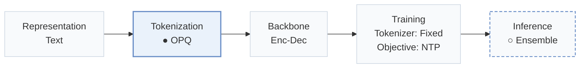
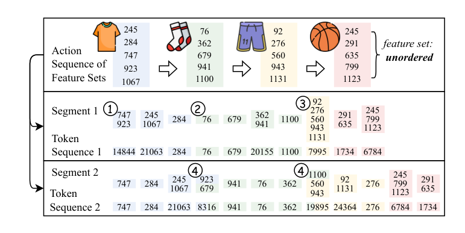
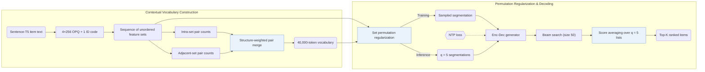
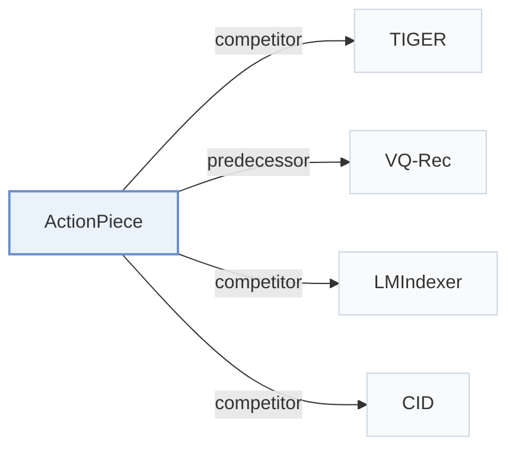

# ActionPiece

[← Problem × Stage Matrix](../../README.md#i--tokenization) · [Papers by Stage](../index/stages.md) · [Papers by Modality](../index/modality.md) · [Papers by Domain](../index/domain.md) · English | [中文](../zh/papers/actionpiece.md)

| **Title** | *Contextually Tokenizing Action Sequences for Generative Recommendation* |
| :-- | :-- |
| **Authors** | Hou et al. |
| **Venue** | ICML’25 |
| **Problem × Stage** | `I. Informativeness` · `Tokenization` |
| **Changes** | ● Tokenization · ○ Inference |
| **SID inputs** | `Text` |
| **Domain** | `E-commerce` |
| **Scenario** | `General Item Recommendation`; `Public Benchmarks` |
| **Links** | [Paper](https://arxiv.org/abs/2502.13581) · [Code](https://github.com/google-deepmind/action_piece) |
| **Reading level** | Reading Notes (Level 2) |

**On this page**: [TL;DR](#tldr) · [At a Glance](#at-a-glance) · [1. Why It Matters](#1-why-this-paper-matters) · [2. Method](#2-how-it-works) · [3. Experiments](#3-experimental-findings) · [4. Limitations](#4-limitations--critical-analysis) · [5. Related Work](#5-connections-to-related-work)

- `Text`: Textual item metadata (titles, descriptions, categories, or prompts).
- `OPQ`: Optimized product quantization.
- `Enc-Dec`: Encoder-decoder.
- `Fixed`: SIDs are built first and not changed while the generator trains.
- `NTP`: Next-token prediction loss only; continuing from a pretrained LLM (SFT) also counts as NTP.
- `Ensemble`: Score aggregation across multiple randomized token segmentations or decoding paths.

### TL;DR

> [!NOTE]
> ActionPiece represents each action as a set of item features and merges co-occurring feature patterns into new tokens, so identical actions get context-dependent tokens instead of fixed independent ones.

---

### At a Glance

| Aspect | Summary |
| :-- | :-- |
| Key Findings | Merging OPQ item feature sets into a 40,000-token context-dependent vocabulary improves Recall and NDCG@5/10 on Amazon Sports and Outdoors, Beauty, and CDs and Vinyl while shortening normalized sequence length, whereas scaling TIGER's vocabulary size alone does not match the gain (Sec. 4.3, Sec. 4.4.1, Table 4, Table 5, Fig. 4). |
| Limitation | Inference averages beam-50 rankings across q = 5 random set-permutation segmentations, and the paper does not report measured inference latency or whether evaluation ranks the full catalog (Sec. 3.3.2, Sec. 3.4, Sec. 4.1). |

---

### 1. Why This Paper Matters

Standard generative recommendation (GR) models map each item to a fixed Semantic ID (SID) in isolation, assigning identical tokens to an action regardless of surrounding history (Abstract). Because the same item reflects different user intent across interaction contexts, ActionPiece represents each action as an unordered set of OPQ feature codes and merges co-occurring feature patterns across adjacent actions into context-dependent tokens.

> "However, existing GR models tokenize each action independently, assigning the same fixed tokens to identical actions across all sequences without considering contextual relationships." (Abstract)

---

### 2. How It Works

#### Actions as Feature Sets

ActionPiece quantizes Sentence-T5 item text embeddings into 4 unordered OPQ codes (256 codewords per codebook) plus 1 conflict-prevention identification code, representing each action as a 5-feature unordered set and each user history as a sequence of feature sets (Abstract, Appendix F).

#### Vocabulary Construction

Starting from the base feature tokens, ActionPiece counts co-occurring token pairs both within individual action sets and across adjacent action sets, then iteratively merges pairs into a 40,000-token context-dependent vocabulary (Abstract, Appendix G). Intra-set and inter-set pairs receive distinct merge weights to reflect their structural roles (Sec. 1).

> "Considering the structural differences between token pairs, e.g., whether they occur within a single set or between two adjacent sets, we assign different weights to different pairs." (Sec. 1)

#### Set Permutation Regularization

Because each action's feature set is unordered, permuting features before applying merge rules yields multiple token segmentations of the same action sequence that preserve semantics (Abstract). Random segmentations augment next-token prediction during training, and at inference ActionPiece decodes $`q = 5`$ permuted segmentations with beam size 50 and averages item scores across the 5 ranking lists (Sec. 3.2.2, Sec. 3.3.2).

---

### 3. Experimental Findings

Experimental setup

- **Datasets**: Amazon Reviews: Sports and Outdoors, Beauty, and CDs and Vinyl. Users with fewer than 5 reviews are filtered; an item-frequency filter is not reported. Processed sizes (users / items / actions): Sports 35,598 / 18,357 / 260,739; Beauty 22,363 / 12,101 / 176,139; CDs 75,258 / 64,443 / 1,022,334.
  - Source: Dataset categories: [S4.SS1.p1](https://arxiv.org/html/2502.13581v3#S4.SS1.p1); user filter and truncation: [A6.p2](https://arxiv.org/html/2502.13581v3#A6.p2); processed sizes: [S3.T3](https://arxiv.org/html/2502.13581v3#S3.T3).
- **Split**: Per-user chronological leave-last-out: last item for test, second-to-last for validation, earlier items for training. Histories are truncated to 20 items for generative methods and 50 items for ID-based and feature-enhanced baselines.
  - Source: Leave-last-out allocation: [S4.SS1.p1](https://arxiv.org/html/2502.13581v3#S4.SS1.p1); history truncation: [A6.p2](https://arxiv.org/html/2502.13581v3#A6.p2).
- **Candidates**: not reported (full catalog versus sampled evaluation candidates); top-K lists are produced by beam search.
  - Source: Evaluation settings name metrics only: [S4.SS1.p3](https://arxiv.org/html/2502.13581v3#S4.SS1.p3); top-K lists come from beam search: [A8.p4](https://arxiv.org/html/2502.13581v3#A8.p4).
- **Visibility**: warm; no unseen-item protocol is defined.
  - Source: Standard leave-last-out protocol with no cold-start experiment: [S4.SS1.p1](https://arxiv.org/html/2502.13581v3#S4.SS1.p1).
- **SID**: Each item is an unordered set of 4 OPQ codes x 256 codewords (sentence-t5-base text embeddings) plus 1 extra identification code to prevent conflicts. ActionPiece then merges co-occurring feature sets into a context-dependent vocabulary of 40,000 tokens (tuned over 5k-40k), so the same item can map to different tokens in different sequences.
  - Source: OPQ features, 256 codewords per digit, extra identification code: [A6.I1.i3.p1](https://arxiv.org/html/2502.13581v3#A6.I1.i3.p1); vocabulary size 40,000 and tuning range: [A7.T7](https://arxiv.org/html/2502.13581v3#A7.T7) and [A8.p2](https://arxiv.org/html/2502.13581v3#A8.p2).
- **Inference budget**: Beam search with beam size 50; inference-time ensemble over q=5 set-permutation segmentations, with item scores averaged across the 5 ranking lists. Recall and NDCG at K=5 and 10. Inference hardware, inference batch size, and measured latency: not reported (each model is trained on one 40GB NVIDIA A100; the paper states only that latency stays comparable when segments run in parallel).
  - Source: Beam size 50 and q=5 segmentations: [A8.p2](https://arxiv.org/html/2502.13581v3#A8.p2) and [A7.T7](https://arxiv.org/html/2502.13581v3#A7.T7); score averaging: [S3.SS3.SSS2.p1](https://arxiv.org/html/2502.13581v3#S3.SS3.SSS2.p1); GPU statement is for training: [A8.p3](https://arxiv.org/html/2502.13581v3#A8.p3); qualitative latency statement: [S3.SS4.p3](https://arxiv.org/html/2502.13581v3#S3.SS4.p3).
- **Results from**: Table 4 (main comparison on Sports, Beauty, and CDs; averages over five seeds); Table 5 (ablations, including TIGER with varied vocabulary sizes); Figures 4-6 (vocabulary size, token utilization, and ensemble size). BERT4Rec, SASRec, FDSA, S3-Rec, TIGER, and LMIndexer numbers on Sports and Beauty are copied from earlier papers; other results are the authors' reimplementations.
  - Source: Main table: [S3.T4](https://arxiv.org/html/2502.13581v3#S3.T4) and [S4.SS2.p1](https://arxiv.org/html/2502.13581v3#S4.SS2.p1); ablation: [S4.T5](https://arxiv.org/html/2502.13581v3#S4.T5); five seeds: [S4.SS1.p3](https://arxiv.org/html/2502.13581v3#S4.SS1.p3); copied baseline numbers: [A8.p1](https://arxiv.org/html/2502.13581v3#A8.p1).

- Main comparison and vocabulary size: on Sports and Outdoors, Beauty, and CDs and Vinyl (averaged over 5 seeds), expanding the merged vocabulary up to 40,000 tokens improves Recall@5/10 and NDCG@5/10 while reducing normalized sequence length (NSL), trading vocabulary memory against shorter decoding sequences (Sec. 4.2, Sec. 4.4.1, Table 4, Fig. 4).
- Vocabulary-scaling ablation: varying TIGER's vocabulary size alone does not reproduce ActionPiece's gains, confirming that improvements come from context-dependent merges rather than token count (Sec. 4.3, Table 5).

  > "These results suggest that the performance improvement of ActionPiece is not simply due to scaling the vocabulary size up or down." (Sec. 4.3)

- Token usage and case patterns: assigning neighbor-dependent tokens to repeated items raises vocabulary token usage and acts as sequence-level data augmentation, capturing recurring multi-action patterns in case analyses (Sec. 4.3, Sec. 4.4.2, Sec. 4.5).
- Ensemble size: averaging rankings across $`q = 5`$ permuted segmentations outperforms single-segmentation decoding as $`q`$ increases (Sec. 3.3.2, Fig. 6).

---

### 4. Limitations & Critical Analysis

**Stated by the authors.** Inference latency remains comparable to single-segmentation decoding only when the $`q = 5`$ permuted segmentations execute in parallel (Sec. 3.4).

**Our analysis.**

- Ensembling $`q = 5`$ beam-50 decodings multiplies compute and memory proportionally to $`q`$, suggesting a throughput penalty under constrained serving budgets.
- VQ-Rec feeds `OPQ` codes into a bidirectional `Encoder` with discriminative `Scoring`; ActionPiece starts from unordered `OPQ` feature sets as well, but merges cross-action patterns for autoregressive generation in an `Enc-Dec` generator.

---

### 5. Connections to Related Work

- **Competitor** · [TIGER](tiger.md): TIGER tokenizes each item independently into ordered RQ-VAE codes, whereas ActionPiece merges unordered feature sets into context-dependent tokens; both use the same encoder-decoder and beam search.
  - Source: ActionPiece v3, Section 4.1 baselines: [S4.SS1.p2](https://arxiv.org/html/2502.13581v3#S4.SS1.p2); Table 4: [S3.T4](https://arxiv.org/html/2502.13581v3#S3.T4); same architecture statement: [A8.p2](https://arxiv.org/html/2502.13581v3#A8.p2).
- **Predecessor** · [VQ-Rec](vq-rec.md): ActionPiece follows VQ-Rec in quantizing sentence embeddings with OPQ into unordered codes, then builds a merged contextual vocabulary over those codes for generation.
  - Source: ActionPiece v3, Appendix F follows Hou et al. (2023) for OPQ features: [A6.I1.i3.p1](https://arxiv.org/html/2502.13581v3#A6.I1.i3.p1); VQ-Rec is a Table 4 baseline: [S3.T4](https://arxiv.org/html/2502.13581v3#S3.T4).
- **Competitor** · [LMIndexer](lmindexer.md): LMIndexer learns text-based semantic indexes item by item, while ActionPiece tokenizes whole action sequences with context-aware merges.
  - Source: ActionPiece v3, Table 1 and Section 4.1 baselines: [S1.T1](https://arxiv.org/html/2502.13581v3#S1.T1) and [S4.SS1.p2](https://arxiv.org/html/2502.13581v3#S4.SS1.p2); Table 4: [S3.T4](https://arxiv.org/html/2502.13581v3#S3.T4).
- **Competitor** · [CID](cid.md): P5-CID builds item IDs by hierarchical clustering, independent of sequence context; ActionPiece's tokens depend on neighboring actions.
  - Source: ActionPiece v3, Table 1 and Section 4.1 baselines: [S1.T1](https://arxiv.org/html/2502.13581v3#S1.T1) and [S4.SS1.p2](https://arxiv.org/html/2502.13581v3#S4.SS1.p2); Table 4: [S3.T4](https://arxiv.org/html/2502.13581v3#S3.T4).

[View all papers in this cell](../../README.md#i--tokenization)
