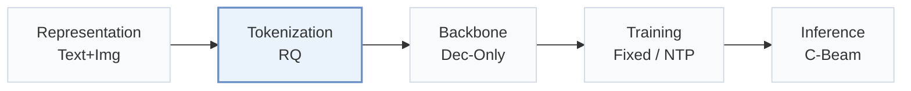
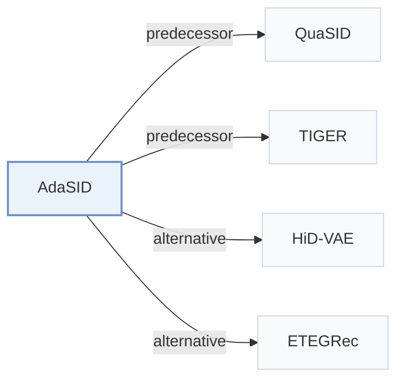

# AdaSID

[← Problem × Stage Matrix](../../README.md#ii--tokenization) · [Papers by Stage](../index/stages.md) · [Papers by Modality](../index/modality.md) · English | [中文](../zh/papers/adasid.md)

| **Title** | *Beyond Static Collision Handling: Adaptive Semantic ID Learning for Multimodal Recommendation at Industrial Scale* |
| :-- | :-- |
| **Authors** | Pan et al. |
| **Venue** | arXiv’26 |
| **Problem × Stage** | `II. Uniqueness and Validity` · `Tokenization` |
| **Links** | [Paper](https://arxiv.org/abs/2604.23522) |
| **Reading level** | Overview (Level 1) |

**On this page**: [TL;DR](#tldr) · [At a Glance](#at-a-glance) · [3. Experiments](#3-experimental-findings) · [5. Related Work](#5-connections-to-related-work)

- `Text+Img`: Text and visual item representations.
- `RQ`: Residual quantization.
- `Dec-Only`: Decoder-only.
- `Fixed`: SIDs are built first and not changed while the generator trains.
- `NTP`: Next-token prediction loss only; continuing from a pretrained LLM (SFT) also counts as NTP.
- `C-Beam`: Constrained beam search.

### TL;DR

> [!NOTE]
> AdaSID regulates Semantic ID overlaps during tokenizer training by relaxing repulsion for semantically compatible items and scaling the rest by local collision load, instead of fixed overlap regularization.

---

### At a Glance

| Aspect | Summary |
| :-- | :-- |
| Research Problem | II. Uniqueness and Validity: Does every item get its own SID, every generated SID name a real item, and the codebook get used evenly? |
| Key Contribution | AdaSID regulates Semantic ID overlaps during tokenizer training by relaxing repulsion for semantically compatible items and scaling the rest by local collision load, instead of fixed overlap regularization. |
| Modified Stage | Tokenization |

---

### 3. Experimental Findings

Experimental setup

- **Datasets**: Offline: Amazon 2018 Reviews, Beauty and Toys and Games, with 5-core filtering of users and items. Sizes (users / items / interactions): Toys 19,412 / 11,924 / 905,253; Beauty 22,363 / 12,101 / 1,048,296. Industrial: Kuaishou e-commerce short-video items with multimodal features (images, text, keyframes, audio transcripts); filtering rules not reported.
  - Source: Amazon 2018 categories, 5-core filtering, leave-one-out: [S5.SS1.SSS1.p1](https://arxiv.org/html/2604.23522v1#S5.SS1.SSS1.p1); sizes: [S5.T1](https://arxiv.org/html/2604.23522v1#S5.T1); industrial setting: [S5.SS3.p1](https://arxiv.org/html/2604.23522v1#S5.SS3.p1).
- **Split**: Offline: leave-one-out into training, validation, and test; the exact validation/test position allocation is not reported beyond the leave-one-out label. Industrial: 4-day online A/B test on the retrieval model and a 4-day offline study on the ranking model.
  - Source: Leave-one-out named without position allocation: [S5.SS1.SSS1.p1](https://arxiv.org/html/2604.23522v1#S5.SS1.SSS1.p1); industrial test periods: [S5.SS3.p1](https://arxiv.org/html/2604.23522v1#S5.SS3.p1).
- **Candidates**: not reported (full catalog versus sampled evaluation candidates).
  - Source: Metrics and backbone only: [S5.SS1.SSS2.p1](https://arxiv.org/html/2604.23522v1#S5.SS1.SSS2.p1).
- **Visibility**: Offline: warm; no unseen-item protocol is defined. Industrial ranking reports a cold-start CVR subset; generator/tokenizer visibility for those items is not reported.
  - Source: Offline protocol: [S5.SS1.SSS1.p1](https://arxiv.org/html/2604.23522v1#S5.SS1.SSS1.p1); industrial cold-start CVR subset without a visibility definition: [S5.T3](https://arxiv.org/html/2604.23522v1#S5.T3) and [S5.I2.i2.p1](https://arxiv.org/html/2604.23522v1#S5.I2.i2.p1).
- **SID**: 3 residual-quantization levels x 256 codes, 32-dimensional code embeddings, 768-dimensional input features. Collisions are reduced during tokenizer training by an adaptive overlap-repulsion loss; a post-hoc disambiguation suffix or other collision-resolution rule is not reported.
  - Source: SID length 3, 256 codes, 32-dimensional code embeddings: [S5.SS1.SSS4.p1](https://arxiv.org/html/2604.23522v1#S5.SS1.SSS4.p1); collision handled by a training-time adaptive overlap loss, with no added suffix described: [S4.SS4.p1](https://arxiv.org/html/2604.23522v1#S4.SS4.p1) and [S4.SS4.p2](https://arxiv.org/html/2604.23522v1#S4.SS4.p2).
- **Inference budget**: Downstream generation uses the same TIGER configuration for all tokenizers; beam width, hardware, inference batch size, and latency: not reported. Recall and NDCG at K=3 and 5.
  - Source: Downstream TIGER configuration only: [S5.SS1.SSS2.p1](https://arxiv.org/html/2604.23522v1#S5.SS1.SSS2.p1) and [S5.SS1.SSS4.p1](https://arxiv.org/html/2604.23522v1#S5.SS1.SSS4.p1); no extra online cost claim: [S4.SS4.p2](https://arxiv.org/html/2604.23522v1#S4.SS4.p2).
- **Results from**: Table 2 (tokenizer comparison on Toys and Beauty under a shared TIGER backbone); Table 3 (Kuaishou online retrieval A/B and offline ranking AUC); Table 4 (ablations); Figure 3 (codebook statistics); Figure 4 (hyperparameter sensitivity on Beauty).
  - Source: Main offline table: [S5.T2](https://arxiv.org/html/2604.23522v1#S5.T2); industrial table: [S5.T3](https://arxiv.org/html/2604.23522v1#S5.T3); ablation: [S5.T4](https://arxiv.org/html/2604.23522v1#S5.T4); codebook statistics: [S5.F3](https://arxiv.org/html/2604.23522v1#S5.F3).

---

### 5. Connections to Related Work

- **Predecessor** · [QuaSID](quasid.md): QuaSID applies a fixed qualification-aware collision regularizer; AdaSID instantiates its collision term following QuaSID and makes the repulsion adaptive to semantic compatibility, local load, and training progress.
  - Source: AdaSID v1, Section 4.1 follows Hu et al. (2026) for the collision term: [S4.SS1.p2](https://arxiv.org/html/2604.23522v1#S4.SS1.p2); QuaSID is the collision-aware baseline in Section 5.1.3 and Table 2: [S5.SS1.SSS3.p1](https://arxiv.org/html/2604.23522v1#S5.SS1.SSS3.p1) and [S5.T2](https://arxiv.org/html/2604.23522v1#S5.T2).
- **Predecessor** · [TIGER](tiger.md): TIGER is the shared downstream generative backbone; AdaSID changes only how the SIDs are learned.
  - Source: AdaSID v1, Section 5.1.2: [S5.SS1.SSS2.p1](https://arxiv.org/html/2604.23522v1#S5.SS1.SSS2.p1); Section 5.1.4: [S5.SS1.SSS4.p1](https://arxiv.org/html/2604.23522v1#S5.SS1.SSS4.p1).
- **Alternative** · [HiD-VAE](hid-vae.md): HiD-VAE suppresses SID overlaps with an explicit objective under a fixed standard, while AdaSID relaxes or strengthens repulsion adaptively.
  - Source: AdaSID v1, Section 1 and Section 2.2 cite Fang et al. (2025) among static overlap-aware objectives: [S1.p3](https://arxiv.org/html/2604.23522v1#S1.p3) and [S2.SS2.p1](https://arxiv.org/html/2604.23522v1#S2.SS2.p1); not a baseline in Table 2.
- **Alternative** · [ETEGRec](etegrec.md): ETEGRec aligns the tokenizer with downstream recommendation through end-to-end supervision, whereas AdaSID keeps a pre-trained tokenizer and regulates code overlaps adaptively.
  - Source: AdaSID v1, Section 2.2 cites Liu et al. (2025) for end-to-end downstream supervision: [S2.SS2.p1](https://arxiv.org/html/2604.23522v1#S2.SS2.p1); not a baseline in Table 2.

[View all papers in this cell](../../README.md#ii--tokenization)
