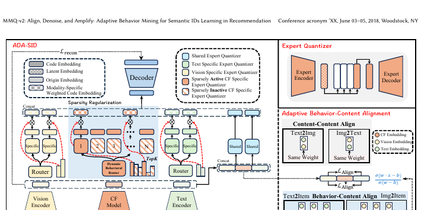

# ADC-SID

*Taming the Long Tail: Denoising Collaborative Information for Robust Semantic ID Generation* — Xu et al. · arXiv’25

`I. Informativeness` · `Tokenization`

[Paper](https://arxiv.org/abs/2510.25622) · [Matrix](../../README.md#i--tokenization)

Reading level: Overview (Level 1) · On this page: [At a Glance](#at-a-glance) · [2. How It Works](#2-how-it-works) · [5. Connections to Related Work](#5-connections-to-related-work)

| Representation | Tokenization | Backbone | Training | Inference |
| :-: | :-: | :-: | :-: | :-: |
| `Text+Img+CF` | **`MoE-VQ`** | `Enc-Dec` | `Fixed† / NTP` | `–` |

- `Enc-Dec`: Encoder-decoder.
- `NTP`: Next-token prediction loss only; continuing from a pretrained LLM (SFT) also counts as NTP.
- `–`: Not reported in the paper.

### At a Glance

| Aspect | Summary |
| :-- | :-- |
| Research Problem | I. Informativeness: Do the SIDs, or the model reading them, carry the collaborative and multimodal signals recommendation needs? |
| Modified Stage | Tokenization |

### 2. How It Works

## 旧卡片说明

迁自 `d61aa6c:papers/mmqv2.md`。保留方法说明、实验叙述与局限；本轮只对照现有记录处理明确冲突，未重新逐句核查原论文。分类和规格以页面上方由记录生成的表格为准。

以下说明与架构图来自旧版 MMQ-v2（arXiv 2510.25622）；该论文自 v3 起改名为 ADC-SID。它与 MMQ（arXiv 2508.15281）是不同论文，旧版说明不覆盖 v3 的全部变更。

### MMQ-v2：自适应行为挖掘语义标识学习

> MMQ-v2 以 ADA-SID 为核心，通过稀疏混合专家自适应融合内容与行为信号，学习更稳健的语义标识。

### 研究动机与问题定义

内容型 SID 难以表达协同偏好，而直接加入行为又可能引入噪声和流行度偏置。ADA-SID 试图根据物品和行为状态动态决定内容与协同信号的融合方式。

### TL;DR（核心摘要）

`文本/图像与行为 → 自适应路由量化 → ADA-SID → 生成模型 → 推荐物品`

方法使用稀疏 MoE 量化网络，把共享专家和模态/行为特定专家结合起来；路由器依据信号选择专家，并通过对齐、去噪和放大机制优化 SID。论文在生成式推荐设置中用生成模型直接预测 SID。

### 输入与使用场景

| 方面 | 说明 |
|---|---|
| 使用信息 | 文本、图像、交互和行为统计 |
| 信息融入位置 | 自适应量化网络与 SID 学习目标 |
| 语义标识结构 | 多级离散序列 |
| 适用场景 | 多模态生成式推荐 |

### 方法设计

#### 3.1 行为-内容混合量化
ADA-SID 使用内容编码器和行为/协同编码器获得多源表示，再通过稀疏 MoE 量化网络分配共享专家与模态特定专家。量化结果形成多级 SID，兼顾内容语义和交互结构。

#### 3.2 自适应行为-内容对齐
模型通过对齐目标让内容表示与行为表示互相约束，并用去噪机制抑制噪声行为、流行度和异常交互。放大机制进一步增强对推荐有效行为的利用。

#### 3.3 动态行为路由
动态路由器根据物品和行为状态决定专家组合，使不同物品不必采用同一种内容-行为融合比例。稀疏性正则控制激活专家数量和码本使用。

#### 3.4 下游生成推荐
生成式推荐器使用学习到的 SID 作为目标序列直接预测下一物品。论文也比较判别式下游任务，并通过工业数据、消融和流行度分层分析验证 ADA-SID。

### 实验结论

- 自适应行为路由优于固定融合策略。
- 去噪和对齐模块对长尾物品表现有帮助。

### 局限性与研究定位

#### 局限性
- 稀疏专家和多模态编码增加了训练与部署复杂度。
- 生成任务与判别任务共用 SID 时的统一服务成本仍未充分报告。

#### 研究定位
MMQ-v2 的核心贡献是让行为信号以自适应方式参与 SID 学习，适合放在“行为增强的语义标识学习”章节。

### 标签

`多模态` · `稀疏MoE` · `行为挖掘` · `语义标识`

### 架构图来源

*图源：原论文，图2。图片使用许可待核实。*

---

### 旧总表补充

来源：`d61aa6c:tables/all-methods.md`。

- 核心贡献：自适应融合行为与内容。
- 使用场景：多模态推荐。

### 5. Connections to Related Work

[View all papers in this cell](../../README.md#i--tokenization)
