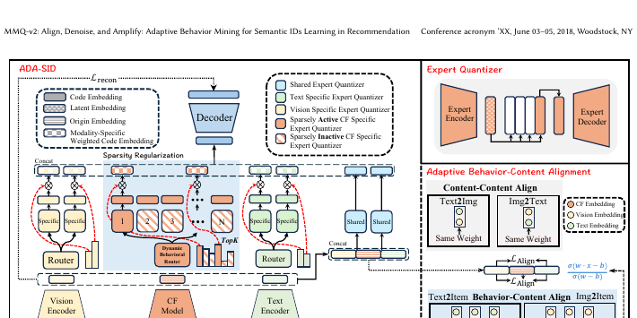
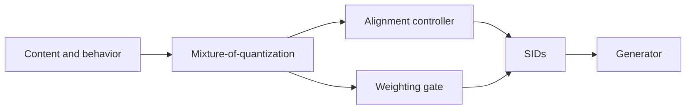
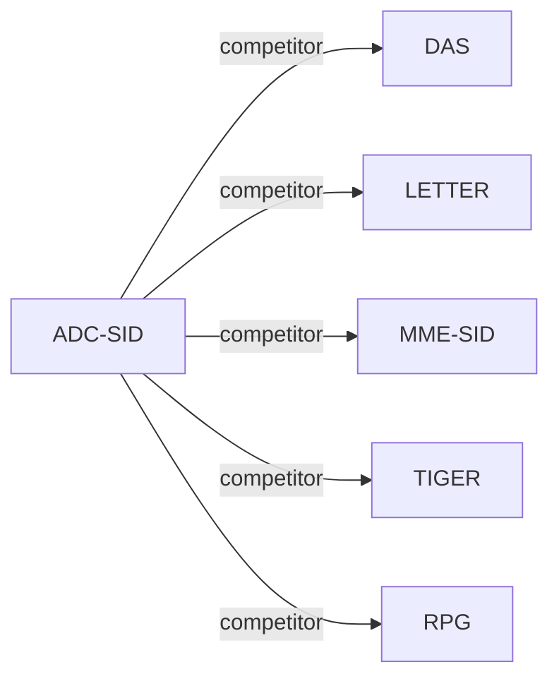

# ADC-SID

*Taming the Long Tail: Denoising Collaborative Information for Robust Semantic ID Generation* — Xu et al. · arXiv’25

`I. Informativeness` · `Tokenization` · [Paper](https://arxiv.org/abs/2510.25622) · [Matrix](../../README.md#i--tokenization) · [中文](../zh/papers/adc-sid.md)

Reading level: Reading Notes (Level 2) · On this page: [TL;DR](#tldr) · [At a Glance](#at-a-glance) · [1. Why It Matters](#1-why-this-paper-matters) · [2. Method](#2-how-it-works) · [3. Experiments](#3-experimental-findings) · [4. Limitations](#4-limitations--critical-analysis) · [5. Related Work](#5-connections-to-related-work)

- `Enc-Dec`: Encoder-decoder.
- `NTP`: Next-token prediction loss only; continuing from a pretrained LLM (SFT) also counts as NTP.
- `–`: Not reported in the paper.

### TL;DR

> [!NOTE]
> ADC-SID adds collaborative information to Semantic ID quantization with alignment strength that adapts to collaborative noise and learned weights for behavioral IDs, instead of uniform alignment and equal weights.

### At a Glance

| Aspect | Summary |
| :-- | :-- |
| Research Problem | I. Informativeness: Do the SIDs, or the model reading them, carry the collaborative and multimodal signals recommendation needs? |
| Key Contribution | ADC-SID adds collaborative information to Semantic ID quantization with alignment strength that adapts to collaborative noise and learned weights for behavioral IDs, instead of uniform alignment and equal weights. |
| Modified Stage | Tokenization |
| Limitation | The behavioral weights are computed from the magnitude of a pre-trained collaborative embedding, so they depend on the quality of that embedding (Sec. 3.4.1). |

### 1. Why This Paper Matters

Semantic IDs (SIDs) quantize item content features so that items can share knowledge, and existing methods add collaborative information to them (Abstract). User-item interactions are highly skewed, so collaborative information is much weaker for long-tail items (Abstract). The authors identify two effects: indiscriminate alignment lets this noise corrupt the content representations of tail items, and equal weights hide which behavioral SIDs are informative (Abstract).

> "unlike relatively uniform content features, user-item interactions are highly skewed, resulting in a significant quality gap in collaborative information between popular and long-tail items." (Abstract)

Based on arXiv v3.

### 2. How It Works

#### Behavior-Content Mixture-of-Quantization

Shared experts learn information common to behavior and content, and specific experts learn modality-specific information (Sec. 3.2).

#### Adaptive Behavior-Content Alignment

An alignment strength controller sets how strongly behavior and content are aligned for head and long-tail items (Sec. 3.3.1).

> "To adaptively align behavior and content information for head and long-tail items, the alignment strength controller is proposed to calculate the alignment strength." (Sec. 3.3.1)

#### Dynamic Behavioral Weighting

A gate learns an importance score for each behavioral SID from the L2 magnitude of the pre-trained collaborative embedding (Sec. 3.4.1, Eq. 22). A ReLU-based router with load balancing reduces training imbalance among the behavioral experts (Sec. 3.4.2, Eq. 23).

> "This gate suppresses noisy behavioral SIDs, improving the robustness of behavioral SIDs when incorporated with downstream recommendations." (Sec. 3.4.1)

### 3. Experimental Findings

Experimental setup

- **Datasets**: Industrial: Southeast Asian e-commerce advertising platform, October 2024 to May 2025, about 30 million users and 40 million ads (Table 1: 35,154,135 users, 48,106,880 items), average sequence length 128; filtering rules not reported. Public: Amazon Product Reviews Beauty (May 1996-September 2014); generative retrieval uses 5-core filtering of users and items, 22,363 users and 12,101 items; ranking uses the rating data with ratings above 3 as positives.
  - Source: Industrial data: [S4.SS1.SSS1.p2](https://arxiv.org/html/2510.25622v3#S4.SS1.SSS1.p2); Beauty filtering and sequence construction: [S4.SS1.SSS1.p3](https://arxiv.org/html/2510.25622v3#S4.SS1.SSS1.p3); sizes: [S4.T1](https://arxiv.org/html/2510.25622v3#S4.T1).
- **Split**: Beauty generative retrieval: chronological sequences capped at 20 items; the train/validation/test allocation is not reported. Beauty ranking: chronological 90%/10% train/test split. Industrial offline split: not reported. Online: 5-day A/B test with 10% random user traffic.
  - Source: Beauty ranking split and retrieval sequence construction: [S4.SS1.SSS1.p3](https://arxiv.org/html/2510.25622v3#S4.SS1.SSS1.p3); online test: [S5.p1](https://arxiv.org/html/2510.25622v3#S5.p1).
- **Candidates**: not reported (full catalog versus sampled evaluation candidates); retrieval uses Recall and NDCG at N=50 and 100.
  - Source: Retrieval metrics only: [S4.SS1.SSS2.p3](https://arxiv.org/html/2510.25622v3#S4.SS1.SSS2.p3).
- **Visibility**: warm; no unseen-item protocol is defined. The long-tail analysis stratifies items by 30-day impression counts (top 25% versus bottom 25%).
  - Source: No cold-start protocol; the popularity analysis groups items by 30-day impressions: [S4.SS5.p1](https://arxiv.org/html/2510.25622v3#S4.SS5.p1).
- **SID**: Industrial: SID length 10 with codebook size printed as "3,00" (shared 2, text 2, visual 2, behavioral 4 codes for ADC-SID). Public: SID length 6 with codebook size 100 (shared 1, text 1, visual 1, behavioral 3). The online system uses an 8-token SID. Collision handling: not reported.
  - Source: Codebook settings: [S4.SS1.SSS3.p3](https://arxiv.org/html/2510.25622v3#S4.SS1.SSS3.p3); online SID length: [S5.p1](https://arxiv.org/html/2510.25622v3#S5.p1); no collision rule found in Sections 3-5.
- **Inference budget**: Generative retrieval uses the REG4REC encoder-decoder; ranking uses PPNet. Beam width, hardware, inference batch size, and latency: not reported.
  - Source: Downstream backbones only: [S4.SS1.SSS3.p2](https://arxiv.org/html/2510.25622v3#S4.SS1.SSS3.p2).
- **Results from**: Table 2 (generative retrieval and discriminative ranking on industrial data and Beauty, with quantization metrics); Table 3 (industrial ablation); Table 4 and Figure 5 (hyperparameters); Figure 6 (popular versus long-tail AUC); Table 5 (5-day online A/B test).
  - Source: Main table: [S4.T2](https://arxiv.org/html/2510.25622v3#S4.T2); ablation: [S4.T3](https://arxiv.org/html/2510.25622v3#S4.T3); hyperparameters: [S4.T4](https://arxiv.org/html/2510.25622v3#S4.T4); popularity: [S4.F6](https://arxiv.org/html/2510.25622v3#S4.F6); online: [S5.T5](https://arxiv.org/html/2510.25622v3#S5.T5).

- Baseline families: behavior-content aligned SIDs such as RQ-Kmeans and LETTER outperform content-only SIDs such as RQ-VAE and OPQ on R@100, N@100, and AUC (Sec. 4.2, Table 2).
- Tasks: the SIDs are evaluated in both generative and discriminative tasks (Abstract).
- Behavioral weighting: the ablation compares learned weights with equal weights (Sec. 4.3.2).
- Popularity groups: with items split into popular (top 25%) and long-tail (bottom 25%) groups by impressions over the last 30 days, ADC-SID gains most on tail items (Sec. 4.5, Fig. 6).

### 4. Limitations & Critical Analysis

**Our analysis.**

- MME-SID uses the same three inputs with `MM-RQ` codes and a `Dec-Only` generator scored by `Scoring`; ADC-SID uses `MoE-VQ` codes with an `Enc-Dec` generator.

### 5. Connections to Related Work

- **Competitor** · [DAS](das.md): DAS aligns SIDs with collaborative signals by multi-view contrastive learning; ADC-SID adds adaptive alignment strength and dynamic weighting to denoise behavior signals for long-tail items.
  - Source: ADC-SID v3, Section 4.1.2 baselines: https://arxiv.org/html/2510.25622v3#S4.I3.i4.p1; Table 2: https://arxiv.org/html/2510.25622v3#S4.T2.
- **Competitor** · [LETTER](letter.md): LETTER fuses semantic and collaborative signals in one RQ-VAE tokenizer with fixed regularization; ADC-SID uses mixture-of-quantization experts with popularity-aware alignment.
  - Source: ADC-SID v3, Section 4.1.2 baselines: https://arxiv.org/html/2510.25622v3#S4.I3.i5.p1; Table 2: https://arxiv.org/html/2510.25622v3#S4.T2.
- **Competitor** · [MME-SID](mme-sid.md): MM-RQ-VAE produces separate collaborative, textual, and visual SIDs with contrastive alignment; ADC-SID adds shared and specific experts and a learned per-token weighting of behavioral SIDs.
  - Source: ADC-SID v3, Section 4.1.2 baselines: https://arxiv.org/html/2510.25622v3#S4.I3.i6.p1; Table 2: https://arxiv.org/html/2510.25622v3#S4.T2.
- **Competitor** · [TIGER](tiger.md): The RQ-VAE baseline is attributed to TIGER's content-only semantic IDs; ADC-SID injects denoised collaborative information.
  - Source: ADC-SID v3, Section 4.1.2 describes the RQ-VAE baseline as TIGER: https://arxiv.org/html/2510.25622v3#S4.I3.i1.p1; Table 2 row RQ-VAE: https://arxiv.org/html/2510.25622v3#S4.T2.
- **Competitor** · [RPG](rpg.md): The OPQ baseline is attributed to RPG's unordered content codes; ADC-SID builds hierarchical behavior-content codes instead.
  - Source: ADC-SID v3, Section 4.1.2 describes the OPQ baseline as RPG: https://arxiv.org/html/2510.25622v3#S4.I3.i2.p1; Table 2 row OPQ: https://arxiv.org/html/2510.25622v3#S4.T2.

[View all papers in this cell](../../README.md#i--tokenization)
