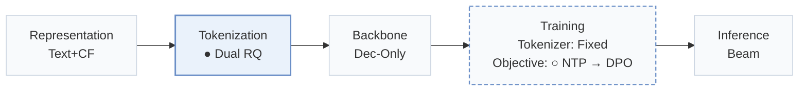
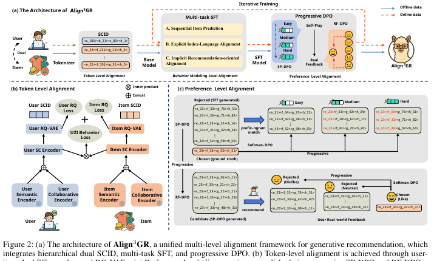
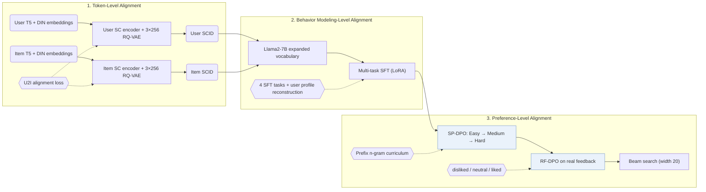
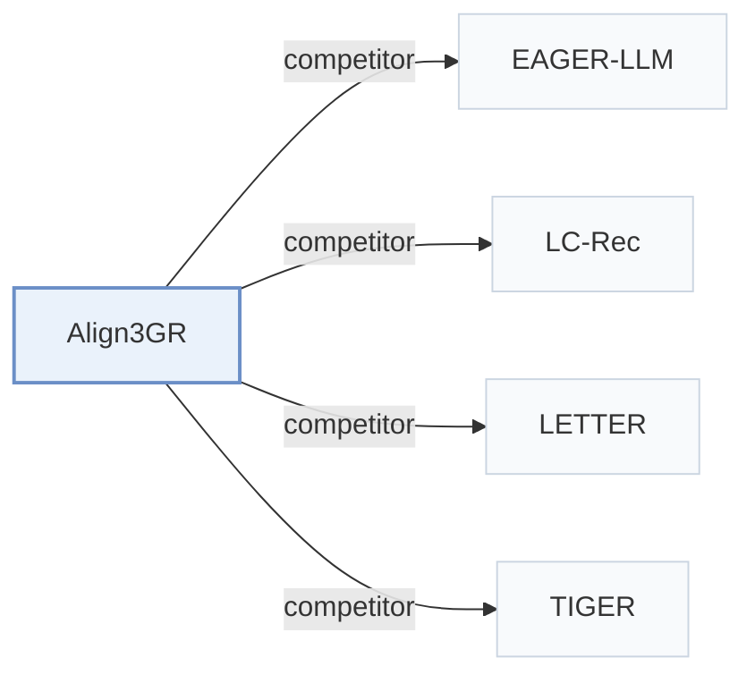

# Align3GR

[← Problem × Stage Matrix](../../README.md#iii--tokenization) · [Papers by Stage](../index/stages.md) · [Papers by Modality](../index/modality.md) · [Papers by Domain](../index/domain.md) · English | [中文](../zh/papers/align3gr.md)

| **Title** | *Align$^3$GR: Unified Multi-Level Alignment for LLM-based Generative Recommendation* |
| :-- | :-- |
| **Authors** | Ye et al. |
| **Venue** | AAAI’26 |
| **Problem × Stage** | `III. SID–Model Alignment` · `Tokenization` |
| **Changes** | ● Tokenization · ○ Objective |
| **SID inputs** | `Text` + `CF` |
| **Domain** | `E-commerce` · `POI / Local` · `Ads` |
| **Scenario** | `General Item Recommendation`; `Online Experiment or Deployment` |
| **Links** | [Paper](https://arxiv.org/abs/2511.11255) |
| **Reading level** | Reading Notes (Level 2) |

**On this page**: [TL;DR](#tldr) · [At a Glance](#at-a-glance) · [1. Why It Matters](#1-why-this-paper-matters) · [2. Method](#2-how-it-works) · [3. Experiments](#3-experimental-findings) · [4. Limitations](#4-limitations--critical-analysis) · [5. Related Work](#5-connections-to-related-work)

- `Text+CF`: Text representations combined with collaborative signals.
- `Dual RQ`: Dual residual quantization over two representation streams or entity types.
- `Dec-Only`: Decoder-only.
- `Fixed`: SIDs are built first and not changed while the generator trains.
- `NTP → DPO`: NTP, then preference optimization.
- `Beam`: Autoregressive beam search over Semantic ID tokens.

### TL;DR

> [!NOTE]
> Align3GR aligns an LLM recommender at three levels, with dual semantic and collaborative tokenization, bidirectional semantic alignment in behavior modeling, and progressive DPO from self-play and real-world feedback.

---

### At a Glance

| Aspect | Summary |
| :-- | :-- |
| Key Findings | Across public benchmarks, Align3GR reports gains of up to +17.8% in Recall@10 and +20.2% in NDCG@10 over the strongest baseline, alongside offline Recall@100 and online revenue gains in industrial deployment (Abstract, Table 1, Table 2). |
| Limitation | Align3GR requires sequential training across dual user/item 3-level RQ-VAEs, four-task SFT, 3-stage SP-DPO, and RF-DPO on Llama2-7B, while collision handling and inference latency are not reported (Experimental Settings). |

---

### 1. Why This Paper Matters

Adapting a pretrained large language model (LLM) to generative recommendation introduces both semantic and behavioral misalignment between natural-language tokens and collaborative interaction patterns (Abstract). Prior LLM recommenders such as LC-Rec align item Semantic IDs (SIDs) primarily through supervised instruction tasks. Align3GR couples alignment across three levels: dual user-and-item semantic-collaborative tokenization, bidirectional multi-task SFT, and progressive curriculum + real-feedback DPO.

> "To bridge this gap, we propose Align3GR, a novel framework that unifies token-level, behavior modeling-level, and preference-level alignment." (Abstract)

---

### 2. How It Works

#### Token-Level Alignment

Dual semantic-collaborative (SC) encoders fuse T5 semantic embeddings and DIN behavioral embeddings for both users and items, and two 3-level RQ-VAEs (256 codewords of dimension 32 per level) quantize them into user SCIDs and item SCIDs (Fig. 2 caption, Experimental Settings). Adding both token sets directly into the Llama2-7B vocabulary avoids token fragmentation during autoregressive generation.

> "Following previous work (Zheng et al. 2024), we first expand the LLM vocabulary to include the SCID tokens of the user and the item, thus avoiding out-of-vocabulary issues and ensuring smooth integration with autoregressive generation tasks." (Behavior Modeling-level Alignment)

#### Behavior Modeling-Level Alignment

Supervised fine-tuning (SFT) extends LC-Rec with four tasks: sequential item prediction, asymmetric item prediction, intention-conditioned item prediction, and personalized preference inference (Multi-task SFT). Every task prompt includes the user's SCID tokens, and bidirectional alignment requires reconstructing the user profile text from the user SCID alongside predicting target item SCIDs (Multi-task SFT).

#### Preference-Level Alignment

Self-play DPO (SP-DPO) constructs curriculum negatives in Easy, Medium, and Hard stages according to prefix n-gram overlap on the 3-level hierarchical SCID (Preference-level Alignment). Real-feedback DPO (RF-DPO) then fine-tunes the policy on logged user interactions stratified into disliked, neutral, and liked tiers (Preference-level Alignment).

> "Specifically, considering the hierarchical nature of SCID, we divide progressive SP-DPO learning into three stages: Easy, Medium, and Hard, using a prefix-ngram match metric (Zheng et al. 2025)" (Preference-level Alignment)

---

### 3. Experimental Findings

Experimental setup

- **Datasets**: Amazon Instruments, Amazon Beauty, and Yelp; users and items with fewer than 5 interactions are filtered. Retained corpus sizes: not reported in the body. Industrial: internal data from a large-scale advertising recommendation platform; filtering not reported.
  - Source: Datasets, 5-interaction filter, leave-one-out, history cap: [Sx4.SSx1.p1](https://arxiv.org/html/2511.11255v2#Sx4.SSx1.p1); industrial platform: [Sx4.SSx3.p1](https://arxiv.org/html/2511.11255v2#Sx4.SSx3.p1).
- **Split**: Leave-one-out into training, validation, and test; histories capped at the 20 most recent items. The exact position allocation is not reported beyond the leave-one-out label. Online: 10% of traffic (about 40+ million users) over multiple weeks.
  - Source: Leave-one-out and 20-item cap: [Sx4.SSx1.p1](https://arxiv.org/html/2511.11255v2#Sx4.SSx1.p1) and [Sx4.SSx1.p3](https://arxiv.org/html/2511.11255v2#Sx4.SSx1.p3); online traffic: [Sx4.SSx3.p1](https://arxiv.org/html/2511.11255v2#Sx4.SSx3.p1).
- **Candidates**: not reported (full catalog versus sampled evaluation candidates); industrial retrieval reports Recall@100.
  - Source: Metrics and beam width only: [Sx4.SSx1.p3](https://arxiv.org/html/2511.11255v2#Sx4.SSx1.p3).
- **Visibility**: warm; no unseen-item protocol is defined.
  - Source: Standard leave-one-out with no cold-start experiment: [Sx4.SSx1.p1](https://arxiv.org/html/2511.11255v2#Sx4.SSx1.p1).
- **SID**: Item SCID: 3-level RQ-VAE x 256 codewords (dimension 32) over concatenated semantic (T5) and collaborative (DIN) embeddings; users receive their own SCIDs from a separate user RQ-VAE. Both are added to the LLM vocabulary. Collision handling: not reported.
  - Source: 3-level RQ-VAE x 256 codes of dimension 32, user and item SCIDs added to the vocabulary: [Sx4.SSx1.p4](https://arxiv.org/html/2511.11255v2#Sx4.SSx1.p4); dual user/item tokenizer: [Sx3.SSx2.p2](https://arxiv.org/html/2511.11255v2#Sx3.SSx2.p2) and [Sx3.SSx2.p4](https://arxiv.org/html/2511.11255v2#Sx3.SSx2.p4).
- **Inference budget**: Beam search with beam width 20 for generative methods (following EAGER-LLM); Recall and NDCG at K=5 and 10. All experiments use 4 NVIDIA GPUs (model not stated); inference batch size and latency: not reported. Backbone: Llama2-7B with LoRA.
  - Source: Beam width 20 following EAGER-LLM: [Sx4.SSx1.p3](https://arxiv.org/html/2511.11255v2#Sx4.SSx1.p3); 4 GPUs for all experiments: [Sx4.SSx1.p4](https://arxiv.org/html/2511.11255v2#Sx4.SSx1.p4).
- **Results from**: Table 1 (Instruments, Beauty, Yelp; averages over five seeds); Table 2 (industrial Recall@100 and online revenue versus a two-tower baseline and TIGER); Tables 3-5 and Figure 4 (tokenization, SFT-task, and DPO ablations).
  - Source: Main table: [Sx3.T1](https://arxiv.org/html/2511.11255v2#Sx3.T1); industrial: [Sx4.T2](https://arxiv.org/html/2511.11255v2#Sx4.T2); ablations: [Sx4.T3](https://arxiv.org/html/2511.11255v2#Sx4.T3), [Sx4.T4](https://arxiv.org/html/2511.11255v2#Sx4.T4), [Sx4.T5](https://arxiv.org/html/2511.11255v2#Sx4.T5); five seeds: [Sx4.SSx1.p4](https://arxiv.org/html/2511.11255v2#Sx4.SSx1.p4).

- Public benchmarks: on 5-core filtered Amazon Instruments, Amazon Beauty, and Yelp (averaged over 5 seeds with beam width 20), Align3GR outperforms traditional, generative (TIGER, LETTER), and LLM-based (LC-Rec, EAGER-LLM) baselines, achieving up to +17.8% in Recall@10 and +20.2% in NDCG@10 over the strongest baseline (Abstract, Experimental Settings, Table 1).
- Multi-level ablations: ablations confirm incremental gains from dual user-item SCID tokenization (Table 3), bidirectional user-item SFT tasks (Table 4), and combining 3-stage SP-DPO with RF-DPO (Table 5, Fig. 4).
- Industrial deployment: on a large-scale advertising platform, Align3GR improves offline Recall@100 over a two-tower model and TIGER, and delivers online revenue gains in multi-week A/B tests on 10% traffic (over 40 million users) before full-scale deployment (Abstract, Table 2).

---

### 4. Limitations & Critical Analysis

**Our analysis.**

- Training proceeds sequentially through dual SCID tokenizers, four-task SFT, 3-stage SP-DPO, and RF-DPO, which suggests that catalog or user-distribution refreshes require multi-stage retraining.
- Users are quantized into fixed SCIDs from historical interactions, leaving cold-start users without precomputed user SCID tokens.
- EAGER-LLM feeds semantic and collaborative item features into a `Dec-Only` LLM via `Dual H-KM` codes; Align3GR tokenizes both users and items with `Dual RQ` (`RQ-VAE`) codes and adds two-phase DPO (`NTP → DPO`).

---

### 5. Connections to Related Work

- **Competitor** · [EAGER-LLM](eager-llm.md): EAGER-LLM aligns item tokens with collaborative signals; Align3GR also tokenizes users and adds progressive self-play and real-feedback DPO.
  - Source: Align3GR v2, Experimental Settings baselines (13) and beam-width protocol: [Sx4.SSx1.p2](https://arxiv.org/html/2511.11255v2#Sx4.SSx1.p2) and [Sx4.SSx1.p3](https://arxiv.org/html/2511.11255v2#Sx4.SSx1.p3); Table 1: [Sx3.T1](https://arxiv.org/html/2511.11255v2#Sx3.T1).
- **Competitor** · [LC-Rec](lc-rec.md): LC-Rec aligns LLMs to item codes with auxiliary tasks; Align3GR adds dual user-item SCIDs and preference-level DPO on top of multi-task SFT.
  - Source: Align3GR v2, baselines (11): [Sx4.SSx1.p2](https://arxiv.org/html/2511.11255v2#Sx4.SSx1.p2); Table 1: [Sx3.T1](https://arxiv.org/html/2511.11255v2#Sx3.T1).
- **Competitor** · [LETTER](letter.md): LETTER learns a regularized item tokenizer; Align3GR fuses semantic and collaborative features for both users and items through a U2I loss.
  - Source: Align3GR v2, baselines (12): [Sx4.SSx1.p2](https://arxiv.org/html/2511.11255v2#Sx4.SSx1.p2); Table 1: [Sx3.T1](https://arxiv.org/html/2511.11255v2#Sx3.T1).
- **Competitor** · [TIGER](tiger.md): TIGER uses content-only RQ-VAE item codes with a small Transformer; Align3GR uses an LLM backbone with dual SCIDs and DPO.
  - Source: Align3GR v2, baselines (10): [Sx4.SSx1.p2](https://arxiv.org/html/2511.11255v2#Sx4.SSx1.p2); Table 1: [Sx3.T1](https://arxiv.org/html/2511.11255v2#Sx3.T1); industrial Table 2: [Sx4.T2](https://arxiv.org/html/2511.11255v2#Sx4.T2).

[View all papers in this cell](../../README.md#iii--tokenization)
