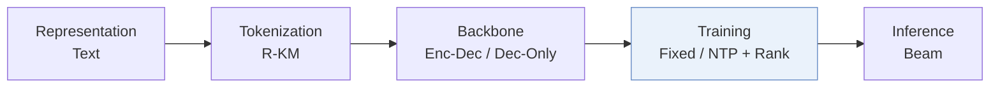
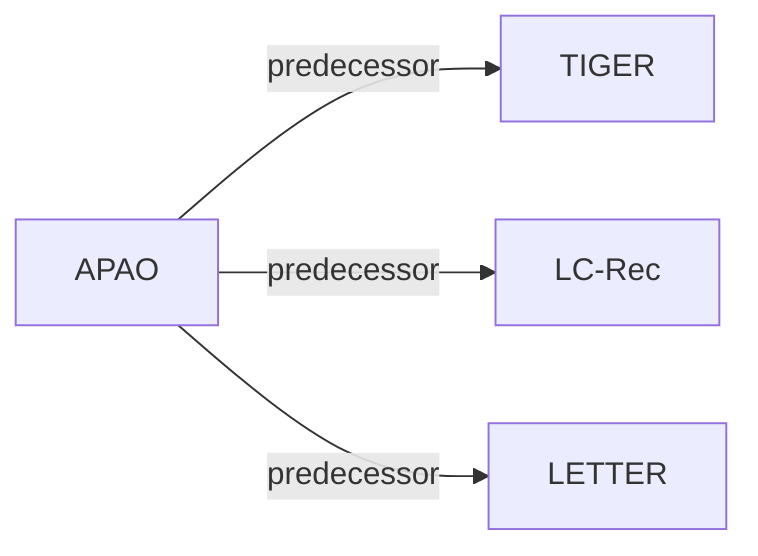

# APAO

| **Title** | *Bridging the Training-Inference Gap in Generative Recommendation via Adaptive Prefix-Aware Optimization* |
| :-- | :-- |
| **Authors** | Yu et al. |
| **Venue** | KDD’26 |
| **Problem × Stage** | `IV. Utility` · `Training` |
| **Links** | [Paper](https://arxiv.org/abs/2603.02730) · [Code](https://github.com/yuyq18/APAO) · [Matrix](../../README.md#iv--training) · [中文](../zh/papers/apao.md) |
| **Reading level** | Overview (Level 1) |

On this page: [TL;DR](#tldr) · [At a Glance](#at-a-glance) · [3. Experiments](#3-experimental-findings) · [5. Related Work](#5-connections-to-related-work)

- `R-KM`: Residual k-means.
- `Enc-Dec / Dec-Only`: Evaluated on both Encoder-Decoder and Decoder-Only backbones.
- `Fixed`: SIDs are built first and not changed while the generator trains.
- `NTP + Rank`: NTP plus a ranking loss.

### TL;DR

> [!NOTE]
> APAO adds prefix-level losses and an adaptive worst-prefix strategy to training, so correct items survive beam-search pruning, closing the gap between token-level cross-entropy training and beam-search inference.

---

### At a Glance

| Aspect | Summary |
| :-- | :-- |
| Research Problem | IV. Utility: Are training and search aimed at what users and the platform value, rather than at token likelihood? |
| Key Contribution | APAO adds prefix-level losses and an adaptive worst-prefix strategy to training, so correct items survive beam-search pruning, closing the gap between token-level cross-entropy training and beam-search inference. |
| Modified Stage | Training |

---

### 3. Experimental Findings

Experimental setup

- **Datasets**: Amazon Office (4,905 users / 2,420 items), Grocery (14,681 / 8,713), Beauty (22,363 / 12,101), and Yelp (30,431 / 20,033), with 5-core filtering of users and items; histories truncated to the 20 most recent items.
  - Source: Datasets, 5-core, leave-one-out: [S5.SS1.SSS1.p1](https://arxiv.org/html/2603.02730v4#S5.SS1.SSS1.p1); statistics: [S5.T2](https://arxiv.org/html/2603.02730v4#S5.T2).
- **Split**: Leave-one-out (following LETTER and LC-Rec; allocation not restated beyond the label).
  - Source: Leave-one-out named: [S5.SS1.SSS1.p1](https://arxiv.org/html/2603.02730v4#S5.SS1.SSS1.p1).
- **Candidates**: not reported (full catalog versus sampled evaluation candidates); top-K from beam search with Recall and NDCG at 10 and 20. Training losses use 100 uniformly sampled negatives; exclusion of history items for these negatives: not reported.
  - Source: Metrics; training negatives fixed at 100 uniform: [S5.SS1.SSS1.p1](https://arxiv.org/html/2603.02730v4#S5.SS1.SSS1.p1) and [S5.SS1.SSS3.p2](https://arxiv.org/html/2603.02730v4#S5.SS1.SSS3.p2).
- **Visibility**: warm; no unseen-item protocol is defined.
  - Source: Standard split with no unseen-item protocol: [S5.SS1.SSS1.p1](https://arxiv.org/html/2603.02730v4#S5.SS1.SSS1.p1).
- **SID**: 4-level RQ-K-means codes over Llama-3.1-8B-Instruct item embeddings; codebook size and collision handling: not reported.
  - Source: 4-level RQ-K-means over Llama-3.1-8B embeddings: [S5.SS1.SSS3.p1](https://arxiv.org/html/2603.02730v4#S5.SS1.SSS3.p1); codebook size and collision rule not found.
- **Inference budget**: Beam search with beam size 20 (scalability over K in Figure 6); TIGER encoder-decoder and Llama decoder backbones of about 0.01B parameters, trained on one NVIDIA A100-40GB. Inference batch size and latency: not reported (Table 4 reports training efficiency).
  - Source: Beam size 20 and hardware: [S5.SS1.SSS3.p1](https://arxiv.org/html/2603.02730v4#S5.SS1.SSS3.p1); beam scalability: [S5.F6](https://arxiv.org/html/2603.02730v4#S5.F6); training efficiency: [S5.T4](https://arxiv.org/html/2603.02730v4#S5.T4).
- **Results from**: Table 1 (four datasets, TIGER and Llama backbones, versus CE, MSL, DPO, DMPO, S-DPO losses); Table 3 (one-stage versus two-stage training); Table 4 (training efficiency); Figures 2-6 (ablations, prefix-level analysis, hyperparameters, beam size).
  - Source: Main: [S5.T1](https://arxiv.org/html/2603.02730v4#S5.T1); paradigms: [S5.T3](https://arxiv.org/html/2603.02730v4#S5.T3); efficiency: [S5.T4](https://arxiv.org/html/2603.02730v4#S5.T4).

---

### 5. Connections to Related Work

- **Predecessor** · [TIGER](tiger.md): TIGER is the encoder-decoder backbone; APAO adds prefix-level losses so that training matches beam-search pruning.
  - Source: APAO v4, backbones: https://arxiv.org/html/2603.02730v4#S5.SS1.SSS2.p3; Table 1: https://arxiv.org/html/2603.02730v4#S5.T1; beam-search analysis: https://arxiv.org/html/2603.02730v4#S3.SS3.p3.
- **Predecessor** · [LC-Rec](lc-rec.md): APAO follows LC-Rec and LETTER for data processing and LLM-embedding tokenization, then changes only the training objective.
  - Source: APAO v4, Section 5.1.1 and 5.1.3 follow Zheng et al. (2024): https://arxiv.org/html/2603.02730v4#S5.SS1.SSS1.p1 and https://arxiv.org/html/2603.02730v4#S5.SS1.SSS3.p1.
- **Predecessor** · [LETTER](letter.md): APAO follows LETTER's preprocessing protocol; LETTER also adds a ranking-guided loss, whereas APAO supervises every prefix level.
  - Source: APAO v4, Section 5.1.1 follows Wang et al. (2024): https://arxiv.org/html/2603.02730v4#S5.SS1.SSS1.p1; Section 1: https://arxiv.org/html/2603.02730v4#S1.p2.

[View all papers in this cell](../../README.md#iv--training)
